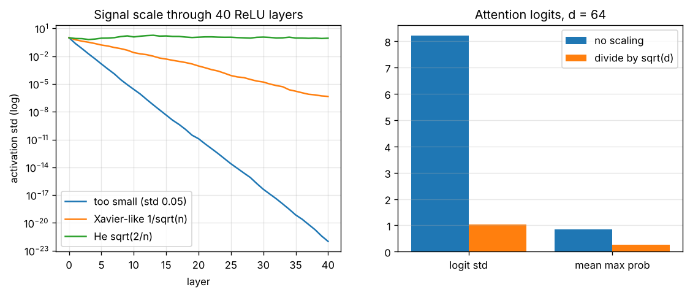

# Day 132 — Consolidation Day: The Scale-Control Thread (He init → BatchNorm → LayerNorm → √d → Pre-LN block → loss scaling)

*(No new concept number. Day 131 followed the aliasing thread; today's cross-phase thread is **"a deep network is a product of many gains, so every layer must keep the gain near 1"**.)*

## 🧠 CONCEPT OF THE DAY — KEEP THE GAIN AT ONE

**Intuition.** Pass a photocopy through 40 copiers. If each copier brightens by 10%, you get a white page; if each dims by 10%, you get a black page. Only gain ≈ 1 keeps a readable image. A deep net is 40 copiers in a row, for the forward signal *and* for the backward gradient.

The same idea reappears across the roadmap:

- **He / Xavier init (18, 19):** choose the weight variance so one layer has gain 1 *at initialisation*.
- **Vanishing / exploding gradients (20, 21):** the backward pass multiplies the same kind of gains, so gain ≠ 1 compounds exponentially.
- **BatchNorm (27) and LayerNorm (28):** stop hoping the gain stays 1 during training; renormalise to mean 0, variance 1 at every layer.
- **Scaled dot-product (55):** a sum of $d$ random products has std $\sqrt d$, so divide by $\sqrt d$ to keep the softmax input at scale 1.
- **Transformer block (60):** residual + LayerNorm + FFN is that same discipline in one reusable unit (pre-LN keeps the identity path clean, see Day 130).
- **Mixed precision (96):** fp16 has a narrow range, so *loss scaling* multiplies the loss by a constant so small gradients do not underflow, then divides it back out.

**The math.** Take a layer $y=\phi(Wx)$ with $W\in\mathbb R^{n_\text{out}\times n_\text{in}}$, i.i.d. zero-mean weights of variance $\sigma_w^2$, and inputs with second moment $\mathbb E[x^2]=q$. Each pre-activation is a sum of $n_\text{in}$ terms, so

$$\operatorname{Var}(Wx)_i=n_\text{in}\,\sigma_w^2\,q$$

Here $n_\text{in}$ is the fan-in, $\sigma_w^2$ the weight variance, $q$ the input second moment. ReLU zeroes half of a symmetric input, so $\mathbb E[\operatorname{ReLU}(z)^2]=\tfrac12\operatorname{Var}(z)$. Per-layer gain on the second moment is therefore

$$g=\tfrac12\,n_\text{in}\,\sigma_w^2\quad\Rightarrow\quad g=1\iff\sigma_w^2=\frac{2}{n_\text{in}}\ (\text{He})$$

After $L$ layers the signal scale is multiplied by $g^{L}$ (std by $g^{L/2}$). Xavier's $\sigma_w^2=1/n_\text{in}$ gives $g=\tfrac12$ for ReLU, so the std shrinks by $\sqrt{1/2}$ per layer.

For attention, if $q_i,k_i$ are independent with mean 0 and variance 1, then $q\cdot k=\sum_{i=1}^d q_ik_i$ has variance $d$. Dividing by $\sqrt d$ restores variance 1, and the softmax stays out of saturation.



`graph_DAY_132.py` (seed 42, width 64, 32 random inputs, nothing downloaded). Left, after 40 layers the std is $1\times10^{-22}$ for weights of std 0.05, $4.5\times10^{-7}$ for Xavier-style init (the predicted $0.707^{40}\approx1.2\times10^{-6}$ decay, up to sampling noise), and 0.87 for He init, which stays near 1. Right, with $d=64$ the unscaled logits have std 8.2 and the average max attention probability is 0.84 (the softmax is nearly one-hot, so its gradients are nearly zero); dividing by $\sqrt{64}=8$ gives std 1.03 and a mean max probability of 0.26, over 16 keys.

**Why it matters / where it leads.** There are no new numbered concepts, so the next threads can be "sampling and temperature" or "the loss landscape". For interviews, the pattern to remember is: *every* fix above is the same fix, applied at different times (init, every step, every attention call, every loss).

**Interview question:** *You train a 50-layer ReLU MLP with Xavier init, and the loss does not move from step 0. Gradient norms of the first layer are about $10^{-8}$ times those of the last. Give the cause quantitatively and two fixes.*

*(Answer at the very bottom.)*

## 🐍 PYTHONIC EDGE

**Log per-layer activation scale with forward hooks instead of editing `forward()`.**

```python
import torch                                          # plain import; C++ would be #include + linking
import torch.nn as nn                                 # "as nn" alias: import X as Y has no C++ equivalent

# BAD: edit the model and sprinkle prints / stash tensors by hand
class Net(nn.Module):                                 # single inheritance; C++: class Net : public Module
    def __init__(self):                               # constructor; self is C++'s this, but explicit
        super().__init__()                            # parent constructor; C++ uses an initialiser list
        self.l1 = nn.Linear(64, 64)                   # instance attribute created in the body (C++: declared in header)
        self.l2 = nn.Linear(64, 64)

    def forward(self, x):                             # called via net(x) -> __call__ -> forward(); never call forward() directly
        h = torch.relu(self.l1(x))
        print(h.std())                                # BAD: debugging code lives inside the model
        return self.l2(h)

# CLEAN: leave the model alone, attach hooks from outside
def attach_scale_probes(model):
    stats = {}                                        # dict literal; C++: std::unordered_map
    def make_hook(name):                              # nested function = closure over 'name' (no C++ equivalent before lambdas)
        def hook(module, inputs, output):             # first-class callable, passed as a value below
            stats[name] = output.detach().std().item()   # detach(): leave the autograd graph; .item(): 0-d tensor -> Python float
        return hook
    handles = [m.register_forward_hook(make_hook(n))  # list comprehension: builds the list in one expression
               for n, m in model.named_modules()      # tuple unpacking in the loop header: (name, module)
               if isinstance(m, nn.Linear)]           # isinstance() is runtime type test (C++: dynamic_cast)
    return stats, handles                             # returning a tuple; caller unpacks it

net = Net()
stats, handles = attach_scale_probes(net)             # tuple unpacking: a, b = fn()
with torch.no_grad():                                 # context manager: __enter__/__exit__ ~ C++ RAII scope guard
    net(torch.randn(32, 64))                          # net(...) invokes __call__, which runs the hooks around forward()
print({k: round(v, 3) for k, v in stats.items()})     # dict comprehension; round() is a builtin function
for h in handles:
    h.remove()                                        # always remove hooks, or they keep firing (and keep tensors alive)
```

Why it matters: the hook is attached from outside, so the same probe works on any model, including ones you did not write.

## 📡 SIGNAL LAB

**Problem.** (a) Feed unit-variance white noise through a 3-tap filter $h=[1,2,1]/4$. What is the output variance? (b) A 3×3 conv layer has $C_\text{in}=64$ input channels and a ReLU after it. What weight std does He init prescribe? (c) Show that (a) is a statement about the filter's frequency response.

**Solution.**

(a) For white noise $x$ with variance $\sigma^2$, $y[n]=\sum_k h[k]x[n-k]$ has $\operatorname{Var}(y)=\sigma^2\sum_k h[k]^2=\sigma^2\,(1+4+1)/16=0.375\,\sigma^2$. This filter *shrinks* the noise power to 37.5%, a gain of $g=0.375$.

(b) A conv layer is a linear layer whose fan-in is $C_\text{in}k^2=64\cdot9=576$. He init gives $\sigma_w=\sqrt{2/576}\approx0.059$. Using `fan_in = C_in` alone and forgetting $k^2$ would give a std 3× too large.

(c) By Parseval, $\sum_k h[k]^2=\int_{-1/2}^{1/2}|H(f)|^2\,df$. White noise has a flat spectrum, so the output power is the *average of $|H|^2$* over frequency. A low-pass kernel such as $[1,2,1]/4$ has $|H(0)|=1$ but small $|H|$ at high frequencies, so its average is below 1.

**So what.** Initialisation is a statement about gain on *white* input, but trained filters see natural images, whose power is concentrated at low frequencies (roughly $1/f^2$ in power). A smooth, low-pass-like kernel therefore passes natural images with a gain closer to $|H(0)|^2$ than to the white-noise average, which is one reason a net that is "fine at init" can drift in scale during training, and why normalisation layers are still needed. For generated-image forensics, normalisation also removes the global amplitude cue and leaves only the *shape* of the spectrum, which is the part detectors should rely on.

## 🏋️ THE GAUNTLET

**Subarray Sum Equals K** (running statistics: this is the same "keep a running aggregate" idea as BatchNorm's running mean). Given an integer array `nums` and an integer `k`, return the number of contiguous, non-empty subarrays whose sum equals `k`.

Constraints: $1\le n\le2\times10^5$; $-10^3\le \texttt{nums[i]}\le10^3$; $-10^9\le k\le10^9$. Values may be negative, so the answer can be up to about $n^2/2$ and needs a 64-bit integer.

**Hints.**
1. Brute force over all $(i,j)$ is $O(n^2)$. Can you express "sum of `nums[i..j]`" as a difference of two single numbers?
2. Define $P_j$ as the sum of the first $j$ elements. A subarray $(i,j]$ has sum $k$ exactly when $P_j-P_i=k$. For a fixed $j$, what value must $P_i$ have?
3. Sliding window fails with negative numbers. Instead, scan once and keep a hash map of how many times each prefix sum has appeared *so far*. Don't forget the empty prefix.

**Pattern:** prefix sum + hash map (counting complements).

**Target:** $O(n)$ expected time, $O(n)$ space.

*(Full solution at the very bottom.)*

## 🏗️ BLUEPRINT

no blueprint today.

## 🗺️ MARCHING ORDERS

Log the activation std at every layer of a model you trust for one forward pass: if it drifts by more than 10× from first to last layer, you have found where your training will be fragile.

Tomorrow: the roadmap is complete, so the next run is another consolidation day (no new concept number), picking a new cross-phase thread.

---

## 🔓 GAUNTLET SOLUTION

```cpp
#include <bits/stdc++.h>
using namespace std;

long long countSubarrays(const vector<int>& a, long long k) {
    unordered_map<long long, int> seen;   // prefix-sum value -> how many times it has occurred
    seen[0] = 1;                          // the empty prefix
    long long pre = 0, ans = 0;
    for (int x : a) {
        pre += x;
        auto it = seen.find(pre - k);     // an earlier prefix P with pre - P == k
        if (it != seen.end()) ans += it->second;
        ++seen[pre];                      // record AFTER querying so a subarray is never empty
    }
    return ans;
}
```

Compiled and run: `[1,1,1], k=2` → `2`; `[1,2,3], k=3` → `2`; `[1,-1,0], k=0` → `3`; `[5], k=5` → `1`; also matched a brute force on 2000 random cases with negative values. One pass with $O(1)$ expected hash operations gives $O(n)$ time and $O(n)$ space.

## 💡 CONCEPT ANSWER

**Cause.** With Xavier init ($\sigma_w^2=1/n_\text{in}$) and ReLU, the per-layer gain on the second moment is $g=\tfrac12 n_\text{in}\sigma_w^2=\tfrac12$. The backward pass has the same structure, so after 50 layers the gradient scale is about $(1/\sqrt2)^{50}\approx3\times10^{-8}$, matching the observed $10^{-8}$ ratio. That is vanishing gradients caused by a per-layer gain below 1, compounded exponentially. (In the graph above, the same arithmetic gave $4.5\times10^{-7}$ at 40 layers.)

**Fixes.** (1) Use He init ($\sigma_w^2=2/n_\text{in}$) so the gain is 1. (2) Add normalisation (BatchNorm or LayerNorm) so the scale is reset at every layer, and/or add residual connections so the gradient has an identity path (Day 130). Gradient clipping does *not* help here; it only limits large gradients.
