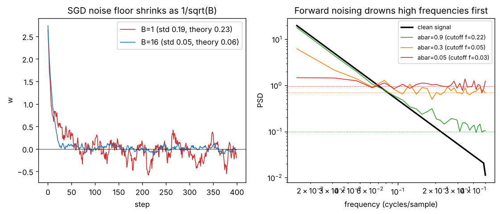

# Day 133 — Consolidation Day: The Noise-as-a-Resource Thread (minibatch SGD → dropout → augmentation → VAE reparameterization → diffusion forward noising → policy-gradient exploration)

*(No new concept number. Day 132 followed the scale-control thread; today's cross-phase thread is **"noise is not only a nuisance, it is a design tool, and its power is judged against the signal's spectrum"**.)*

## 🧠 CONCEPT OF THE DAY — NOISE ON PURPOSE

**Intuition.** A sculptor sands a statue with grit. Coarse grit removes fine detail first, and a little grit stops the chisel from locking into one tiny groove. Training injects randomness for the same two reasons: it *regularises* (blurs fine detail) and it *explores* (keeps you from locking in). The catch is that noise is only harmless if it is small compared with the signal *at the frequencies you care about*.

The thread through the roadmap:

- **Minibatch SGD (10, 12):** the batch gradient is the true gradient plus noise whose variance shrinks like $1/B$.
- **Dropout (26) and data augmentation (29):** noise injected into activations or inputs; the network cannot rely on any single feature or pixel.
- **VAE reparameterization (79):** write $z=\mu+\sigma\odot\epsilon$ so the noise $\epsilon$ is an *input* and gradients flow through $\mu,\sigma$.
- **Diffusion (83, 84):** destroy data with a known noise schedule, then learn to undo it.
- **Policy gradients / PPO (106, 107):** a stochastic policy is noise in the action space, and entropy bonuses keep it from collapsing early.

**The math.** On a quadratic $f(w)=\tfrac12 h w^2$ with minibatch gradient $g_t=hw_t+\xi_t$, $\operatorname{Var}(\xi_t)=s^2/B$, the SGD update $w_{t+1}=(1-\eta h)w_t-\eta\xi_t$ is an AR(1) process. Its stationary variance is

$$\operatorname{Var}(w_\infty)=\frac{\eta\,s^2}{B\,h\,(2-\eta h)}$$

Here $\eta$ is the learning rate, $h$ the curvature, $s^2$ the per-example gradient variance, $B$ the batch size. The iterate hovers at a noise floor $\propto\sqrt{\eta/B}$, which is why "double the batch, double the LR" (linear scaling) keeps the ratio $\eta/B$ fixed.

For diffusion, the forward step is

$$x_t=\sqrt{\bar\alpha_t}\,x_0+\sqrt{1-\bar\alpha_t}\,\epsilon,\qquad \epsilon\sim\mathcal N(0,I)$$

with $\bar\alpha_t\in(0,1)$ the cumulative signal-retention factor. In the frequency domain, the signal contributes power $\bar\alpha_t\,S(f)$ and the noise adds a flat floor $1-\bar\alpha_t$. For natural signals $S(f)\propto1/f^2$, so the crossover frequency where signal meets floor moves *down* as $\bar\alpha_t$ falls.



`graph_DAY_133.py` (seed 42, nothing downloaded). Left, with $\eta=0.1$, $h=s=1$: the empirical std over steps 100–400 is 0.190 for $B=1$ (theory 0.229) and 0.052 for $B=16$ (theory 0.057). The $B=1$ gap is sampling error from one 300-step run, not a different law. Right, with $N=64$ samples and 40 signals averaged, the signal drops below the noise floor at about 0.22 cycles/sample for $\bar\alpha=0.9$, 0.05 for $\bar\alpha=0.3$ and 0.03 for $\bar\alpha=0.05$. Fine detail dies first, coarse structure last.

**Why it matters / where it leads.** The roadmap is complete, so the next threads can be "sampling and temperature" or "the loss landscape". The reusable idea: reasoning in terms of *signal-to-noise per frequency* explains why diffusion generates coarse-to-fine, why augmentation helps low-data regimes, and why a large LR with small batch generalises differently from the reverse.

**Interview question:** *You scale training from batch 256 to 4096 on 16 GPUs. Loss curves look fine but validation accuracy drops 2 points. Using the noise-floor formula, explain why, and give two standard remedies.*

*(Answer at the very bottom.)*

## 🐍 PYTHONIC EDGE

**Trick: reproducible noise with a local `torch.Generator`, instead of reseeding the global RNG.** Global seeding makes dropout, augmentation and init all share one stream, so adding one unrelated random call anywhere changes every later number.

```python
import torch

# BAD: global state; any other random call shifts the stream
torch.manual_seed(0)                       # side effect on the whole process, no C++ analogue to a scoped RNG
noise = torch.randn(4)                     # draws from the shared global generator

# CLEAN: a private generator you pass around explicitly
def make_noise(shape, *, gen):             # '*' makes gen keyword-only (no C++ equivalent)
    return torch.randn(shape, generator=gen)   # shape is a tuple, e.g. (4,); keyword arg, not positional

g = torch.Generator().manual_seed(0)       # method chaining; manual_seed returns the generator itself
a = make_noise((4,), gen=g)                # (4,) is a one-element tuple; the trailing comma matters
b = make_noise((4,), gen=g)                # second draw continues g's own stream
g.manual_seed(0)                           # rewind only this stream
assert torch.equal(a, make_noise((4,), gen=g))   # assert: raises AssertionError on failure, like a checked invariant
assert not torch.equal(a, b)               # 'not' replaces C++ '!'

class NoisyLinear(torch.nn.Module):        # C++: class NoisyLinear : public torch::nn::Module
    def __init__(self, n, *, sigma=0.1):   # constructor; self is C++'s this but explicit
        super().__init__()                 # parent constructor (C++: initialiser list)
        self.w = torch.nn.Parameter(torch.randn(n, n))   # instance attribute created in body, no header declaration
        self.sigma = sigma                 # plain float attribute

    def forward(self, x, gen=None):        # None is Python's nullptr-like "no value"
        eps = torch.randn_like(x) if gen is None else torch.randn(x.shape, generator=gen)
        return x @ self.w + self.sigma * eps   # @ is matmul; * is elementwise

m = NoisyLinear(4, sigma=0.1)
y = m(torch.ones(2, 4), gen=g)             # calling the object runs __call__, which wraps forward() with hooks
```

Debugging payoff: a flaky test that differs run to run usually has a hidden global-RNG consumer. Passing generators makes the dependency visible in the signature.

## 📡 SIGNAL LAB

**Problem.** A unit-variance, 64-sample signal has power spectrum $S(f)=a/f^2$ with $a\approx4.8\times10^{-3}$ (this is what the script measures: $S(f)f^2$ is constant at 0.0048 across all bins). One diffusion step keeps $\bar\alpha=0.3$, so the surviving signal power is $0.3\,S(f)$ and the white-noise floor is $1-\bar\alpha=0.7$. At what frequency does the signal meet the floor? What does a detector see above that frequency?

**Solution.** Set $0.3\,a/f_c^2=0.7$, so $f_c=\sqrt{0.3a/0.7}=\sqrt{0.3\cdot0.0048/0.7}\approx0.045$ cycles/sample. The graph's measured crossover is 0.047, the nearest frequency bin on the $1/64$ grid (bins sit at multiples of 0.0156), so theory and experiment agree. Repeating for $\bar\alpha=0.9$ gives $f_c=\sqrt{0.9\cdot0.0048/0.1}=0.21$ (measured 0.219).

**So what.** The crossover depends on the spectrum's *level* $a$ as well as on $\bar\alpha$, so check the units and normalisation of your PSD before quoting a cutoff. Above $f_c$ the observed spectrum is just the flat floor $1-\bar\alpha_t$: any generator fingerprint living only there (for example the periodic upsampling peaks from Day 131) is erased at that noise level. For frequency-domain forensics, evaluate detectors on images with controlled noise, because a detector trained on clean images that keys on high-frequency peaks will fail once noise or JPEG covers those bins.

## 🏋️ THE GAUNTLET

**Sliding Window Maximum** (denoising by max-pooling is the 1-D cousin of today's smoothing story). Given an integer array `nums` of length `n` and a window size `k`, return an array of the maximum of every contiguous window of size `k`, from left to right.

Constraints: $1\le k\le n\le10^5$; $-10^4\le \texttt{nums[i]}\le10^4$.

**Hints.**
1. Brute force scans each window in $O(k)$, so $O(nk)$. Which elements can *never* be the maximum of any future window?
2. If a later element is at least as large as an earlier one, the earlier one is useless: it leaves the window first and is smaller. Keep only candidates whose values decrease from oldest to newest.
3. Store indices in a double-ended queue. Pop from the back while the new value dominates, pop from the front when its index leaves the window, and read the maximum at the front.

**Pattern:** monotonic deque.

**Target:** $O(n)$ time (each index pushed and popped at most once), $O(k)$ extra space.

*(Full solution at the very bottom.)*

## 🏗️ BLUEPRINT

no blueprint today.

## 🗺️ MARCHING ORDERS

Train the same tiny model at batch 32 and batch 512 with the same LR, then once with LR scaled by 16: seeing the three curves side by side will teach the noise-floor formula better than any derivation.

Tomorrow: the roadmap is complete, so the next run is another consolidation day (no new concept number), picking a new cross-phase thread.

---

## 🔓 GAUNTLET SOLUTION

```cpp
#include <bits/stdc++.h>
using namespace std;

vector<int> maxSlidingWindow(const vector<int>& a, int k) {
    deque<int> dq;                          // indices; values strictly decreasing front -> back
    vector<int> out;
    for (int i = 0; i < (int)a.size(); ++i) {
        if (!dq.empty() && dq.front() <= i - k) dq.pop_front();    // front slid out of the window
        while (!dq.empty() && a[dq.back()] <= a[i]) dq.pop_back(); // dominated by the newcomer
        dq.push_back(i);
        if (i >= k - 1) out.push_back(a[dq.front()]);              // window is full: front is the max
    }
    return out;
}
```

Compiled and run: `[1,3,-1,-3,5,3,6,7], k=3` → `3 3 5 5 6 7`; also matched a brute force on 3000 random cases with negative values. Each index enters and leaves the deque at most once, so $O(n)$ time and $O(k)$ space.

## 💡 CONCEPT ANSWER

**Why.** The SGD noise floor scales like $\sqrt{\eta/B}$. Going from $B=256$ to $4096$ (16×) with the same LR cuts the gradient noise std by 4×, so the iterate settles into sharper minima with less implicit regularisation, and the training loss can look fine while validation drops: the "large-batch generalisation gap". Also, fewer steps per epoch means less total movement unless the LR is raised.

**Remedies.** (1) Linear LR scaling ($\eta\to16\eta$, keeping $\eta/B$ constant) plus a warmup so the larger LR does not diverge early on (Day 17). (2) Add regularisation or noise back: stronger augmentation, label smoothing or dropout; or use a layer-wise adaptive optimiser (LARS/LAMB) designed for very large batches.
