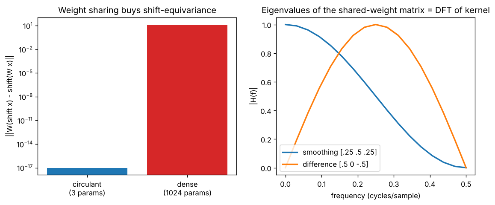

# Day 134 — Consolidation Day: The Weight-Sharing Thread (convolution → kernels & stride → RNN cell → self-attention → ViT patchify → U-Net skips)

*(No new concept number. Day 133 followed the noise thread, and Day 128 the bottleneck thread; today's cross-phase thread is **"reuse the same weights everywhere, and you get symmetry for free"**.)*

## 🧠 CONCEPT OF THE DAY — ONE STAMP, MANY PLACES

**Intuition.** A rubber stamp. You carve it once, then press it at every position on the page. You pay for one carving, not one per position, and a stamp pressed one inch to the right leaves the same mark one inch to the right. Weight sharing is that stamp: the parameter count stops growing with input size, and the model inherits a *symmetry* (a shift of the input gives a shifted output) without having to learn it from data.

The thread through the roadmap:

- **Convolution (32, 33):** one kernel slides over space, so the layer is equivariant to translation.
- **RNN cell (45):** the same $W_h, W_x$ are reused at every time step, giving equivariance to time shifts and the ability to handle any length. (Day 46–47: the price is a long product of the same Jacobian.)
- **Self-attention (54–57):** the same $W_Q,W_K,W_V$ are applied at every token, so attention is permutation-equivariant. That is exactly why positional encodings (58, 59) are needed.
- **ViT patchify (89):** one linear projection shared by every patch, i.e. a strided convolution whose kernel equals its stride.
- **U-Net (94):** the same conv blocks at each scale, with skip connections to carry back the detail that pooling discarded.

**The math.** A 1-D circular convolution of $x\in\mathbb R^N$ with kernel $k$ is multiplication by a circulant matrix $C$ whose rows are shifted copies of $k$:

$$y = Cx,\qquad C_{ij}=k_{(j-i)\bmod N}$$

Let $S$ be the cyclic shift operator. Because every row is the previous row shifted, $CS=SC$, which is *equivariance*. A dense $N\times N$ matrix has $N^2$ free parameters; $C$ has only $|k|$ (here 3). The DFT diagonalises every circulant matrix at once:

$$C = F^{-1}\,\operatorname{diag}(\hat k)\,F,\qquad \hat k = \text{DFT}(k)$$

Here $F$ is the DFT matrix and $\hat k_m$ is the filter's gain at frequency $m/N$. So the eigenvalues of a shared-weight layer *are* its frequency response, and convolution in space is pointwise multiplication in frequency.



`graph_DAY_134.py` (seed 42, $N=32$, nothing downloaded) prints: circulant equivariance error 0.00 (bar clamped to 1e-17 for the log axis), dense 13.7; $\max|Cx-\text{IFFT}(\hat x\hat k)|=2.8\times10^{-16}$; and the eigenvalue magnitudes of $C$ match $|\hat k|$. The right panel shows the 3-tap smoother has gain 1 at $f=0$ and 0 at $f=0.5$, the difference kernel the opposite.

**Why it matters / where it leads.** Equivariance is an *assumption baked into the architecture*. It is right for textures and local structure, wrong when absolute position matters (and breaks at borders with zero padding, today's Pythonic Edge). Every "why does X need Y" in the roadmap (positional encodings, padding choices, stride aliasing from Day 131) is a consequence of what symmetry your shared weights assume.

**Interview question:** *A convolutional layer is translation-equivariant and a CNN classifier is roughly translation-invariant. What operations turn the first into the second, and name two ways the equivariance is actually broken in practice.*

*(Answer at the very bottom.)*

## 🐍 PYTHONIC EDGE

**Trick: test a symmetry as a property with a reusable checker, instead of eyeballing one shift.** The "bad" version below also hides a real bug: `mode="same"` zero-pads, so equivariance fails at the borders.

```python
import numpy as np                          # import X as Y alias; C++ has no equivalent of aliasing a whole module

# BAD: one hand-picked shift, one hand-read number
x = np.random.default_rng(0).standard_normal(8)   # method call on a factory object; no seed globals
k = np.array([0.25, 0.5, 0.25])             # list literal -> array; no 'new' or std::vector
y1 = np.convolve(np.roll(x, 2), k, mode="same")   # keyword arg mode=...; roll = circular shift
y2 = np.roll(np.convolve(x, k, mode="same"), 2)
print(np.abs(y1 - y2).max())                # 0.326, not 0: zero padding broke equivariance at the edges

# CLEAN: pass the function itself and test many shifts
def check_equivariant(f, x, *, shifts=range(-3, 4), atol=1e-9):   # f is a first-class callable; '*' makes the rest keyword-only
    for s in shifts:                        # range() is a lazy object you can store as a default value
        lhs = f(np.roll(x, s))              # negative s rolls left; no manual modulo
        rhs = np.roll(f(x), s)
        assert np.allclose(lhs, rhs, atol=atol), f"broke at shift {s}"   # assert + f-string message
    return True

class CircConv:                             # C++: class CircConv { ... }; no base class needed
    def __init__(self, kernel):             # constructor; self is C++'s this but explicit
        self.k = np.asarray(kernel)         # attribute created in the body; C++ declares it in the header
    def __call__(self, x):                  # dunder: makes instances callable like f(x) (torch.nn.Module builds on this)
        return np.fft.ifft(np.fft.fft(x) * np.fft.fft(self.k, len(x))).real   # fft(k, n) zero-pads k to length n
    def __len__(self):                      # dunder: lets len(obj) work
        return len(self.k)

conv = CircConv([0.25, 0.5, 0.25])
print(check_equivariant(conv, x), len(conv))      # passing an object as a callable; len() calls __len__
try:                                        # try/except instead of C++ try/catch
    check_equivariant(lambda v: v * np.arange(len(v)), x)   # lambda: anonymous function, a position-dependent map
except AssertionError as e:                 # 'as e' binds the exception object
    print("caught:", e)                     # caught: broke at shift -3
```

Debugging payoff: encode each symmetry you expect (shift, permutation, scale) as a one-line property check. It catches padding and indexing bugs that accuracy numbers hide. (Run and verified with numpy only.)

## 📡 SIGNAL LAB

**Problem.** The 3-tap smoothing kernel $k=[0.25,\,0.5,\,0.25]$ is applied as a circular convolution to a length-32 signal. (a) What is its gain at $f=0$ and at the Nyquist frequency $f=0.5$? (b) Stacking it $L$ times (a deep net of linear smoothers), what is the gain at $f=0.25$?

**Solution.** The frequency response is $\hat k(f)=0.5+0.5\cos(2\pi f)$ (the kernel is symmetric, so the sine terms cancel). (a) $\hat k(0)=1$ (mean preserved) and $\hat k(0.5)=0$ (the alternating pattern $+1,-1,+1,\dots$ is wiped out). (b) $\hat k(0.25)=0.5$, so $L$ layers give $0.5^L$: after 4 layers only 6% survives.

**So what.** Repeated local averaging is a low-pass whose cutoff keeps shrinking, which is why deep stacks of smoothing-like convolutions (and over-smoothing in graph nets) lose detail, and why ResNet/U-Net skip paths matter (Day 130). For your forensics lane: a generator's upsampling filter is a shared-weight kernel too, so its $\hat k$ leaves a deterministic, repeating imprint in the spectrum. That is the fingerprint you detect.

## 🏋️ THE GAUNTLET

**Rotate Array.** Given an integer array `nums` of length `n` and an integer `k`, rotate it to the right by `k` steps *in place* (a circular shift, the same operator $S$ as above).

Constraints: $1\le n\le10^5$; $0\le k\le10^9$; $-2^{31}\le \texttt{nums[i]}\le2^{31}-1$. Extra space must be $O(1)$.

**Hints.**
1. Copying into a second array is easy but costs $O(n)$ space. What does `k` equal when `k ≥ n`?
2. Take `[1..7]`, `k=3`, target `[5,6,7,1,2,3,4]`. Reverse the whole array and compare with the target.
3. After a full reversal, the first $k$ elements and the last $n-k$ elements are each in the wrong *internal* order but the right *block* position. Fix them separately.

**Pattern:** in-place reversal trick (three reversals).

**Target:** $O(n)$ time, $O(1)$ extra space.

*(Full solution at the very bottom.)*

## 🏗️ BLUEPRINT

no blueprint today.

## 🗺️ MARCHING ORDERS

Take any conv layer you have, switch padding from zeros to circular, and re-run the equivariance check: seeing the border error vanish makes the symmetry concrete.

Tomorrow: the roadmap is complete, so the next run is another consolidation day (no new concept number), picking a new cross-phase thread.

---

## 🔓 GAUNTLET SOLUTION

```cpp
#include <bits/stdc++.h>
using namespace std;

void rotateRight(vector<int>& a, long long k) {
    int n = a.size();
    if (n == 0) return;
    k %= n;                                          // k can be up to 1e9; rotating by n is the identity
    reverse(a.begin(), a.end());                     // [7 6 5 4 3 2 1]
    reverse(a.begin(), a.begin() + k);               // first k back in order  -> [5 6 7 ...]
    reverse(a.begin() + k, a.end());                 // rest back in order     -> [... 1 2 3 4]
}
```

Compiled and run: `[1..7], k=3` → `5 6 7 1 2 3 4`; matched a brute force on 3000 random cases (k up to 99, n from 1 to 12). Three linear passes: $O(n)$ time, $O(1)$ space.

## 💡 CONCEPT ANSWER

**Equivariant → invariant.** Equivariance means shifting the input shifts the feature map. To get (approximate) invariance, *aggregate away position*: global average or max pooling over the spatial dimensions after the last conv, or local pooling repeated through the net, followed by a classifier head that sees only position-free statistics.

**How it breaks in practice.** (1) *Padding and borders*: zero padding gives the network a way to detect the image edge and hence absolute position (shown in today's Pythonic Edge). (2) *Strided downsampling / pooling*: stride-$s$ sampling aliases (Day 131), so a one-pixel shift can change the output, and equivariance holds only for shifts that are multiples of the total stride. A fully-connected head on a flattened map is a third: it is not shared at all.
