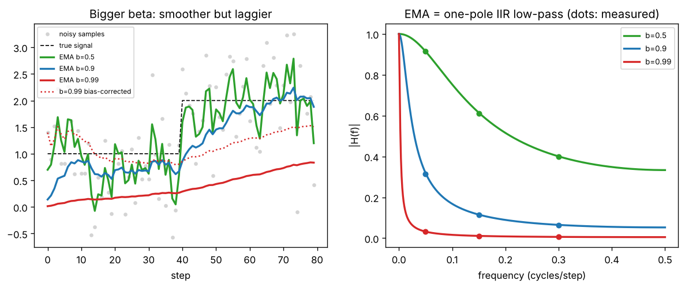

# Day 135 — Consolidation Day: The EMA Thread (momentum → Adam → BatchNorm running stats → DINO teacher → DQN target network)

*(No new concept number. Day 134 followed the weight-sharing thread; today's cross-phase thread is **"keep a running average instead of trusting one noisy sample"**.)*

## 🧠 CONCEPT OF THE DAY — THE LEAKY BUCKET OF HISTORY

**Intuition.** A bucket with a small hole that you top up with a fresh cup each step. The water level is mostly recent history, with older cups fading away geometrically. You never store the history; one number carries it. That number is an exponential moving average (EMA).

The thread through the roadmap:

- **Momentum (13):** the velocity is an EMA of past gradients, so noisy directions cancel and consistent ones add.
- **RMSprop / Adam (15, 16):** an EMA of $g$ (first moment) and an EMA of $g^2$ (second moment), giving a per-parameter step size.
- **BatchNorm (27):** running mean and variance for inference are EMAs of batch statistics.
- **DINO (93):** the teacher's weights are an EMA of the student's, a slowly moving, more stable target.
- **DQN (105):** the target network is a lagged (hard or Polyak-averaged) copy of the online network, so the regression target stops chasing itself.

**The math.** For a stream $x_t$ and decay $\beta\in[0,1)$:

$$m_t=\beta\,m_{t-1}+(1-\beta)\,x_t,\qquad m_0=0$$

Unrolling gives weights that decay geometrically:

$$m_t=(1-\beta)\sum_{i=1}^{t}\beta^{\,t-i}x_i$$

Here $\beta^{t-i}$ is how much sample $i$ still counts at time $t$. The weights sum to $1-\beta^t$, not 1, so starting from $m_0=0$ the estimate is biased toward zero early on. Adam's fix is to divide by that sum:

$$\hat m_t=\frac{m_t}{1-\beta^{t}}$$

The effective memory is about $1/(1-\beta)$ steps (the time constant): $\beta=0.9$ remembers ~10 steps, $\beta=0.99$ ~100.



`graph_DAY_135.py` (seed 42, 80 samples, nothing downloaded) prints time constants 2 / 10 / 100 steps for $\beta=0.5/0.9/0.99$, and shows why correction matters: at step 1 the raw $\beta=0.99$ EMA is 0.014 while the first sample is 1.397; the corrected value equals the sample exactly. The left panel shows the trade: larger $\beta$ gives a smoother curve but lags the step at $t=40$ by roughly its time constant.

**Why it matters / where it leads.** One scalar knob, $\beta$, trades **noise for lag** in every place above. Too small and the target jitters (DQN diverges, DINO collapses); too large and it is stale (the teacher never improves, BatchNorm stats don't track the data). It leads straight to the Signal Lab: an EMA is a filter, and filter design is the right language for choosing $\beta$.

**Interview question:** *Adam initializes both moment estimates at zero. Why does that matter in the first few steps, how does the bias correction fix it, and what goes wrong if you drop it with $\beta_2=0.999$?*

*(Answer at the very bottom.)*

## 🐍 PYTHONIC EDGE

**Trick: update EMA state in place, and keep the update in one reusable callable.** The bad version rebinds dictionary entries, so anything holding a reference to the old array silently sees stale data (and in PyTorch it also copies tensors every step).

```python
import numpy as np                          # import X as Y alias; C++ has no equivalent of aliasing a whole module

# BAD: builds a brand-new array each step and rebinds the dict entry
def ema_bad(teacher, student, beta):
    for k in teacher:                       # iterating a dict yields its keys; C++ map iteration yields pairs
        teacher[k] = beta * teacher[k] + (1 - beta) * student[k]   # new object; old references go stale

# CLEAN: mutate the existing arrays in place
def ema_update(teacher, student, *, beta=0.9):    # '*' makes beta keyword-only; callers must write beta=...
    for (k, pt), ps in zip(teacher.items(), student.values()):   # zip pairs two iterables; tuple unpacking in the for header
        pt *= beta                          # augmented assignment on an ndarray mutates in place (torch: pt.mul_(beta))
        pt += (1 - beta) * ps               # also in place; plain 'pt = pt * beta' would rebind the local name only
    return teacher                          # returns the same dict object, not a copy

class EMA:                                  # C++: class EMA { ... }; no base class needed
    def __init__(self, params, beta=0.9):   # constructor; self is C++'s this but explicit
        self.shadow = {k: v.copy() for k, v in params.items()}   # dict comprehension; C++ would loop and emplace
        self.beta = beta                    # attribute created in the body; C++ declares it in the header
    def __call__(self, params):             # dunder: makes ema(params) work like a function call
        return ema_update(self.shadow, params, beta=self.beta)   # keyword-only arg passed by name

student = {"w": np.ones(3), "b": np.zeros(1)}
ema = EMA(student, beta=0.9)
alias = ema.shadow["w"]                     # a second name for the same array object, not a copy
for step in range(3):                       # range() is a lazy object, not a vector
    student["w"] += 1.0                     # in-place add on the array stored in the dict
    ema(student)                            # calls EMA.__call__
print(ema.shadow["w"], alias is ema.shadow["w"])   # [1.561 1.561 1.561] True ('is' tests object identity, like comparing pointers)
```

Debugging payoff: with the `ema_bad` version, `alias is ema.shadow["w"]` becomes `False`, and anything that cached the old array (an optimizer, a DataParallel replica) never sees updates. In PyTorch the same idea is `pt.mul_(beta).add_(ps, alpha=1 - beta)` under `torch.no_grad()`. (Run and verified with numpy only; torch was not installed here.)

## 📡 SIGNAL LAB

**Problem.** The EMA $m_t=\beta m_{t-1}+(1-\beta)x_t$ is a linear filter. (a) Derive its frequency response. (b) For $\beta=0.9$, what is the gain at DC and at Nyquist ($f=0.5$ cycles/step)? (c) You want gradient noise above $f=0.1$ cycles/step cut by at least half (gain $\le 0.5$). Does $\beta=0.9$ do it?

**Solution.** (a) Take the z-transform: $H(z)=\dfrac{1-\beta}{1-\beta z^{-1}}$, a one-pole IIR low-pass. On the unit circle $z=e^{j\omega}$, $\omega=2\pi f$:

$$|H(\omega)|=\frac{1-\beta}{\sqrt{1-2\beta\cos\omega+\beta^{2}}}$$

(b) DC: $\omega=0$ gives $\frac{1-\beta}{1-\beta}=1$. Nyquist: $\omega=\pi$ gives $\frac{1-\beta}{1+\beta}=\frac{0.1}{1.9}\approx0.053$. (c) At $f=0.1$, $\omega=0.628$, $\cos\omega=0.809$, so $|H|=\frac{0.1}{\sqrt{1-1.456+0.81}}=\frac{0.1}{\sqrt{0.354}}\approx0.168\le0.5$. Yes, with room to spare; the $-3$ dB point is much lower, near $f\approx0.017$, about $\frac{1-\beta}{2\pi\beta}$.

**So what.** Picking $\beta$ is picking a cutoff frequency: the half-power point is roughly $f_c\approx(1-\beta)/2\pi$ cycles/step. Anything in the gradient varying faster than that is treated as noise. The cost is the lag in the left panel (phase delay, about $1/(1-\beta)$ steps at low frequency). For your forensics lane: any EMA over per-image spectra (a running mean PSD for a generator fingerprint) is the same low-pass, applied across samples instead of time; a small $\beta$ lets sample-specific content leak into the "fingerprint", a large one needs many images to converge.

## 🏋️ THE GAUNTLET

**Sliding Window Maximum.** Given an integer array `nums` and a window size `k`, the window slides one position at a time from the far left to the far right. Return the maximum of each window.

Constraints: $1\le n\le10^5$; $1\le k\le n$; $-10^4\le \texttt{nums[i]}\le10^4$.

**Hints.**
1. Brute force scans $k$ elements per window, $O(nk)$. Which elements of the current window could *never* become a future maximum?
2. If a newer element is at least as large as an older one in the window, the older one is dominated: it leaves sooner and is never larger. What structure of candidates remains, and in what order are their values?
3. Keep candidate *indices* so you can tell when the front has left the window. Where do you remove dominated elements from, and where do you read the answer?

**Pattern:** monotonic deque (a max-filter, the nonlinear cousin of today's moving average).

**Target:** $O(n)$ time, $O(k)$ extra space.

*(Full solution at the very bottom.)*

## 🏗️ BLUEPRINT

no blueprint today.

## 🗺️ MARCHING ORDERS

Next time a training run looks noisy, change one EMA decay (Adam's $\beta_2$, or BatchNorm momentum) and watch what moves; you'll feel the noise-vs-lag trade directly.

Tomorrow: the roadmap is complete, so the next run is another consolidation day (no new concept number), picking a new cross-phase thread.

---

## 🔓 GAUNTLET SOLUTION

```cpp
#include <bits/stdc++.h>
using namespace std;

vector<int> slidingMax(const vector<int>& a, int k) {
    deque<int> dq;                                   // indices; values strictly decreasing front -> back
    vector<int> res;
    for (int i = 0; i < (int)a.size(); ++i) {
        while (!dq.empty() && dq.front() <= i - k) dq.pop_front();   // front left the window
        while (!dq.empty() && a[dq.back()] <= a[i]) dq.pop_back();   // dominated: older and not larger
        dq.push_back(i);
        if (i >= k - 1) res.push_back(a[dq.front()]);                // window full -> front is the max
    }
    return res;
}
```

Compiled and run: `[1,3,-1,-3,5,3,6,7], k=3` → `3 3 5 5 6 7`; matched a brute force on 5000 random cases. Each index is pushed and popped at most once: $O(n)$ time, $O(k)$ space.

## 💡 CONCEPT ANSWER

**Why it matters.** With $m_0=0$, the EMA after $t$ steps has total weight $1-\beta^t$ on the data, so $m_t\approx(1-\beta^t)\,\mathbb E[x]$, shrunk toward zero. For the first moment ($\beta_1=0.9$) the effect disappears within ~20 steps. For the second moment with $\beta_2=0.999$, $1-\beta_2^t\approx t/1000$ early on, so $v_t$ is underestimated by up to 1000× at step 1.

**The fix.** Divide by $1-\beta^t$: $\hat m_t=m_t/(1-\beta_1^t)$, $\hat v_t=v_t/(1-\beta_2^t)$. This makes the estimates unbiased when the signal is stationary, and the correction factor fades to 1 as $t$ grows.

**What breaks without it.** The update is $\hat m/\sqrt{\hat v}$. Without correction, $\sqrt{v_t}$ is shrunk far more than $m_t$ in the first steps (by $\sqrt{1-\beta_2^t}$ versus $1-\beta_1^t$), so the effective step is too large: for a constant gradient $g$ the first step is $0.1g/\sqrt{0.001g^2}\approx3.2$ instead of the correct 1, and it stays inflated for the first hundreds of steps. That is why warmup (Day 17) is often paired with Adam: it protects the early steps where the estimates are least trustworthy.
