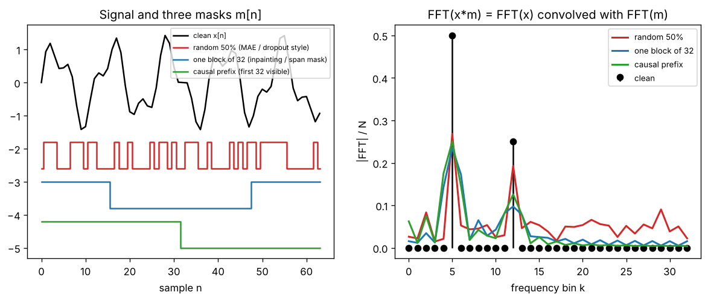

# Day 136 — Consolidation Day: The Masking Thread (dropout → causal masking → BERT MLM → MAE → diffusion noising)

*(No new concept number. Day 135 followed the EMA thread; today's cross-phase thread is **"hide part of the input, make the model deal with it"**.)*

## 🧠 CONCEPT OF THE DAY — THE REDACTED DOCUMENT

**Intuition.** Hand someone a document with parts blacked out and ask them to reconstruct it. To succeed they must learn how the pieces relate to each other. That is the oldest self-supervision trick: a **mask** decides what the model sees, and the loss is computed on what it did not see (or on a robust prediction despite the hiding).

The thread through the roadmap:

- **Dropout (26):** a random mask on activations; the network cannot rely on any single unit.
- **Causal masking (62):** a fixed triangular mask on attention scores; position $t$ may not see $t+1\ldots$, which makes next-token training legal.
- **BERT / masked LM (67):** hide ~15% of tokens, predict them from both sides.
- **MAE (92):** hide ~75% of image patches, encode only the visible ones, reconstruct pixels. The extreme ratio is what forces semantics instead of local interpolation.
- **Diffusion (83, 84):** noising is a soft mask. Each step destroys information a little; the denoiser learns to restore it.

**The math.** Every case multiplies by a 0/1 mask $m$ (or adds $-\infty$ before a softmax):

$$\tilde x = m\odot x,\qquad m_i\in\{0,1\}$$

For attention, the mask lives inside the softmax:

$$\text{softmax}\!\left(\frac{QK^\top}{\sqrt d}+M\right),\qquad M_{ij}=\begin{cases}0 & j\le i\\ -\infty & j>i\end{cases}$$

Here $M_{ij}=-\infty$ gives $e^{-\infty}=0$ weight, so hidden positions get exactly zero attention. Adding $-\infty$ (not multiplying by 0 after the softmax) keeps each row normalised over the visible entries.

Training objectives differ only in *where* the loss is taken:

$$\mathcal L_{\text{MLM/MAE}}=\frac{1}{|\mathcal M|}\sum_{i\in\mathcal M}\ell\big(f(m\odot x)_i,\,x_i\big)$$

Here $\mathcal M$ is the set of hidden positions, so the model is scored only on what it could not copy.



`graph_DAY_136.py` (seed 42, 64 samples, nothing downloaded) shows what masking does *to the data distribution*. The clean signal has two spectral lines (summed magnitude 0.750, off-tone floor 0.000). After masking, the line magnitude drops to 0.462 (random, 45% kept), 0.333 (block) and 0.376 (prefix), and the off-tone floor rises to 0.045, 0.019 and 0.016. Energy has leaked out of the lines. The Signal Lab explains why.

**Why it matters / where it leads.** Masking turns unlabeled data into supervised data, and the *mask pattern* is a design choice that sets what the model learns: causal gives a generator, random-token gives a good encoder, high-ratio patch masking gives strong visual features. It leads to the observation that masking is not free: it changes the input statistics, so train-time and test-time masks must match (dropout is switched off at inference, BERT's `[MASK]` token never appears downstream).

**Interview question:** *In causal self-attention you must stop position $t$ from attending to future tokens. Why do we add $-\infty$ to the scores before the softmax instead of multiplying the attention weights by a 0/1 mask afterwards, and what is the failure mode of using a large negative constant like $-10^4$ in fp16?*

*(Answer at the very bottom.)*

## 🐍 PYTHONIC EDGE

**Trick: apply masks with `np.where` / `masked_fill` and a boolean array, never a Python loop over positions.** The same code shape works in PyTorch with `scores.masked_fill(mask, float("-inf"))`.

```python
import numpy as np                              # import X as Y alias; no C++ analogue for aliasing a module

def softmax(z):                                 # plain function; first-class callable, can be passed around as a value
    z = z - z.max(axis=-1, keepdims=True)       # axis=-1: negative index counts from the end (C++ has no such thing)
    e = np.exp(z)                               # vectorised exp over the whole array, no explicit loop
    return e / e.sum(axis=-1, keepdims=True)    # '/' on arrays is elementwise; keepdims keeps the shape broadcastable

rng = np.random.default_rng(42)                 # an object holding RNG state; C++ <random> engines are similar
scores = rng.normal(size=(4, 4))                # shape is a tuple (4, 4); tuples are immutable, written with parentheses
T = scores.shape[-1]                            # [-1] on a tuple: last element

# BAD: Python loops, and multiplying AFTER softmax leaves rows that no longer sum to 1
w = softmax(scores)
for i in range(T):                              # range() is a lazy object, not an array
    for j in range(T):
        if j > i:                               # no braces; indentation is the block
            w[i, j] = 0.0                       # w[i, j] is one subscript call; C++ would be w[i][j]

# CLEAN: build a boolean mask once, fill with -inf, THEN softmax
mask = np.triu(np.ones((T, T), dtype=bool), k=1)   # keyword argument k=1; True strictly above the diagonal
masked = np.where(mask, -np.inf, scores)           # ternary-per-element; C++ would need a loop or std::transform
w = softmax(masked)                                # rows now sum to 1 over the visible entries

assert np.allclose(w.sum(axis=-1), 1.0)         # assert is a statement; raises AssertionError, no <cassert> needed
assert (w[mask] == 0).all()                     # boolean-mask indexing returns a 1-D array of the True positions
```

```python
class CausalMask:                               # C++: class CausalMask { ... }; no base class needed
    def __init__(self, T):                      # constructor; 'self' is C++'s 'this' but passed explicitly
        self.T = T                              # C++: declare in the header, assign in the constructor body
        self.mask = np.triu(np.ones((T, T), dtype=bool), k=1)   # attributes are created by assignment

    def __call__(self, scores):                 # makes instances callable like a function: CausalMask(T)(scores)
        return np.where(self.mask, -np.inf, scores)   # same idea as nn.Module: calling the object runs __call__

    def __len__(self):                          # dunder method: len(obj) calls this
        return self.T

apply = CausalMask(T)                           # no 'new'; calling the class creates an instance
assert len(apply) == T                          # len() dispatches to __len__
```

## 📡 SIGNAL LAB

**Problem.** A signal $x[n]$ has two pure tones at bins 5 and 12 (N = 64). You mask half of the samples. Predict qualitatively how the spectrum changes for (a) a random 50% mask and (b) one contiguous block, and explain the graph's numbers.

**Solution.** Multiplication in time is convolution in frequency:

$$\mathcal F\{x\odot m\}=\mathcal F\{x\}\ast\mathcal F\{m\}$$

Each spectral line of $x$ is replaced by a copy of the mask's spectrum $\hat m[k]$ centred on that line.

- **Random mask.** $m$ is white-ish, so $\hat m[k]$ has one big DC term (the keep fraction, 0.45 here) and a flat noise floor. Each tone keeps a line at about (keep fraction) of its height and sprays the rest uniformly over all bins. The floor rises to 0.045, the highest of the three.
- **Block mask.** $m$ is a rectangular window, so $\hat m$ is a sinc: a main lobe at DC and slowly decaying sidelobes. The leakage stays concentrated near the tones (floor 0.019) but the main lobe is wider (the tone is "blurred" over neighbouring bins).
- **Causal prefix.** Same rectangle shape, different position: same magnitude pattern, different phase.

**So what.** Masking is **spectral leakage by design**. The model sees data whose spectrum is a smeared version of the real one. For MAE this has a nice consequence: a random 75% patch mask is a white-noise-like mask, so low-frequency content (smooth regions) can be interpolated from neighbouring visible patches, while high-frequency detail cannot, and the reconstruction loss pushes the encoder toward semantics. For your forensics lane: generator fingerprints live in narrow high-frequency peaks (Day 88). Random masking spreads those peaks into a broadband floor and shrinks them to roughly the keep fraction, so a detector trained on masked inputs may lose exactly the periodic upsampling artifacts you want. If you mask for augmentation, check the peak heights before and after.

## 🏋️ THE GAUNTLET

**Merge Intervals.** Given an array of intervals `[start, end]` (closed, `start <= end`), merge all overlapping intervals (touching at a shared endpoint counts as overlapping) and return the disjoint intervals that cover exactly the same points, sorted by start.

Constraints: $1\le n\le10^5$; $0\le \texttt{start}\le\texttt{end}\le10^9$. Input order is arbitrary.

**Hints.**
1. Comparing every pair is $O(n^2)$. What ordering of the input would make "does this interval overlap anything before it?" a question about just one earlier interval?
2. After sorting by start, an interval can only overlap the *most recent merged* block, never an earlier one. Why?
3. Keep a result list. For each interval, either extend the last block's end or start a new block. What single comparison decides, and what must the new end be?

**Pattern:** sort + linear sweep (greedy).

**Target:** $O(n\log n)$ time, $O(n)$ output space.

*(Full solution at the very bottom.)*

## 🏗️ BLUEPRINT

no blueprint today.

## 🗺️ MARCHING ORDERS

Take a trained model and evaluate it with 0%, 25%, 50% and 75% of the input masked; the shape of that accuracy curve says more about what it learned than the clean score does.

Tomorrow: the roadmap is complete, so the next run is another consolidation day (no new concept number), picking a new cross-phase thread.

---

## 🔓 GAUNTLET SOLUTION

```cpp
#include <bits/stdc++.h>
using namespace std;

vector<vector<int>> mergeIntervals(vector<vector<int>> v) {
    sort(v.begin(), v.end());                          // by start, then end
    vector<vector<int>> res;
    for (auto& iv : v) {
        if (!res.empty() && iv[0] <= res.back()[1])    // overlaps or touches the last merged block
            res.back()[1] = max(res.back()[1], iv[1]); // extend; the new interval may be nested, so take max
        else
            res.push_back(iv);                         // gap: start a new block
    }
    return res;
}
```

Compiled and run: `[[1,3],[8,10],[2,6],[15,18],[6,7]]` → `[1,7] [8,10] [15,18]`; checked against a brute-force point-coverage comparison on 3000 random cases. Sorting dominates: $O(n\log n)$ time, $O(n)$ space for the result.

## 💡 CONCEPT ANSWER

**Why $-\infty$ before the softmax.** The softmax normalises each row to sum to 1. If you zero the weights *after* the softmax, the future positions already took a share of the probability mass, so the remaining visible weights sum to less than 1 and the output is a shrunken, position-dependent average (the rows are not even equal in scale). Worse, the softmax computed the weights using the future scores, so the values leak through the normalisation denominator: position $t$'s output depends on tokens after $t$, which breaks causality in a subtler way. Adding $-\infty$ makes $e^{-\infty}=0$ *inside* the sum, so the denominator is over visible entries only and each row is a proper distribution.

**fp16 failure mode.** fp16 has a max magnitude of 65504 and only about 3 decimal digits of precision. A large negative constant is fine for large-magnitude negative scores, but if the *visible* scores are also large in magnitude (say below $-10^4$ after scaling or in an unnormalised model), the "masked" entries are no longer smaller than the visible ones and receive non-zero weight. Using a constant beyond the fp16 range (such as $-10^5$) overflows to $-\infty$ on conversion, which is fine for the softmax itself but gives `NaN` (`-inf - -inf`) when an entire row is masked (for example, padding rows). The standard remedies: use `torch.finfo(dtype).min` instead of a hand-picked constant, subtract the row max in fp32 inside the softmax, and make sure no row is fully masked (or zero those rows' outputs afterwards).
