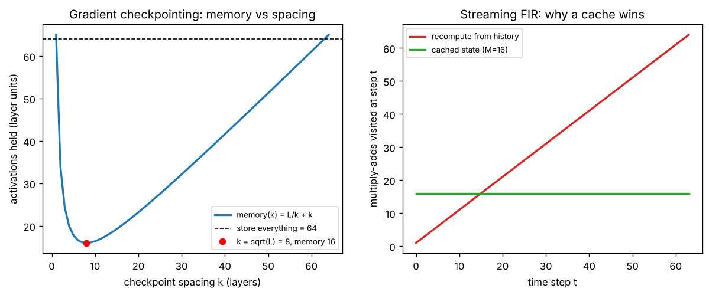

# Day 137 — Consolidation Day: The Recompute-vs-Store Thread (truncated BPTT → FlashAttention → gradient checkpointing → KV cache)

*(No new concept number. Day 136 followed the masking thread; today's cross-phase thread is **"memory and compute are exchangeable: decide what to keep and what to recompute"**.)*

## 🧠 CONCEPT OF THE DAY — THE NOTEBOOK OR THE BRAIN

**Intuition.** Solving a long calculation you can either write every intermediate result in a notebook (fast to look up, fills the desk) or keep only a few checkpoints and redo the steps in between when you need them (small desk, extra work). Deep learning keeps meeting this same choice, and the answer depends on which resource is scarcer *at that moment*.

The thread through the roadmap:

- **BPTT (46):** backprop through time stores every hidden state. Truncating to a window of $K$ steps caps memory at the price of ignoring longer dependencies.
- **FlashAttention (64):** never stores the $n\times n$ attention matrix. It recomputes score tiles in the backward pass because re-doing the matmul in fast on-chip SRAM is cheaper than reading the matrix back from slow HBM.
- **Gradient checkpointing (97):** keep only every $k$-th layer's activations, recompute the rest during backward.
- **KV cache (100):** the opposite direction. During decoding, *store* past keys and values so each new token costs $O(n)$ instead of recomputing the whole prefix at $O(n^2)$.
- **ZeRO (99):** shard optimiser state, gradients and parameters across devices, and gather a shard only when it is needed. This is the same exchange, with network traffic as the currency.

**The math.** For an $L$-layer network with one unit of activation memory per layer, storing everything costs $L$. With checkpoints every $k$ layers you hold $L/k$ checkpoints plus one segment of $k$ live activations while recomputing it:

$$M(k)=\frac{L}{k}+k$$

Here $L$ is the number of layers, $k$ the checkpoint spacing and $M(k)$ the peak activation memory in layer units. Setting $dM/dk=-L/k^2+1=0$ gives the optimum:

$$k^\*=\sqrt L,\qquad M(k^\*)=2\sqrt L$$

The price is one extra forward pass, so the step costs about $\tfrac{4}{3}\times$ the baseline (forward $=1$, backward $\approx 2$, plus the recomputed forward $=1$, giving $4$ against $3$).

For the KV cache, producing $n$ tokens without a cache re-projects the whole prefix at every step, so the $K,V$ projection work per layer is

$$\sum_{t=1}^{n} t\,d^2 = O(n^2 d^2)\ \text{without a cache},\qquad \sum_{t=1}^{n} d^2 = O(n d^2)\ \text{with one}$$

Here $d$ is the model width and $t$ the current prefix length. Each step still reads all $t$ cached entries for the attention itself, so the cache's real cost is its size: $2\cdot L\cdot n\cdot d$ numbers per sequence.



`graph_DAY_137.py` (seed 42, nothing downloaded) prints the numbers. For $L=64$: storing everything holds 64 layer units, while $k=8=\sqrt{64}$ holds 16, a $4.0\times$ reduction for one extra forward pass. In the streaming filter ($N=64$ samples, $M=16$ taps) recomputing from history visits 2080 multiply-adds against 1024 for a cached state, with identical outputs (asserted in the script). The gap grows linearly with the stream length.

**Why it matters / where it leads.** Almost every systems trick in Phases 7 and 10 is a point on this one curve. The question to ask of any proposed optimisation is "what does it trade, and is that resource the actual bottleneck?" It also explains why serving and training pull in opposite directions: training is memory-bound on activations (recompute helps), decoding is memory-bound on the cache (caching helps but the cache itself becomes the problem, hence GQA/MQA and paged attention).

**Interview question:** *You are fine-tuning a 24-layer transformer and run out of GPU memory at batch size 8. You turn on gradient checkpointing and it fits at batch size 32. Roughly how much slower is each step, why does the larger batch often still give higher throughput, and which activations should you checkpoint first?*

*(Answer at the very bottom.)*

## 🐍 PYTHONIC EDGE

**Trick: use a generator to stream with bounded state, instead of materialising the whole history.** The same idea (keep only what the future needs) is what a KV cache or a checkpoint is.

```python
import numpy as np                              # import X as Y alias; no C++ analogue for aliasing a module
from collections import deque                   # from-import pulls one name into the namespace

# BAD: keeps every sample and recomputes the full dot product each time
def fir_bad(xs, h):
    out = []                                    # list grows with the stream, memory is O(n)
    for t in range(len(xs)):                    # range() is a lazy object, not an array
        acc = 0.0
        for j in range(t + 1):                  # revisits the whole past at every step
            if t - j < len(h):                  # chained comparison and no braces; indentation is the block
                acc += h[t - j] * xs[j]
        out.append(acc)
    return out

# CLEAN: a generator holding a fixed-size window
def fir_stream(xs, h):                          # a function with 'yield' is a generator, C++ has no direct equivalent
    window = deque([0.0] * len(h), maxlen=len(h))   # keyword argument; old items fall off automatically
    for x in xs:                                # iterating any iterable, no index needed
        window.appendleft(x)                    # method call on an object; newest sample goes to the front
        yield float(np.dot(h, window))          # yield hands back one value and pauses here, keeping local state

h = np.array([0.5, 0.3, 0.2])
xs = [1.0, 2.0, 3.0, 4.0]
assert np.allclose(fir_bad(xs, h), list(fir_stream(xs, h)))   # list(...) drains the generator; assert raises on False
y0, y1, *rest = fir_stream(xs, h)               # tuple unpacking with *rest; C++17 structured bindings have no star form
```

```python
class StreamFIR:                                # C++: class StreamFIR { ... }; no base class needed
    def __init__(self, h):                      # constructor; 'self' is C++'s 'this' but passed explicitly
        self.h = np.asarray(h)                  # C++: declare in the header, assign in the constructor body
        self.window = deque([0.0] * len(h), maxlen=len(h))   # attributes are created by assignment

    def __call__(self, x):                      # instances become callable, like nn.Module calling forward()
        self.window.appendleft(x)               # mutates the instance state; there is no 'const' here
        return float(self.h @ np.array(self.window))   # '@' is matmul, here a dot product of 1-D arrays

    def __len__(self):                          # dunder: len(obj) dispatches to this
        return len(self.h)

f = StreamFIR(h)                                # no 'new'; calling the class creates an instance
assert len(f) == 3                              # len() calls __len__
assert abs(f(1.0) - 0.5) < 1e-12                # f(1.0) runs __call__, not a method named 'f'
```

## 📡 SIGNAL LAB

**Problem.** You filter a long audio stream with an $M$-tap FIR filter $h$. (a) What is the minimum state you must keep between samples to compute exactly the same output as filtering the whole signal at once? (b) For block processing with the FFT you split the stream into blocks of length $B$. Why must consecutive blocks overlap, and by how much? (c) The same filter is applied to a spectrogram-style pipeline: should you cache the FFT of $h$?

**Solution.**

(a) Each output is a sum over the last $M$ inputs:

$$y[t]=\sum_{m=0}^{M-1}h[m]\,x[t-m]$$

so exactly the last $M-1$ samples of $x$ are the state. This is the signal-processing KV cache. Keeping it makes the per-sample work $O(M)$ regardless of how long the stream already is (the graph's right panel: 1024 against 2080 operations for $N=64$, and the ratio approaches $N/M$ for long streams).

(b) FFT multiplication computes a *circular* convolution of length $B$. The first $M-1$ outputs of each block are wrapped-around contamination. **Overlap-save** discards them: take blocks of length $B$ with $M-1$ samples of overlap, multiply by the cached $\mathrm{FFT}(h)$ zero-padded to $B$, inverse transform, and keep the last $B-M+1$ outputs. The overlapping $M-1$ samples are, again, the cached state.

(c) Yes. $\mathrm{FFT}(h)$ is fixed, so computing it once is the "store" side of the trade, saving one FFT per block. Each block then costs two FFTs, $O(B\log B)$, instead of $O(BM)$ for direct convolution.

**So what.** Streaming inference and block FFT processing both reduce to "carry exactly the right amount of past". Too little state gives wrong outputs (boundary artefacts); too much wastes memory. For your research lane: when you compute per-patch spectra of generated images in a sliding window, adjacent windows share most of their samples. Caching the shared rows and using a sliding DFT, rather than re-running the FFT per window, is the same trade, and it matters when a forensic detector has to run on large images.

## 🏋️ THE GAUNTLET

**Longest Consecutive Sequence.** Given an unsorted array of integers `nums`, return the length of the longest run of consecutive integers (values $x, x+1, x+2,\dots$) that appear in the array, in any order. Duplicates count once.

Constraints: $0\le n\le10^5$; $-10^9\le \texttt{nums}[i]\le10^9$. The time limit rules out $O(n\log n)$ sorting on the hardest tests; aim for linear expected time.

**Hints.**
1. Sorting works but costs $O(n\log n)$. What data structure answers "is $x+1$ present?" in constant expected time?
2. If you try to extend a run from *every* element you may re-walk the same run many times. Which element of a run is the only one worth starting from?
3. How can you tell that $x$ is the start of a run using only one membership query? Once you start there, why does each element get visited a bounded number of times in total?

**Pattern:** hash set with "start of run" pruning (store-for-lookup, the thread's theme).

**Target:** $O(n)$ expected time, $O(n)$ space.

*(Full solution at the very bottom.)*

## 🏗️ BLUEPRINT

**Decoding server: KV cache memory vs batch size.** The cache for one sequence is $2\cdot L\cdot n\cdot d\cdot b$ bytes ($L$ layers, $n$ tokens, $d$ model width, $b$ bytes per number). With, for example, $L=32$, $d=4096$, $n=4096$ and fp16, that is $2\cdot32\cdot4096\cdot4096\cdot2\approx 2.1$ GB per sequence, so an 80 GB card with 26 GB of weights serves only about 25 concurrent sequences. The key tradeoff: reserve the maximum length per request (simple, wastes memory on short requests, caps batch size) or allocate in pages as sequences grow (paged attention: more concurrent requests and higher throughput, at the cost of an indirection table and non-contiguous reads). Shrinking $d$ in the cache via grouped-query attention is the other lever, trading a little quality for a proportional cut in cache size.

## 🗺️ MARCHING ORDERS

Next time a run goes out of memory, resist the reflex of cutting the batch size. List the five biggest tensors, ask for each "store or recompute?", and change exactly one.

Tomorrow: the roadmap is complete, so the next run is another consolidation day (no new concept number), picking a new cross-phase thread.

---

## 🔓 GAUNTLET SOLUTION

```cpp
#include <bits/stdc++.h>
using namespace std;

int longestConsecutive(vector<int>& a) {
    unordered_set<int> s(a.begin(), a.end());   // dedupes and gives O(1) expected lookup
    int best = 0;
    for (int x : s) {
        if (s.count(x - 1)) continue;           // x - 1 exists, so x is not the start of a run
        int y = x;
        while (s.count(y + 1)) ++y;             // walk the run once, from its start only
        best = max(best, y - x + 1);
    }
    return best;
}
```

Compiled and run: `[100,4,200,1,3,2]` → `4`; checked against a sorted-set brute force on 3000 random small arrays with negatives and duplicates. Each element is walked at most once (only from its run's start), so the total is $O(n)$ expected time, $O(n)$ space. For adversarial hash collisions use a sorted array plus a linear pass for $O(n\log n)$ worst case.

## 💡 CONCEPT ANSWER

**Slowdown.** With checkpointing you redo roughly one extra forward pass per step. If forward $\approx1$ and backward $\approx2$ units, a step goes from about $3$ to about $4$, so about $30\%$ slower (commonly quoted as 20–35%). Checkpointing only the transformer blocks, not the embedding or the loss head, keeps it near the low end.

**Why throughput can still improve.** The batch grew $4\times$ for a roughly $1.3\times$ slower step. If the GPU was under-utilised at batch 8 (small matmuls, kernel launch overhead, poor arithmetic intensity), the larger matmuls run closer to peak, so samples per second go up. It also lets you take fewer optimiser steps with less gradient noise, or avoid gradient accumulation. If the GPU was already saturated at batch 8, you gain little and checkpointing is only worth it for fitting the model at all.

**What to checkpoint first.** Checkpoint at block boundaries (keep each block's input, recompute inside it); that gives the $\sqrt L$-style saving with simple code. Within a block, the cheapest things to recompute and the most memory-hungry to store are the attention score/softmax tensors (size $n^2$ per head) and the MLP's wide hidden activation (typically $4d$). Selective recomputation of just those, or using FlashAttention which does it for you, recovers most of the memory at much less than the 30% cost. Matmul outputs are expensive to recompute and are kept.
