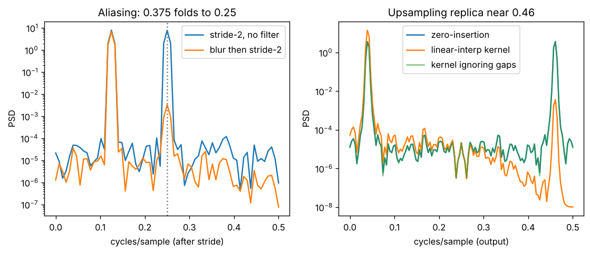

# Day 139 — Consolidation Day: The Spectral Thread (convolution theorem → stride & pooling aliasing → transposed-conv replicas → sinusoidal positions → diffusion noising)

*(No new concept number. Day 138 followed the discrete-made-differentiable thread; today's cross-phase thread is **"every layer that resamples or mixes positions is a filter, and filters have a spectrum"**.)*

## 🧠 CONCEPT OF THE DAY — THE SPECTRAL LENS

**Intuition.** Think of a signal as a chord and a layer as an equaliser. A convolution does not "look at neighbours" so much as boost some notes and mute others. Once you see layers as equalisers, three questions answer themselves: what happens when I throw away samples (stride, pooling), what happens when I invent samples (upsampling), and what happens when I tell the model where it is in a sequence (positional encoding).

**The math.** Three facts carry the whole thread.

Convolution theorem (Phase 4: Days 32-33, 36, 44). For a signal $x$ and kernel $h$, with $\mathcal F$ the Fourier transform:

$$\mathcal F\{x*h\}(\omega)=\mathcal F\{x\}(\omega)\cdot\mathcal F\{h\}(\omega)$$

So a conv layer multiplies the spectrum by $H(\omega)$. A $3\times3$ blur is a low-pass, an edge kernel is a high-pass, and a dilated kernel (Day 44) has a comb-shaped $H$ because its taps are spaced apart.

Downsampling by a factor $M$ (stride, pooling: Days 33, 35) keeps every $M$-th sample, which in frequency adds $M$ shifted copies of the spectrum:

$$Y(\omega)=\frac1M\sum_{m=0}^{M-1}X\!\left(\frac{\omega-2\pi m}{M}\right)$$

Here $X$ and $Y$ are the spectra before and after. If $X$ has energy above the new Nyquist frequency, the copies overlap and a high frequency *folds* onto a low one (aliasing). Cure: low-pass first, then subsample (anti-aliased "BlurPool").

Upsampling by $L$ by inserting zeros (the first half of a transposed conv, Days 43, 80, 88) is the mirror image: it creates $L$ spectral replicas of the original spectrum, so

$$X_{\uparrow}(\omega)=X(L\omega)$$

The kernel that follows must be a low-pass that kills the replicas. A kernel that ignores the zero gaps, or one whose stride does not divide its size, leaves part of a replica behind, and that remnant is the checkerboard artifact.

Sinusoidal positions (Day 58) are literally a Fourier basis: $\mathrm{PE}(p)_{2i}=\sin(p/10000^{2i/d})$, $\mathrm{PE}(p)_{2i+1}=\cos(\cdot)$, so their dot product depends only on the offset:

$$\mathrm{PE}(p)\cdot\mathrm{PE}(p+k)=\sum_i\cos(\omega_i k)$$

with $\omega_i=10000^{-2i/d}$. The model gets relative position from a sum of cosines, which is why shifts become phase rotations it can learn.



`graph_DAY_139.py` (seed 42, nothing downloaded) prints the numbers: with plain stride-2, the folded tone at 0.25 has PSD **7.84**; blurring first drops it to **0.0033** (33.7 dB lower). On the right, the replica at 0.46 has PSD **3.68** after zero-insertion and **0.0036** after a linear-interpolation kernel.

**Three key connections.**

1. **Conv = filter (Phase 4 → everything).** Kernel size, dilation and receptive field are all statements about $H(\omega)$.
2. **Resampling = aliasing and replicas (Phases 4, 8, 9).** Stride and pooling fold spectra down, transposed conv and nearest-neighbour upsampling add replicas. U-Net skips (Day 94) partly repair this by re-injecting the high frequencies the downsampling path lost.
3. **Fourier bases show up on purpose (Phases 6, 8).** Sinusoidal PE is one. Diffusion's forward noising (Day 83) is another view: natural images have a roughly $1/f^2$ power spectrum while Gaussian noise is flat, so high frequencies drop below the noise first and the reverse process rebuilds coarse structure before fine detail.

**Why it matters / where it leads.** This is the lens for your research lane: generated images carry the fingerprint of their upsampling path as periodic peaks in the spectrum, and classifiers that stride without anti-aliasing are not shift-invariant. It also gives a sharp interview answer to "why does a CNN's output change when you shift the input by one pixel?"

**Interview question:** *You halve the resolution of a feature map with a stride-2 convolution (or max-pool). A colleague notices the network's predictions flip when the input is shifted by one pixel. Explain why in terms of the spectrum, and name two fixes.*

*(Answer at the very bottom.)*

## 🐍 PYTHONIC EDGE

**Trick: replace index loops with slice strides and boolean masks, and read spectra with `np.fft.rfft` + `np.fft.rfftfreq`.** Stride-2 subsampling is just `x[::2]`, and "energy in a frequency band" is one masked sum.

```python
import numpy as np                              # import X as Y alias; C++ has no equivalent of aliasing a whole library name

x = np.sin(2 * np.pi * 0.375 * np.arange(256))  # '*' on arrays is elementwise; '**' would be power (C++: std::pow)

# BAD: Python loop that copies every other element, and a manual band sum
down = []                                       # empty list literal; C++ would use std::vector<double>
for i in range(0, len(x), 2):                   # range() is a lazy object (start, stop, step); C++ writes a for(;;) header
    down.append(x[i])                           # list.append grows in place; no push_back type to declare
band = 0.0
for k in range(len(down) // 2 + 1):             # '//' is floor division; '/' is always true division in Python 3
    f = k / len(down)
    if 0.2 <= f <= 0.3:                         # chained comparison; C++ needs (0.2 <= f && f <= 0.3)
        band += abs(np.fft.rfft(down)[k]) ** 2  # recomputes the FFT every iteration (O(n^2 log n) disaster)

# CLEAN: slice stride + vectorised mask
down = x[::2]                                   # [start:stop:step] slice, a view not a copy; negative step reverses, [-1] is last
P = np.abs(np.fft.rfft(down)) ** 2              # rfft returns only non-negative frequencies for real input
f = np.fft.rfftfreq(len(down))                  # companion helper: the frequency of each bin
band = P[(f >= 0.2) & (f <= 0.3)].sum()         # '&' is elementwise AND on bool arrays ('and' would raise); boolean-mask indexing
assert band > 0                                 # assert raises AssertionError on False; no NDEBUG switch like C++
```

The OOP form shows how a reusable "check for aliasing" helper looks:

```python
class AliasProbe:                               # C++: class AliasProbe (no base); Python 3 classes implicitly extend object
    def __init__(self, stride=2, *, nfft=None): # constructor; 'self' is C++'s 'this' but explicit; '*' makes nfft keyword-only
        self.stride = stride                    # attribute created by assignment; C++ declares it in the class body
        self.nfft = nfft                        # None is Python's null (vs nullptr); test with 'is None', not ==

    def __call__(self, x):                      # dunder: makes the object callable like a function (as nn.Module does)
        y = x[::self.stride]                    # same slice-with-step as above
        n = self.nfft or len(y)                 # 'or' returns the first truthy operand, a Python idiom with no C++ analogue
        return np.abs(np.fft.rfft(y, n=n)) ** 2 # n=... is a keyword argument passed by name

probe = AliasProbe(stride=2)                    # no 'new'; calling the class constructs the object
P = probe(x)                                    # runs __call__; in torch you would write layer(x), never layer.forward(x)
peak = int(P.argmax())                          # int() converts the numpy integer to a plain Python int
```

## 📡 SIGNAL LAB

**Problem.** A 1-D feature signal is $x[n]=\sin(2\pi\cdot0.0625\,n)+\sin(2\pi\cdot0.375\,n)$ (frequencies in cycles per sample, so Nyquist is 0.5). (a) You apply a stride-2 conv with a delta kernel. Where does each tone land? (b) You blur with $h=[1,4,6,4,1]/16$ first. How much of the problem does that fix, and what do you pay? (c) Where does a stride-2 transposed conv put replicas of a tone at 0.04 cycles/sample, and what must the following kernel do? (d) What does (c) mean for forensics?

**Solution.**

(a) Subsampling by 2 doubles the frequency in cycles per *new* sample: the low tone becomes $0.125$ (fine), the high tone becomes $0.75$, which exceeds the new Nyquist $0.5$ and folds to $1-0.75=0.25$. A spurious tone appears at 0.25 that was never in the input. In the script its PSD is **7.84**.

(b) The binomial kernel has $H(\omega)=\cos^4(\pi f)$, which at $f=0.375$ is about $0.02$ in amplitude, so the folded tone is cut to PSD **0.0033**, **33.7 dB** lower. The cost is a slightly attenuated low tone and a less sharp image: this is the usual anti-aliasing tradeoff, and the reason BlurPool improves shift-stability a little at some accuracy cost on fine texture.

(c) Zero-insertion at $L=2$ maps a tone at $0.04$ (output units: $0.08/2$) to itself *and* a replica at $0.5-0.04=0.46$. Measured replica PSD: **3.68** after zero-insertion, **0.0036** after a linear-interpolation kernel $[0.5,1,0.5]$ whose response $1+\cos(2\pi f)$ is nearly zero near Nyquist. The kernel that ignores the zero gaps leaves the replica at **3.68** untouched.

(d) Learned transposed convs approximate this low-pass only partly, so generators leave a periodic residue at (a fraction of) the sampling grid frequency. That is the spectral peak your detectors can find. It is also why re-sizing or JPEG-ing a generated image can erase the fingerprint, so always evaluate after the same post-processing for real and fake sets.

**So what.** Plot the PSD of your feature maps (or images) before and after each resampling op. A new narrow peak is a replica, a new bump at low frequency from a high-frequency input is an alias.

## 🏋️ THE GAUNTLET

**Subarray Sum Equals K** (a prefix sum is a running convolution with a step kernel; the trick below is the discrete analogue of differencing it). Given an integer array `nums` and an integer `k`, return the number of contiguous non-empty subarrays whose sum equals `k`.

Constraints: $1\le n\le2\cdot10^4$; $-1000\le\texttt{nums}[i]\le1000$; $-10^7\le k\le10^7$. Negative values are allowed.

**Hints.**
1. Define $S_j$ = sum of the first $j$ elements. The sum of `nums[i..j-1]` can be written using two values of $S$. How?
2. A two-pointer sliding window would work if all numbers were non-negative. Why does it break here, and what can you count instead of moving pointers?
3. For each new prefix $S_j$ you want to know how many *earlier* prefixes equal $S_j-k$. What structure answers "how many times have I seen this value?" in $O(1)$?

**Pattern:** prefix sums + hash map of counts (seed the map with prefix 0).

**Target:** $O(n)$ time, $O(n)$ space.

*(Full solution at the very bottom.)*

## 🏗️ BLUEPRINT

no blueprint today.

## 🗺️ MARCHING ORDERS

Next time a layer changes the number of samples, ask two questions before running it: what did I throw away, and what spectrum did I just invent?

Tomorrow: the roadmap is complete, so the next run is another consolidation day (no new concept number), picking a new cross-phase thread.

---

## 🔓 GAUNTLET SOLUTION

```cpp
#include <bits/stdc++.h>
using namespace std;

int subarraySum(vector<int>& a, int k) {
    unordered_map<int,int> seen;                // prefix sum -> number of times seen
    seen[0] = 1;                                // empty prefix, so subarrays starting at index 0 count
    int s = 0, res = 0;
    for (int x : a) {
        s += x;                                 // running prefix sum S_j
        auto it = seen.find(s - k);             // earlier prefixes equal to S_j - k
        if (it != seen.end()) res += it->second;
        ++seen[s];                              // record only after querying, so we never pair a prefix with itself
    }
    return res;
}
```

Compiled and run: `[1,1,1], k=2` → `2`; checked against an $O(n^2)$ brute force on 3000 random small arrays with negative values, no mismatches. Each element does one hash lookup and one insert, so the total is $O(n)$ expected time and $O(n)$ space.

## 💡 CONCEPT ANSWER

**Why it flips.** A stride-2 conv (or max-pool) keeps only even-indexed samples. If the feature map has energy above the new Nyquist frequency, that energy folds onto lower frequencies as aliasing, and the folded phase depends on where the sampling grid starts. Shifting the input by one pixel changes that phase, so the downstream features change even though the content did not. The layer is therefore not shift-equivariant, and the classifier built on it is not shift-invariant.

**Fix 1: anti-alias before subsampling.** Apply a low-pass (e.g. a binomial/Gaussian blur) and then stride, as in BlurPool. This removes the energy that would fold, at a small cost in fine detail.

**Fix 2: reduce reliance on the grid.** Options include shift-augmentation during training, adaptive polyphase sampling (choose the sampling phase by a shift-invariant rule such as the max-norm phase), or using larger smooth pooling windows. Each reduces, but none fully eliminates, the dependence on grid alignment unless the signal is band-limited first.
