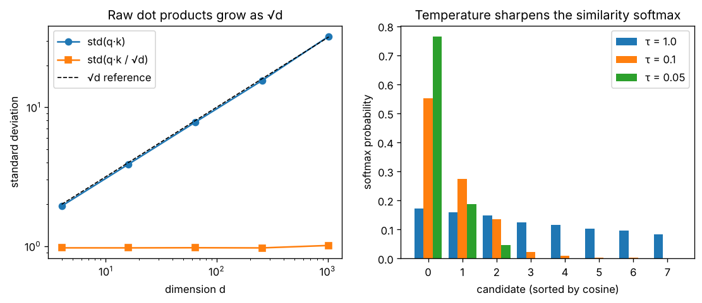

# Day 140 — Consolidation Day: The Dot-Product Similarity Thread (neuron → attention q·k/√d → InfoNCE temperature → CLIP/SimCLR → RAG retrieval)

*(No new concept number. Day 139 followed the spectral thread; today's cross-phase thread is **"almost everything that compares two things is a dot product, and the dot product needs its scale controlled"**.)*

## 🧠 CONCEPT OF THE DAY — THE DOT PRODUCT AS A QUESTION

**Intuition.** A dot product asks one question: *how much do these two vectors point the same way?* Phase 1's neuron asks it of an input and a weight vector ("does this input look like my template?"). Attention asks it of a query and a key. CLIP and SimCLR ask it of two embeddings. A RAG retriever asks it of a question and a document chunk. It is the same operation each time, so it also fails in the same ways: the answer grows with dimension, it mixes "same direction" with "long vector", and turning scores into a choice via softmax needs a sharpness knob.

**The math.** Three facts carry the thread.

Scale grows with dimension (Day 55, √d). For $q,k\in\mathbb R^d$ with independent zero-mean unit-variance entries:

$$\operatorname{Var}(q\cdot k)=\sum_{i=1}^{d}\operatorname{Var}(q_ik_i)=d \quad\Rightarrow\quad \operatorname{std}(q\cdot k)=\sqrt d$$

Here $d$ is the embedding or head dimension. Large logits push softmax into saturation, where its gradient is nearly zero (Days 5, 20), so attention divides by $\sqrt d$ to keep the variance at 1.

Direction versus length. Cosine similarity removes the length:

$$\cos\theta=\frac{q\cdot k}{\lVert q\rVert\,\lVert k\rVert}$$

CLIP and SimCLR (Days 90, 91) L2-normalise embeddings first, so the score cannot be inflated by making vectors longer. Retrieval (Day 108) does the same so that long documents do not win by magnitude.

Temperature is the sharpness knob. The InfoNCE loss for anchor $i$ with positive $i^+$ over a batch of $N$ candidates is

$$\mathcal L_i=-\log\frac{\exp(s_{i,i^+}/\tau)}{\sum_{j=1}^{N}\exp(s_{i,j}/\tau)}$$

where $s_{i,j}=\cos\theta_{ij}$ and $\tau>0$ is the temperature. Small $\tau$ makes the softmax peaky and concentrates the gradient on the hardest negatives. Large $\tau$ treats all negatives alike. This is the same softmax-plus-cross-entropy as Day 5, with the dot product supplying the logits.



`graph_DAY_140.py` (seed 42, nothing downloaded) prints the numbers: raw $\operatorname{std}(q\cdot k)$ is **1.94, 3.89, 7.79, 15.54, 32.36** for $d=4,16,64,256,1024$, which is $\approx\sqrt d$, while the scaled version stays at **0.97 to 1.01**. On the right, the top candidate gets probability **0.171** at $\tau=1$, **0.552** at $\tau=0.1$ and **0.764** at $\tau=0.05$ (entropy falls from 2.05 to 0.67 nats).

**Three key connections.**

1. **Neuron → attention (Phases 1, 6).** $w\cdot x+b$ compares input with a *learned* template. Attention compares a query with *data-dependent* templates (keys), so the "weights" are computed on the fly. Self-attention is a layer whose kernel is made from its own input.
2. **Softmax needs a scale (Phases 1, 6, 9, 11).** $\sqrt d$ in attention, $\tau$ in CLIP/SimCLR, logit temperature at sampling time (Day 86) and the PPO policy softmax all do one job: set how peaky the choice is. Too sharp gives vanishing gradients and mode collapse. Too flat gives no learning signal.
3. **Normalise, then compare (Phases 3, 9, 11).** LayerNorm, L2-normalised embeddings, cosine retrieval and QK-norm all remove magnitude so that the dot product measures *angle*. The cost is a hypersphere geometry: with $d$ large, random directions are nearly orthogonal (cosine $\approx0\pm1/\sqrt d$), so a cosine of 0.3 is already very significant.

**Why it matters / where it leads.** This is the answer to "why divide by √d?", "what does the temperature in CLIP do?" and "why do vector databases use cosine or inner product?". It also leads to the research lane: the dot product of two signals is their cross-correlation at lag zero, and Parseval's theorem says it can be computed in the frequency domain, which is the bridge to today's Signal Lab.

**Interview question:** *In scaled dot-product attention you divide $QK^\top$ by $\sqrt{d_k}$. A colleague proposes dividing by $d_k$ instead, "to be safe". What happens to training, and what would you check to decide?*

*(Answer at the very bottom.)*

## 🐍 PYTHONIC EDGE

**Trick: use `torch.einsum` (or `@` with explicit shapes) for batched similarity, and `assert` on shapes so a silent broadcast cannot hide a bug.** The classic bug is `a @ b` between a `(B, d)` batch and a `(B, d)` batch, which errors, while `a * b` broadcasts happily and gives a wrong "similarity".

```python
import torch                                    # import is a runtime statement, not a preprocessor include like C++ #include
import torch.nn.functional as F                 # 'as F' alias; C++ would need 'namespace F = ...' or a using-declaration

a = torch.randn(8, 64)                          # batch of 8 query embeddings, 64 dims; no 'new', no manual shape template
b = torch.randn(8, 64)                          # batch of 8 keys

# BAD: Python loop, and a normalisation that is easy to forget
sims = []                                       # empty list literal; C++ would be std::vector<float>
for i in range(8):                              # range() is a lazy object, not a loop header
    row = []
    for j in range(8):
        row.append((a[i] * b[j]).sum().item())  # '*' is elementwise; .item() pulls a Python float out of a 0-d tensor
    sims.append(row)

# CLEAN: normalise once, one batched matmul
a_n = F.normalize(a, dim=-1)                    # dim=-1 is negative indexing: the last axis (C++ has no negative index)
b_n = F.normalize(b, dim=-1)                    # keyword argument passed by name
S = a_n @ b_n.T                                 # '@' is matmul, '.T' is a transpose view (no copy)
assert S.shape == (8, 8), S.shape               # assert raises AssertionError on False; the 2nd operand is the message
S2 = torch.einsum("id,jd->ij", a_n, b_n)        # einsum names the axes; same result, self-documenting
assert torch.allclose(S, S2, atol=1e-6)         # allclose compares floats with tolerance (never == on floats)
top1 = S.argmax(dim=1)                          # for each query, index of best key; returns a LongTensor
```

The OOP form shows how a small reusable scorer looks:

```python
class CosineScorer(torch.nn.Module):            # C++: class CosineScorer : public torch::nn::Module (Python lists the base in parens)
    def __init__(self, tau=0.07):               # constructor; 'self' is C++'s 'this' but explicit
        super().__init__()                      # parent constructor; C++ uses an initialiser list instead
        self.tau = tau                          # instance attribute by assignment; C++ declares it in the class body

    def forward(self, a, b):                    # the method the framework calls for you
        a, b = F.normalize(a, dim=-1), F.normalize(b, dim=-1)   # tuple unpacking: two assignments in one line
        return (a @ b.T) / self.tau             # '/' is true division on tensors

scorer = CosineScorer(tau=0.05)                 # calling the class constructs the object (no 'new')
logits = scorer(a, b)                           # __call__ wraps forward() with hooks; never call scorer.forward(a, b)
loss = F.cross_entropy(logits, torch.arange(8)) # diagonal is the positive pair: this is InfoNCE in one line
```

## 📡 SIGNAL LAB

**Problem.** Let $x$ be a smooth length-64 signal (seed 42, white noise through a 5-tap moving average) and $y$ a copy circularly shifted by 5 samples. (a) What is the cosine similarity of $x$ and $y$ in the time domain? (b) What is the cosine similarity of their *magnitude spectra* $|X|$ and $|Y|$? (c) How do you recover the shift using the FFT? (d) What does this mean for comparing images or feature maps in a forensics pipeline?

**Solution.**

(a) The time-domain cosine is **−0.16**. The content is identical, but the dot product only looks at lag zero, so a 5-sample shift misaligns the waveforms and the score is meaningless as a "same content" test.

(b) Circular shift multiplies the spectrum by a phase, $Y[k]=X[k]e^{-j2\pi k s/N}$, which has magnitude 1. So $|Y|=|X|$ exactly, and the cosine of the magnitude spectra is **1.0**. Magnitude spectra are shift-invariant descriptors (they throw away phase, i.e. position).

(c) Cross-correlation is a dot product at every lag at once, and the correlation theorem computes all of them in $O(N\log N)$:

$$r[\ell]=\sum_n x[n]\,y[n+\ell]=\mathcal F^{-1}\{\overline{X}\cdot Y\}[\ell]$$

The $\arg\max$ of $r$ is **5**, the true shift, and the normalised peak value is **1.0**. Parseval's theorem is the lag-zero special case: $x\cdot y=\tfrac1N\operatorname{Re}\sum_k X[k]\overline{Y[k]}$, and both sides give **−0.882** for this pair.

(d) A dot product (and any layer built from it) is *position-sensitive*; the magnitude spectrum is *position-insensitive but phase-blind*. For generated-image forensics, the periodic upsampling peaks live in $|X|$, so a detector on magnitude spectra is robust to crops and shifts, while anything that depends on phase (edges, structure) needs the position-aware path.

**So what.** Before reaching for a bigger model, ask which invariance your similarity score has. Dot product: none. Cosine: scale. Cosine of $|\mathrm{FFT}|$: scale and shift.

## 🏋️ THE GAUNTLET

**Find K Closest Elements** (retrieval in 1-D: the nearest neighbours of a query in a sorted index). Given a sorted integer array `arr`, an integer `k` and a target `x`, return the `k` elements closest to `x`, in ascending order. Element `a` is closer than `b` if `|a-x| < |b-x|`, or `|a-x| == |b-x|` and `a < b`.

Constraints: $1\le k\le n\le10^4$; $-10^4\le\texttt{arr}[i],x\le10^4$; `arr` is sorted ascending.

**Hints.**
1. The answer is always a contiguous window of length `k`. Why? (Think about what sortedness does to distance from `x`.)
2. So you only need the window's starting index `lo` in `[0, n-k]`. How does the answer for window `lo` compare with window `lo+1`? Only two elements differ.
3. Compare `x - arr[mid]` with `arr[mid+k] - x`. If that comparison tells you which side to move, what does that say about doing binary search over `lo` instead of scanning?

**Pattern:** binary search on the answer (the window start), comparing the two boundary elements.

**Target:** $O(\log(n-k)+k)$ time, $O(1)$ extra space.

*(Full solution at the very bottom.)*

## 🏗️ BLUEPRINT

**Exact vs approximate nearest-neighbour search for RAG.** A flat (brute-force) index computes the dot product against every vector: perfect recall, $O(Nd)$ per query, fine up to roughly a million chunks. Graph indexes such as HNSW trade a few percent of recall and a large memory overhead for $\sim O(\log N)$ queries. Key tradeoff: recall versus latency and RAM, so measure recall@k of the ANN index against a flat index on a sample of real queries before you ship, and re-measure when you change the embedding model (the geometry changes).

## 🗺️ MARCHING ORDERS

Whenever you see a similarity score, ask three things: what scale does it live on, what invariances does it have, and what sharpness is the softmax on top of it using?

Tomorrow: the roadmap is complete, so the next run is another consolidation day (no new concept number), picking a new cross-phase thread.

---

## 🔓 GAUNTLET SOLUTION

```cpp
#include <bits/stdc++.h>
using namespace std;

vector<int> findClosestElements(const vector<int>& arr, int k, int x) {
    int lo = 0, hi = (int)arr.size() - k;        // lo = start of the k-window, in [0, n-k]
    while (lo < hi) {
        int mid = lo + (hi - lo) / 2;
        // Window [mid, mid+k) versus [mid+1, mid+k+1): only arr[mid] and arr[mid+k] differ.
        if (x - arr[mid] > arr[mid + k] - x)     // right edge strictly closer -> slide window right
            lo = mid + 1;
        else                                     // ties keep the smaller value, so stay left
            hi = mid;
    }
    return vector<int>(arr.begin() + lo, arr.begin() + lo + k);
}
```

Compiled and run: `[1,2,3,4,5], k=4, x=3` → `[1,2,3,4]`; checked against a stable-sort brute force on 20000 random small arrays (with duplicates and negatives), no mismatches. Binary search over $[0,n-k]$ takes $O(\log(n-k))$ steps, then copying the window costs $O(k)$, with $O(1)$ extra space besides the output.

## 💡 CONCEPT ANSWER

**Dividing by $d_k$ over-corrects.** After dividing by $\sqrt{d_k}$ the logits have variance about 1, which is the sweet spot. Dividing by $d_k$ gives variance $1/d_k$ (standard deviation $1/\sqrt{d_k}$), so the logits shrink toward zero and the softmax becomes nearly uniform. Every query then attends almost equally to every key: the output is close to an average of the values, the gradient with respect to the scores is tiny, and the model learns to attend very slowly (or compensates by growing $W_Q,W_K$, which fights weight decay and wastes capacity).

**What I would check.** Log the standard deviation of the pre-softmax logits and the mean attention entropy per layer at init and during early training. With $\sqrt{d_k}$ the logit std is about 1 and entropy is high but below $\log n$; with $d_k$ the std is $\approx1/\sqrt{d_k}$ and entropy sits at $\approx\log n$ (uniform). Also compare loss curves for a few hundred steps: the $d_k$ run should lag. The same diagnostic catches the opposite failure (no scaling at large $d_k$), where entropy collapses toward 0 and gradients vanish.
