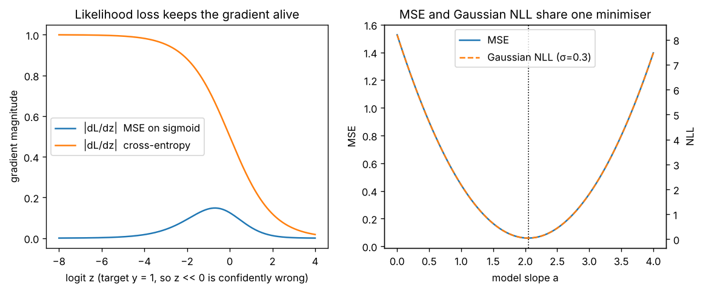

# Day 141 — Consolidation Day: The Loss-Is-a-Likelihood Thread (MSE → cross-entropy → VAE ELBO → diffusion ε-loss → RLHF KL)

*(No new concept number. Day 140 followed the dot-product thread; today's cross-phase thread is **"almost every loss you have met is a negative log-likelihood in disguise, and the disguise tells you what the model assumes about noise"**.)*

## 🧠 CONCEPT OF THE DAY — LOSSES ARE ASSUMPTIONS ABOUT NOISE

**Intuition.** Choosing a loss is choosing a story about how the data was corrupted. "The target is the prediction plus bell-curve noise" gives MSE. "The label was drawn from a categorical distribution" gives cross-entropy. "The latent is a noisy sample" gives the VAE's KL term. Once you see the story, you can predict where the loss will be fragile: MSE hates outliers because Gaussian tails are thin, and a sigmoid with MSE goes quiet when it is wrong because the story and the output nonlinearity do not match.

**The math.** Training by maximum likelihood means minimising the negative log-likelihood (NLL) of the data under the model, $-\log p_\theta(y\mid x)$.

Gaussian noise with fixed width gives MSE (Day 4):

$$-\log \mathcal N(y;\hat y,\sigma^2)=\frac{(y-\hat y)^2}{2\sigma^2}+\log\!\big(\sigma\sqrt{2\pi}\big)$$

Here $\hat y$ is the model output and $\sigma$ is the assumed noise std. With $\sigma$ fixed, this is an affine function of the squared error, so it has the same minimiser as MSE.

A categorical label gives cross-entropy (Day 5):

$$-\log p_\theta(y\mid x)=-\log\frac{e^{z_y}}{\sum_j e^{z_j}}$$

where $z$ are the logits. Its gradient with respect to the logits is simply $p-\text{onehot}(y)$. Pairing a sigmoid output with MSE instead multiplies that error by the sigmoid slope $p(1-p)$, which is near 0 exactly when the unit is confidently wrong.

The VAE (Day 79) maximises the evidence lower bound:

$$\log p(x)\ \ge\ \mathbb E_{q(z\mid x)}[\log p(x\mid z)]-\mathrm{KL}\big(q(z\mid x)\,\Vert\,p(z)\big)$$

where $q$ is the encoder, $p(x\mid z)$ the decoder and $p(z)$ the prior. The first term is a reconstruction NLL (MSE if the decoder is Gaussian); the second is a regulariser. Diffusion (Day 84) is the same bound unrolled over noise levels, and with Gaussian steps each term collapses to an MSE on the noise, which is why DDPM trains with $\lVert\epsilon-\epsilon_\theta(x_t,t)\rVert^2$. RLHF (Day 72) maximises reward minus $\beta\,\mathrm{KL}(\pi_\theta\Vert\pi_{\text{ref}})$, the same "fit the data, stay near a prior" shape.



`graph_DAY_141.py` (seed 42, nothing downloaded) prints the numbers. At logit $z=-6$ ($p=0.0025$, target 1) the MSE gradient magnitude is **0.0025** while cross-entropy's is **0.9975**. At $z=-2$ it is 0.0925 against 0.8808. On the right, the slope minimising MSE and the slope minimising Gaussian NLL are both **2.05**, and the two curves differ by an affine map to within $1.8\times10^{-15}$.

**Three key connections.**

1. **Loss ⇔ noise model (Phases 1, 8).** MSE = Gaussian, cross-entropy = categorical, L1 = Laplace (Day 25, hence robust to outliers). Label smoothing (Day 31) changes the assumed label noise; weight decay (Day 24) is a Gaussian prior on the weights (MAP estimation).
2. **Match the output nonlinearity to the loss (Phases 1, 2).** The cross-entropy gradient $p-y$ has no $p(1-p)$ factor, which is why sigmoid+BCE and softmax+CE train quickly where sigmoid+MSE stalls. This is the vanishing-gradient story (Day 20) seen from the loss side.
3. **Reconstruction + a pull toward a simple distribution (Phases 8, 11).** The VAE's KL to the prior, diffusion's fixed noising process and RLHF's KL to the reference policy all say "fit the data, but do not wander far from something simple". The weight on that KL ($\beta$) is the knob that trades fidelity for stability, and it is a common source of collapse (posterior collapse, reward hacking).

**Why it matters / where it leads.** It answers "why MSE for regression and cross-entropy for classification?" with a derivation rather than a convention, and "what does the KL term in a VAE or RLHF actually do?". For the research lane: the Gaussian-decoder assumption (MSE) is blind to phase and weights all pixels equally, which is part of why VAE outputs are blurry (high frequencies carry little energy and so little loss). That motivates the spectral losses you will see in forensics work.

**Interview question:** *You train a binary classifier with a sigmoid output and MSE loss, and training stalls early when many examples start confidently wrong. Why, and what do you change, given that the labels and architecture stay fixed?*

*(Answer at the very bottom.)*

## 🐍 PYTHONIC EDGE

**Trick: compute NLL from logits with a shifted log-softmax and `take_along_axis`, never `log(softmax(...))`.** The naive version overflows and returns `inf` for large logits; the shifted one is exact.

```python
import numpy as np                          # import X as Y alias; C++ would use #include + namespace alias

logits = np.array([[2.0, 1.0, 0.1],
                   [1000.0, 0.0, -1000.0]])   # shape (2, 3); nested lists, no braces or type
y = np.array([0, 2])                        # class index per row (second row is confidently wrong)

# BAD: exp() overflows to inf, then inf/inf is nan and log(0) is -inf
with np.errstate(all="ignore"):             # 'with' context manager: restores warning state on exit (C++ RAII)
    p = np.exp(logits) / np.exp(logits).sum(axis=-1, keepdims=True)   # axis=-1: negative index counts from the end
    bad = -np.log(p[np.arange(len(y)), y])  # fancy indexing: two index arrays pick (row, col) pairs
print(bad)                                  # [0.417 inf]

# CLEAN: subtract the row max first, then work in log space
z = logits - logits.max(axis=-1, keepdims=True)           # broadcasting: (2,3) - (2,1); no explicit loop
logp = z - np.log(np.exp(z).sum(axis=-1, keepdims=True))  # ** and exp are vectorised; log-sum-exp identity
good = -np.take_along_axis(logp, y[:, None], axis=-1).squeeze(-1)   # y[:, None] adds an axis (slice notation); squeeze drops it
print(good)                                 # [0.417 2000.]  finite and correct
assert np.isfinite(good).all()              # assert raises AssertionError if false
assert np.allclose(np.exp(logp).sum(-1), 1.0)   # each row of probabilities sums to 1
```

Run output: the bad version gives `[0.417 inf]`, the clean one `[0.417 2000.]`. If a loss goes `nan` or `inf` only on a few batches, suspect `log(softmax(x))` first; `torch.nn.functional.cross_entropy` and `log_softmax` already do the shift for you.

## 📡 SIGNAL LAB

**Problem.** A decoder trained with MSE is shown a 1-D "image row" $x[n]=\sin(2\pi\cdot 3n/64)+0.1\sin(2\pi\cdot 28n/64)$ for $n=0,\dots,63$: a strong low-frequency component and a weak high-frequency one. A blurry reconstruction $\hat x$ keeps the low tone exactly and drops the high tone entirely. (a) What MSE does it pay? (b) The high tone's amplitude is 10× smaller than the low one's. How does its share of the total MSE-relevant energy compare? (c) What does that say about training a generator with MSE alone?

**Solution.**

(a) The error is exactly the dropped tone, $e[n]=0.1\sin(2\pi\cdot28n/64)$. A sinusoid of amplitude $A$ has mean square $A^2/2$ over whole periods (the 64-sample window holds exactly 28 cycles), so

$$\mathrm{MSE}=\frac{0.1^2}{2}=0.005$$

(b) The signal's total mean square is $\tfrac12+\tfrac{0.01}{2}=0.505$. By Parseval, the energy in a frequency bin is its share of the mean square, so the high tone holds $0.005/0.505\approx1\%$ of the energy: an amplitude ratio of 10 becomes an energy ratio of 100.

(c) **So what.** A Gaussian-NLL/MSE loss weights errors by energy, so erasing a component with 1% of the energy costs 1% of the loss. Natural images have power spectra falling roughly as $1/f^2$, so high frequencies are always cheap to drop, and a model trained with MSE alone drifts toward blurry outputs. This is also why high-frequency artifacts of generators (Day 88) live where the training loss barely looks, and why forensics detectors working on spectra find signal exactly in that cheap region.

## 🏋️ THE GAUNTLET

**Problem: Minimum Size Subarray Sum.** Given an array `a` of $n$ **positive** integers and an integer `target`, return the minimal length of a contiguous subarray whose sum is $\ge$ `target`, or `0` if none exists.

**Constraints:** $1\le n\le 10^5$, $1\le a_i\le 10^4$, $1\le \text{target}\le 10^9$.

Example: `target = 7`, `a = [2,3,1,2,4,3]` → `2` (the subarray `[4,3]`).

**Hints**
1. Fix the right end $r$. What is the best left end for it, and what happens to that best left end as $r$ grows?
2. Why does "all elements positive" matter? Think about what happens to the sum when you extend or shrink the window.
3. Keep a running sum. Add `a[r]`, then while the sum is still $\ge$ target, record the length and drop `a[l]`. Each index enters and leaves at most once.

**Pattern:** sliding window / two pointers (monotone window with positive values). **Target:** $O(n)$ time, $O(1)$ extra space.

**Algo language:** C++. Solution at the bottom.

## 🏗️ BLUEPRINT

no blueprint today.

## 🗺️ MARCHING ORDERS

Before you pick a loss, finish the sentence "I am assuming the noise is ___". If you cannot, you have not chosen a loss yet.

Tomorrow: the roadmap is complete, so the next run is another consolidation day (no new concept number), picking a new cross-phase thread.

---

## 🔓 GAUNTLET SOLUTION

```cpp
#include <bits/stdc++.h>
using namespace std;

int minSubArrayLen(int target, const vector<int>& a) {
    int n = (int)a.size(), best = INT_MAX, l = 0;
    long long sum = 0;                       // sums reach 1e9 plus one element: use 64-bit to be safe
    for (int r = 0; r < n; r++) {
        sum += a[r];                         // grow the window on the right
        while (sum >= target) {              // shrink while still valid; positivity makes this monotone
            best = min(best, r - l + 1);
            sum -= a[l++];
        }
    }
    return best == INT_MAX ? 0 : best;
}
```

Compiled and run: `target=7, a=[2,3,1,2,4,3]` → `2`; checked against an $O(n^2)$ brute force on 20000 random small arrays, no mismatches. Each of `l` and `r` moves at most $n$ times, so $O(n)$ time and $O(1)$ space.

## 💡 CONCEPT ANSWER

**The sigmoid derivative kills the gradient.** With MSE, $\partial L/\partial z=(p-y)\,p(1-p)$. For a confidently wrong example, $p\to0$ with $y=1$, so $p(1-p)\to0$ and the update is nearly zero even though the error is largest. At $z=-6$ the gradient is 0.0025 (vs 0.9975 for cross-entropy), so those examples barely move and training stalls.

**Fix.** Switch to binary cross-entropy (the Bernoulli NLL), whose gradient with respect to the logit is $p-y$: the slope factor cancels, so the update is proportional to the error. In practice use the fused `BCEWithLogitsLoss` for numerical stability. The labels and architecture stay the same; only the loss now matches the output's probabilistic story.
