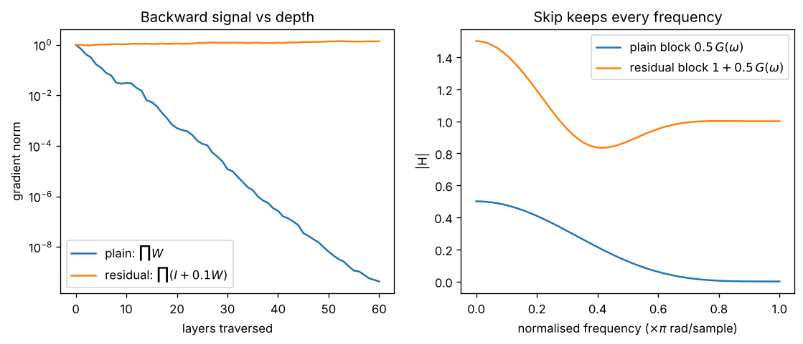

# Day 142 — Consolidation Day: The Identity-Path Thread (ResNet → LSTM → Transformer residual stream → U-Net)

*(No new concept number. Day 141 followed the loss-as-likelihood thread; today's cross-phase thread is **"every architecture that trains deep keeps a clean identity path alongside its computation"**.)*

## 🧠 CONCEPT OF THE DAY — THE HIGHWAY AND THE EXITS

**Intuition.** Picture a motorway with exits. The motorway carries the signal straight through; each block is an exit that can add something to the traffic, but never has to rebuild it. Depth stops being "compose 100 functions" and becomes "start with the input and keep editing it". Gradients ride the same motorway backwards.

**The math.** A plain layer computes $h_{l+1}=F_l(h_l)$, so the backward signal is a product of Jacobians:

$$\frac{\partial h_L}{\partial h_0}=\prod_{l=0}^{L-1}J_l,\qquad J_l=\frac{\partial F_l}{\partial h_l}$$

If the typical singular value of $J_l$ is below 1 the product vanishes exponentially in $L$ (Day 20); above 1 it explodes (Day 21). A residual layer (Day 41) computes $h_{l+1}=h_l+F_l(h_l)$, so:

$$\frac{\partial h_L}{\partial h_0}=\prod_{l=0}^{L-1}\big(I+J_l\big)$$

where $I$ is the identity. Expanding the product gives $I+\sum_l J_l+\dots$: there is always a term of size 1 that no depth can shrink. The same trick appears in four places:

- **LSTM cell state (Day 48):** $c_t=f_t\odot c_{t-1}+i_t\odot\tilde c_t$. When the forget gate $f_t\approx1$ this is an identity path through time.
- **Transformer residual stream (Day 60):** $x\leftarrow x+\mathrm{Attn}(\mathrm{LN}(x))$, then $x\leftarrow x+\mathrm{FFN}(\mathrm{LN}(x))$. Every block reads from and writes to one shared stream.
- **DenseNet (Day 42):** concatenation instead of addition, but the same "earlier features stay reachable" idea.
- **U-Net skips (Day 94):** high-resolution encoder features are routed straight to the decoder, so fine detail does not have to survive the bottleneck.



`graph_DAY_142.py` (seed 42, width 16, 60 layers, nothing downloaded) prints the numbers: the plain stack's gradient norm falls to **4.31e-10** after 60 layers, while the residual stack (branch scaled by 0.1) stays at **1.387**. On the right, the plain block's gain is 0.5 at DC and exactly 0 at Nyquist, whereas the residual block's gain is 1.5 at DC and **1.0 at Nyquist**.

**Three key connections.**

1. **Depth is trainable because of additive paths (Phases 2, 4, 5, 6).** Vanishing gradients (Day 20) were the wall; ResNet, the LSTM cell state and the transformer residual all get past it with the same algebra, $\partial(h+F(h))/\partial h=I+J$.
2. **The identity path is also an inductive bias (Phases 4, 6, 9).** A block initialised near $F\approx0$ starts as the identity, so a deeper network can never start out worse than a shallower one. This is also why pre-LN (normalise inside the branch, keep the stream clean) trains more stably than post-LN.
3. **Skips preserve information the bottleneck would destroy (Phases 8, 9).** U-Net, VAE-with-skips and diffusion denoisers all route fine detail around the narrow middle. For a generative-forensics researcher this matters: skip paths are exactly where high-frequency content survives to the output, so they are where upsampling artifacts and spectral fingerprints get decided.

**Why it matters / where it leads.** "Why do residual connections help?" is the most asked architecture question in ML screens, and "the gradient is $I+J$ instead of $J$" is the one-line answer that shows you understand it. Next, the consolidation thread can pivot to normalisation (BatchNorm, LayerNorm, RMSNorm) as the other half of the stability story.

**Interview question:** *In a residual network the gradient has the form $\prod(I+J_l)$. A teammate says "so gradients can never vanish or explode in a ResNet". What is wrong with that claim, and what in practice keeps a 1000-layer ResNet or transformer stable?*

*(Answer at the very bottom.)*

## 🐍 PYTHONIC EDGE

**Trick: wrap a block in a `Residual` class that adds the skip in `__call__`, so any block can become a residual one without rewriting its `forward`.** It also keeps the skip in exactly one place, which makes it the thing to check when a deep model will not train.

```python
import numpy as np                              # import X as Y alias; C++ would use #include and a namespace alias

class Block:                                    # C++: class Block { public: ... };
    def __init__(self, w):                      # constructor; self is C++'s this, but explicit
        self.w = w                              # instance attribute; C++ declares the member in the header
    def forward(self, x):                       # normally called via obj(x), never directly
        return np.tanh(self.w @ x)              # @ is matmul in Python; C++ needs a library call
    def __call__(self, x):                      # dunder: makes obj(x) work, like operator() in C++
        return self.forward(x)                  # torch's __call__ also runs hooks around forward()

class Residual(Block):                          # single inheritance; C++: class Residual : public Block
    def __init__(self, w):
        super().__init__(w)                     # parent ctor; C++ uses an initialiser list
    def __call__(self, x):
        return x + super().__call__(x)          # skip connection: identity plus the branch output

rng = np.random.default_rng(42)                 # seeded generator object, not a global srand()
x = rng.standard_normal(8)                      # shape (8,)
ws = [0.3 * rng.standard_normal((8, 8)) for _ in range(30)]   # list comprehension; _ is a throwaway name

for name, cls in (("plain", Block), ("residual", Residual)):  # tuple unpacking; classes are first-class values
    h = x
    for w in ws:                                # iterates the list directly, no index variable
        h = cls(w)(h)                           # cls(w) builds an object, then (h) calls it
    print(name, np.linalg.norm(h))              # print takes multiple args; no << chain
```

Run output: `plain 0.0046`, `residual 14.35` — the plain stack has shrunk the signal by about three orders of magnitude after 30 layers, while the residual one keeps it alive. Swapping `cls` is the whole experiment, because classes can be passed around like any other value.

## 📡 SIGNAL LAB

**Problem.** A block's branch is a linear filter $G(\omega)$ with $|G(0)|=1$ and $|G(\pi)|=0$ (a low-pass), and the block uses gain $0.5$: $F(\omega)=0.5\,G(\omega)$. (a) What are the block's gain at DC and at Nyquist without a skip, and with a skip $H=1+F$? (b) After 10 stacked blocks, what is the total gain at Nyquist in each case? (c) What does this say about stacking low-pass-like layers in a generator?

**Solution.**

(a) Without a skip, $|F(0)|=0.5$ and $|F(\pi)|=0$. With the skip, $H(\omega)=1+0.5\,G(\omega)$, so $H(0)=1.5$ and $H(\pi)=1+0=1$.

(b) A cascade multiplies frequency responses, so after 10 blocks:

$$|H_{\text{plain}}(\pi)|^{10}=0^{10}=0,\qquad |H_{\text{skip}}(\pi)|^{10}=1^{10}=1$$

At DC the plain cascade gives $0.5^{10}\approx10^{-3}$ and the skip cascade gives $1.5^{10}\approx57.7$.

(c) The skip guarantees a gain of 1 at every frequency the branch ignores, so high-frequency content is passed through untouched however many blocks you stack. The flip side is DC (and any band where the branch has gain $>0$) being amplified geometrically, which is one reason residual streams need normalisation.

**So what.** A stack of plain low-pass-ish layers is a blur machine: each layer multiplies the spectrum by a decaying envelope, so fine detail disappears exponentially with depth. Skips and U-Net shortcuts are how a generator keeps its high-frequency energy at all. If a detector can tell fake images apart by their spectrum, then *where* the generator's skip paths and upsamplers sit largely decides what that spectrum looks like. `graph_DAY_142.py` shows the exact gains above (DC 0.5 vs 1.5, Nyquist 0 vs 1.0).

## 🏋️ THE GAUNTLET

**Problem: Longest Subarray With Sum K.** Given an array $a$ of $n$ integers (positive, zero or negative) and an integer $k$, print the length of the longest contiguous subarray whose sum is exactly $k$, or $0$ if none exists.

*Input:* first line $n,k$; second line $a_1\dots a_n$.
*Constraints:* $1\le n\le 2\cdot10^5$, $|a_i|\le10^9$, $|k|\le10^{14}$. Use 64-bit sums.

*Example:* `5 3` / `1 -1 5 -2 3` → `4` (the subarray `1 -1 5 -2`).

**Pattern:** prefix sums + hash map (the "running total" trick, the same shape as a skip connection: carry the accumulated state forward, look backwards by difference). **Target:** $O(n)$ expected time, $O(n)$ memory.

**Hints.**

1. Define $P_i=a_1+\dots+a_i$. How can you write the sum of $a_{j+1}\dots a_i$ using only $P$ values?
2. For a fixed right end $i$, which earlier prefix value would make the sum exactly $k$? You are searching for a specific number, not a range.
3. Store the *first* index at which each prefix value appears. Why does keeping the first, not the last, give the longest subarray? And which index should the empty prefix get?

*Solution is at the very bottom, under 🔓 GAUNTLET SOLUTION.*

## 🏗️ BLUEPRINT

**Serving a deep model with skip-heavy blocks: activation memory is the tradeoff.** Skips (and U-Net shortcuts) force you to keep earlier activations alive until they are consumed, so peak memory scales with how many skip tensors are in flight, not just with depth. At training time that is why activation checkpointing (Day 97) targets the residual stream; at serving time it is why you fuse the add into the preceding kernel. Key tradeoff: recompute versus store.

## 🗺️ MARCHING ORDERS

Pick one deep model you use and find its skip connections in the code today; being able to point at the `x + f(x)` line is worth more than reciting the theory.

Tomorrow: Consolidation continues — a new cross-phase thread (normalisation: BatchNorm → LayerNorm → RMSNorm and why each sits where it does).

---

🔓 GAUNTLET SOLUTION

```cpp
#include <bits/stdc++.h>
using namespace std;

int main() {
    int n; long long k;
    cin >> n >> k;
    unordered_map<long long, int> first;   // prefix sum -> earliest index where it occurs
    first[0] = -1;                         // empty prefix sits before index 0
    long long s = 0;
    int best = 0;
    for (int i = 0; i < n; ++i) {
        long long a; cin >> a;
        s += a;                            // s = P_{i+1}
        auto it = first.find(s - k);       // need an earlier prefix equal to s - k
        if (it != first.end()) best = max(best, i - it->second);
        first.emplace(s, i);               // emplace does not overwrite, so the earliest index is kept
    }
    cout << best << "\n";
}
```

Time $O(n)$ expected, memory $O(n)$. Keeping the first occurrence maximises $i-j$; seeding `first[0] = -1` handles subarrays that start at index 0. With adversarial inputs against `unordered_map`, use a custom hash or a sorted `map` ($O(n\log n)$). Compiled and checked on the example above (prints `4`) and on `4 0 / 1 2 3 4` (prints `0`).

💡 CONCEPT ANSWER

The claim is wrong because $I+J_l$ can still have singular values above 1, and a product of 1000 such matrices can grow exponentially: the identity term guarantees the gradient is not *forced* to vanish, but nothing prevents explosion. In the expansion $\prod(I+J_l)=I+\sum_l J_l+\sum_{l<m}J_mJ_l+\dots$, the higher-order terms are exactly the ones that can blow up if the $J_l$ are not small. In practice what keeps very deep nets stable is: (1) small initialisation or scaling of each residual branch's output (zero-init the last layer or a learnable scale such as LayerScale/ReZero, or $1/\sqrt{L}$ scaling), (2) normalisation placed so the stream stays well-conditioned (pre-LN, which also keeps a clean identity path), (3) warmup and gradient clipping (Days 17 and 21), and (4) mixed-precision care since the residual stream's magnitude grows with depth.
