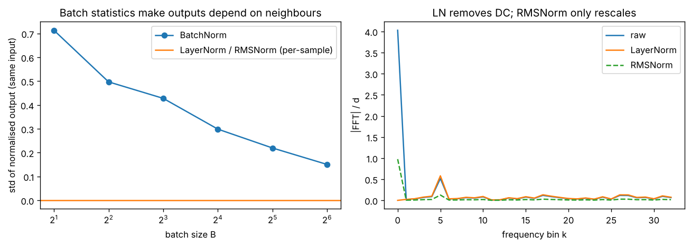

# Day 143 — Consolidation Day: The Normalisation Thread (BatchNorm → LayerNorm → RMSNorm)

*(No new concept number. Day 142 followed the identity-path thread; today's cross-phase thread is **"every deep model controls the scale of its activations, and where you compute the statistics decides what breaks"**.)*

## 🧠 CONCEPT OF THE DAY — WHO DO YOU AVERAGE OVER?

**Intuition.** Normalisation is a thermostat for activations. The only design question is *which readings the thermostat averages*: the same feature across the **batch** (BatchNorm), all features of **one sample** (LayerNorm), or just the **root-mean-square** of one sample with no re-centring (RMSNorm). That one choice decides whether samples can influence each other, whether train and inference behave the same, and how much it costs.

**The math.** For an activation vector $x\in\mathbb{R}^d$ (or a batch of them):

$$\mathrm{BN}(x_{b,j})=\gamma_j\,\frac{x_{b,j}-\mu_j}{\sqrt{\sigma_j^2+\epsilon}}+\beta_j,\qquad \mu_j=\frac1B\sum_b x_{b,j}$$

$$\mathrm{LN}(x_b)=\gamma\odot\frac{x_b-\mu_b}{\sqrt{\sigma_b^2+\epsilon}}+\beta,\qquad \mu_b=\frac1d\sum_j x_{b,j}$$

$$\mathrm{RMSNorm}(x_b)=\gamma\odot\frac{x_b}{\sqrt{\frac1d\sum_j x_{b,j}^2+\epsilon}}$$

where $B$ is batch size, $d$ the feature count, $\mu,\sigma^2$ the mean and variance, $\epsilon$ a small constant for numerical safety, and $\gamma,\beta$ learned scale and shift. BN averages over $b$ (the batch axis); LN and RMSNorm average over $j$ (the feature axis), so each sample is normalised on its own.



`graph_DAY_143.py` (seed 42, nothing downloaded) prints the numbers behind the plot. Left: the same input gets a BatchNorm output that wobbles with a std of **0.714 at B=2** and still **0.151 at B=64**, purely because of who else is in the batch; LayerNorm and RMSNorm have exactly zero such noise. Right: the DC bin of the feature vector is **4.03** raw, **6.9e-17** after LayerNorm, and **0.977** after RMSNorm.

**Three key connections.**

1. **BN's batch statistics are a train/inference mismatch and a coupling between samples (Phases 3, 4).** At train time BN uses noisy batch stats; at inference it uses running averages. Small batches (detection, segmentation, memory-bound generators) make the noise large, which is why those models moved to GroupNorm or LayerNorm. It also explains BN's mild regularising effect (Day 27).
2. **Sequence models need per-sample statistics (Phases 5, 6).** In an RNN or transformer, batch positions have different lengths and the batch axis is not "the same feature", so LayerNorm (Day 28) became the default. It also makes training and serving identical, which matters for KV-cache decoding with batch size 1.
3. **RMSNorm keeps the useful half (Phases 7, 10).** Re-centring (subtracting the mean) is a reduction plus a subtraction that buys little in practice; dropping it saves compute and memory traffic and is what LLaMA-style models use. Pre-norm placement (Day 142) keeps the residual stream clean, so norm placement and norm type together define stability.

**Why it matters / where it leads.** "BatchNorm vs LayerNorm" is a standard screen question, and the strong answer is about the *axis of the statistics*, not the formula. From here the consolidation thread can move to the optimisation story (Adam, weight decay, warmup) as the other half of making deep models train.

**Interview question:** *You trained a ConvNet with BatchNorm and it works at batch size 128, but at batch size 2 (a memory-limited fine-tune) accuracy collapses, and at inference on a single image the outputs differ from validation-time numbers. Explain both symptoms and give two fixes.*

*(Answer at the very bottom.)*

## 🐍 PYTHONIC EDGE

**Trick: reduce over the last axis with `axis=-1, keepdims=True`.** It makes the statistics broadcast against the original tensor with no reshaping, and it is the idiom that separates a LayerNorm (feature axis) from a BatchNorm (axis 0) in one argument.

Bad way, with manual reshapes that silently break when the shape changes:

```python
mu = x.mean(axis=1)                  # shape (B,), not (B, 1)
y = (x.T - mu).T                     # transpose twice to make broadcasting work; fragile and slow
```

Clean way, wrapped in classes so the norm type is swappable:

```python
import numpy as np                              # import X as Y alias; C++ would use #include and a namespace alias

class Norm:                                     # C++: class Norm { public: ... };
    def __init__(self, eps=1e-5):               # constructor; default argument like C++, self is explicit
        self.eps = eps                          # instance attribute; C++ declares the member in the header
    def forward(self, x):
        raise NotImplementedError               # C++: pure virtual; Python raises at call time
    def __call__(self, x):                      # dunder: makes obj(x) work, like operator() in C++
        return self.forward(x)                  # torch's __call__ wraps forward() with hooks

class LayerNorm(Norm):                          # single inheritance; C++: class LayerNorm : public Norm
    def forward(self, x):
        mu = x.mean(-1, keepdims=True)          # -1 indexes the last axis; keepdims keeps shape (B, 1) for broadcasting
        var = x.var(-1, keepdims=True)
        return (x - mu) / np.sqrt(var + self.eps)

class RMSNorm(Norm):
    def forward(self, x):
        ms = (x ** 2).mean(-1, keepdims=True)   # ** is exponentiation; C++ has no operator for it
        return x / np.sqrt(ms + self.eps)       # no mean subtraction: one fewer reduction

rng = np.random.default_rng(42)                 # seeded generator object, not a global srand()
x = 4.0 + rng.standard_normal((3, 8))           # shape (3, 8): 3 tokens, 8 features, offset by 4
for name, cls in (("LN", LayerNorm), ("RMS", RMSNorm)):   # tuple unpacking; a class is passed as a value
    y = cls()(x)                                # cls() builds the object, (x) calls it
    assert y.shape == x.shape, name             # assert: crash early on a shape bug
    print(name, y.mean(-1).round(3), (y ** 2).mean(-1).round(3))
```

Run output: `LN [-0. -0. 0.] [1. 1. 1.]` and `RMS [0.967 0.986 0.986] [1. 1. 1.]`. Both give unit mean-square per token, but only LayerNorm zeroes the mean. A quick `assert` on `y.mean(-1)` or `(y**2).mean(-1)` is the fastest way to catch a norm applied over the wrong axis.

## 📡 SIGNAL LAB

**Problem.** A token's feature vector is $v_n=c+A\sin(2\pi k_0 n/d)+\eta_n$ with $d=64$, DC offset $c=4$, tone amplitude $A=1$ at bin $k_0=5$, and small noise $\eta$. (a) What does LayerNorm do to bin 0 and bin $k_0$ of the DFT? (b) What does RMSNorm do? (c) Why does this matter for a spectrum-based image detector that reads features after a norm layer?

**Solution.**

(a) The DFT bin 0 equals $d$ times the mean, so subtracting the mean zeroes it exactly (the plot prints $6.9\times10^{-17}$, i.e. floating-point zero). Every other bin is only divided by $\sigma$. Here $\sigma\approx\sqrt{A^2/2+\sigma_\eta^2}\approx0.75$, so the tone's amplitude grows by $1/\sigma$ and the *relative* spectral shape is preserved:

$$X_{\mathrm{LN}}[k]=\frac{X[k]}{\sigma}\quad(k\neq0),\qquad X_{\mathrm{LN}}[0]=0$$

(b) RMSNorm divides every bin, DC included, by the same scalar $\sqrt{\mathrm{ms}}$, where $\mathrm{ms}=c^2+\sigma^2$ is dominated by the offset. The DC bin drops from 4.03 to 0.977, but it stays the largest bin, and the tone shrinks (in the plot it all but disappears next to the DC bin) because the divisor is now about 4.1.

(c) Normalisation is a linear filter in the *feature* axis followed by a per-sample gain. If a detector's signal lives in low-amplitude high-frequency structure, then RMSNorm lets a large DC component set the gain and squash that structure, while LayerNorm removes the DC first and then rescales so the structure is amplified. The "so what": norm choice changes which spectral components survive to the next layer, so when you probe features for generation artifacts, record *which* norm sits before the probe.

## 🏋️ THE GAUNTLET

**Problem: Subarrays Divisible by K.** Given an array $a$ of $n$ integers (possibly negative) and an integer $k\ge1$, print the number of non-empty contiguous subarrays whose sum is divisible by $k$.

*Input:* first line $n,k$; second line $a_1\dots a_n$.
*Constraints:* $1\le n\le 2\cdot10^5$, $1\le k\le 2\cdot10^5$, $|a_i|\le10^9$. Use 64-bit integers; the answer can reach about $2\cdot10^{10}$.

*Example:* `5 5` / `4 5 0 -2 -3` → `6`.

**Pattern:** prefix sums modulo $k$ + counting array ("two prefixes with the same remainder bound a divisible subarray"). **Target:** $O(n+k)$ time, $O(k)$ memory.

**Hints.**

1. Let $P_i$ be the prefix sum. When is $P_i-P_j$ divisible by $k$, in terms of $P_i \bmod k$ and $P_j \bmod k$?
2. So the question becomes: how many pairs $j<i$ share a remainder? Process left to right and keep a count per remainder.
3. Two traps: the empty prefix (which remainder does it start with?) and negative numbers (what does `%` return in C++ for a negative left side, and how do you fix it?).

*Solution is at the very bottom, under 🔓 GAUNTLET SOLUTION.*

## 🏗️ BLUEPRINT

no blueprint today.

## 🗺️ MARCHING ORDERS

Open one model you use and write down, for each norm layer, which axis it averages over and where it sits relative to the skip; that two-line audit explains most "it trains at batch 128 but not at 2" bugs.

Tomorrow: Consolidation continues — a new cross-phase thread (the optimisation story: SGD → Adam → AdamW → warmup/cosine schedules and why they pair with normalisation).

---

🔓 GAUNTLET SOLUTION

```cpp
#include <bits/stdc++.h>
using namespace std;

int main() {
    int n; long long k;
    cin >> n >> k;
    vector<long long> cnt(k, 0);           // cnt[r] = how many prefixes have remainder r
    cnt[0] = 1;                            // empty prefix
    long long s = 0, ans = 0;
    for (int i = 0; i < n; ++i) {
        long long a; cin >> a;
        s = ((s + a) % k + k) % k;         // keep remainder in [0, k) even for negatives
        ans += cnt[s]++;                   // pair with every earlier prefix of equal remainder
    }
    cout << ans << "\n";
}
```

Time $O(n+k)$, memory $O(k)$. Compiled and checked: the example above prints `6`, and `1 2` / `5` prints `0`.

💡 CONCEPT ANSWER

**Symptom 1 (collapse at batch size 2).** BatchNorm estimates the mean and variance from the batch. With $B=2$ these estimates are extremely noisy (the graph above shows an output std of about 0.7 for the same input), and each sample's normalised value depends heavily on its single neighbour. The network sees a different, noisy input distribution than it was designed for.

**Symptom 2 (single image at inference differs).** At inference BN does not use batch stats; it uses the *running averages* collected during training. If those were collected with tiny or unrepresentative batches, or the momentum is wrong, they do not match the true population statistics, so outputs shift. (Forgetting `model.eval()` is the other classic cause, since a batch of one then normalises the image against itself.)

**Fixes.** (1) Replace BN with a per-sample norm that does not depend on batch size: GroupNorm (the standard choice for small-batch vision) or LayerNorm. (2) Keep BN but freeze it: put BN layers in eval mode during fine-tuning and use the pretrained running statistics. Others that also work: SyncBN across GPUs to enlarge the effective batch, or gradient accumulation (which does not fix BN itself, since stats are still per micro-batch).
