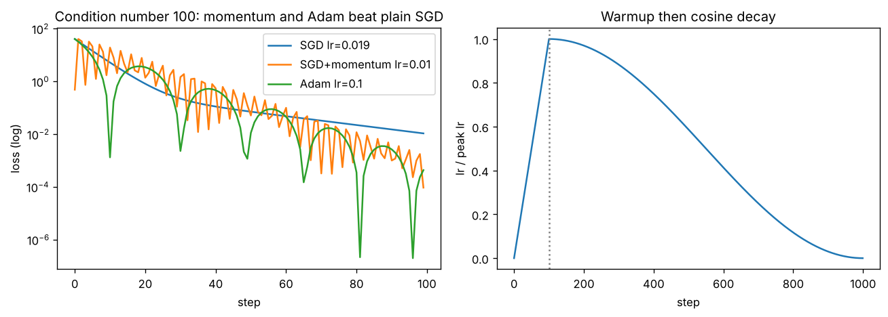

# Day 144 — Consolidation Day: The Optimisation Thread (SGD → Momentum → Adam → AdamW → Warmup/Cosine)

*(No new concept number. Day 143 closed the normalisation thread; today's cross-phase thread is **"every optimiser trick is a patch for one problem: the loss surface is steep in some directions and flat in others"**.)*

## 🧠 CONCEPT OF THE DAY — ONE LEARNING RATE CANNOT FIT EVERY DIRECTION

**Intuition.** Picture rolling a ball down a long narrow canyon. Plain SGD bounces between the steep walls while crawling along the flat floor. Momentum is the ball's inertia: wall-to-wall bounces cancel, floor-direction pushes add up. Adam goes further and gives every parameter its own step size, shrinking steps where gradients are big and noisy and growing them where they are small. AdamW then fixes how weight decay is applied, and warmup/cosine schedules fix *when* big steps are safe.

**The math.** With gradient $g_t$ and learning rate $\eta$:

$$\text{SGD+momentum:}\quad m_t=\beta m_{t-1}+g_t,\qquad w_t=w_{t-1}-\eta\,m_t$$

$$\text{Adam:}\quad m_t=\beta_1 m_{t-1}+(1-\beta_1)g_t,\quad v_t=\beta_2 v_{t-1}+(1-\beta_2)g_t^2,\quad w_t=w_{t-1}-\eta\,\frac{\hat m_t}{\sqrt{\hat v_t}+\epsilon}$$

$$\text{AdamW:}\quad w_t=w_{t-1}-\eta\left(\frac{\hat m_t}{\sqrt{\hat v_t}+\epsilon}+\lambda\,w_{t-1}\right)$$

Here $m_t$ is the running mean of gradients (direction), $v_t$ the running mean of squared gradients (scale), $\hat m_t=m_t/(1-\beta_1^t)$ and $\hat v_t=v_t/(1-\beta_2^t)$ undo the zero-initialisation bias, $\epsilon$ guards the division, and $\lambda$ is the weight-decay coefficient. In AdamW the decay term sits *outside* the adaptive division; in "Adam + L2" it is folded into $g_t$ and therefore gets divided by $\sqrt{\hat v_t}$, so parameters with large gradient history are barely decayed.

On a quadratic with curvatures $h_{\max}$ and $h_{\min}$, plain SGD needs $\eta<2/h_{\max}$ to stay stable, so progress along the flat axis scales like $h_{\min}/h_{\max}=1/\kappa$ per step, where $\kappa$ is the condition number.



`graph_DAY_144.py` (deterministic, nothing downloaded) prints the numbers behind the plot. After 100 steps at $\kappa=100$: SGD (largest stable $\eta=0.019$) is at loss **1.08e-02**, SGD+momentum at **9.46e-05**, and Adam at **4.36e-04**. Momentum wins this toy by two orders of magnitude over SGD; Adam is also far ahead but oscillates a little at $\eta=0.1$ because its step does not shrink as the gradient does. Right: the schedule starts at 0.00, reaches 1.00 at step 100, is 0.50 at step 550, and decays to about 0 at step 999.

**Three key connections.**

1. **Momentum and Adam both attack ill-conditioning (Phase 2, Days 13–16).** Momentum averages out the oscillating direction; Adam rescales per-parameter. Neither changes the surface, they change how you walk on it. This is why a well-conditioned net (good init, normalisation, Days 18–19, 27–28, 143) is less sensitive to which optimiser you pick.
2. **AdamW decouples regularisation from adaptivity (Phases 2–3, Days 16, 24).** L2 regularisation and weight decay are the same thing for SGD but *not* for Adam, because Adam rescales the gradient and the L2 term rides along. AdamW applies decay directly to the weights, which is why it is the default for transformers.
3. **Warmup exists because Adam's $\hat v_t$ is unreliable early (Phases 2, 6, 7, Day 17).** In the first steps $v_t$ is built from very few gradient samples, so steps can be huge and push post-LN transformers or LLMs into bad regions. Warmup lets the statistics settle before the peak $\eta$ is used, and cosine decay then anneals into a flat minimum. Pre-norm (Day 142) plus normalisation (Day 143) lowers how much warmup you need, but rarely removes it.

**Why it matters / where it leads.** "Why AdamW and not Adam + L2?" and "why warmup?" are two of the most common optimiser screens. Together with the identity-path (Day 142) and normalisation (Day 143) threads, you now have the three pillars of stable deep training: *signal path, scale control, step control*.

**Interview question:** *You fine-tune a transformer with Adam and an L2 penalty of 0.01 in the loss. The loss spikes in the first 200 steps and, after convergence, the large-gradient parameters have much larger weights than a colleague's run that used AdamW with weight_decay=0.01. Explain both observations and say what you would change.*

*(Answer at the very bottom.)*

## 🐍 PYTHONIC EDGE

**Trick: PyTorch parameter groups, so weight decay skips biases and norm gains.** Decaying a LayerNorm gain $\gamma$ or a bias pulls it toward zero for no benefit. Splitting parameters by `ndim` is the idiom that every serious training script uses.

Bad way, one decay value for everything:

```python
opt = torch.optim.AdamW(model.parameters(), lr=3e-4, weight_decay=0.1)   # decays biases and norm gains too
```

Clean way, two groups built with a comprehension:

```python
import torch                                       # C++: #include <torch/torch.h>
import torch.nn as nn                              # import X as Y alias; C++ would write namespace nn = torch::nn;

class TinyNet(nn.Module):                          # C++: class TinyNet : public torch::nn::Module
    def __init__(self):                            # constructor; self is C++'s this but explicit
        super().__init__()                         # parent constructor; C++ uses an initialiser list
        self.fc = nn.Linear(8, 8)                  # instance attribute; C++ declares it in the header first
        self.ln = nn.LayerNorm(8)
    def forward(self, x):                          # call model(x), not model.forward(x): __call__ runs hooks
        return self.ln(self.fc(x))

model = TinyNet()
decay    = [p for p in model.parameters() if p.ndim >= 2]   # list comprehension; no C++ equivalent (loop + push_back)
no_decay = [p for p in model.parameters() if p.ndim < 2]    # biases and LN gains are 1-D
groups = [dict(params=decay, weight_decay=0.1),             # dict(...) with keyword args; C++ would build a struct
          dict(params=no_decay, weight_decay=0.0)]
opt = torch.optim.AdamW(groups, lr=3e-4, betas=(0.9, 0.95))  # **kwargs-style call with keyword arguments
assert len(opt.param_groups) == 2                            # assert: runtime check, raises AssertionError
n_dec = sum(p.numel() for p in decay)                        # generator expression inside sum(); lazy, no list built
print(n_dec, sum(p.numel() for p in no_decay))               # prints 64 and 24 for this net (8x8 weight; 8+8+8 vectors)
```

(Counts: $8\cdot8=64$ decayed weights; $8+8+8=24$ undecayed for the bias, LN gain and LN bias.) A one-line `assert` on group sizes catches the classic bug where every parameter silently lands in one group.

## 📡 SIGNAL LAB

**Problem.** A noisy gradient sequence is $g_t = 1 + n_t$ with $n_t$ white noise of variance $\sigma^2$. (a) Show that the momentum buffer $m_t=\beta m_{t-1}+(1-\beta)g_t$ is a low-pass filter and give its $-3$ dB cutoff for $\beta=0.9$. (b) How much noise power does it remove? (c) Why does that matter for a frequency-domain generative-forensics model trained with a tiny batch?

**Solution.**

(a) This is a first-order IIR filter, $H(z)=\dfrac{1-\beta}{1-\beta z^{-1}}$, with magnitude

$$|H(\omega)|^2=\frac{(1-\beta)^2}{1-2\beta\cos\omega+\beta^2}.$$

DC gain is exactly 1 (the mean gradient passes unchanged). Setting $|H|^2=\tfrac12$ gives

$$\cos\omega_c = 1-\frac{(1-\beta)^2}{2\beta}\;\Rightarrow\; \omega_c=\arccos\!\left(1-\frac{0.01}{1.8}\right)\approx 0.105\ \text{rad/step},$$

i.e. about $0.017$ cycles per step: gradient components that flip faster than roughly every 60 steps are attenuated.

(b) For white noise, output variance is $\sigma^2\sum_k h_k^2=\sigma^2\,\dfrac{1-\beta}{1+\beta}$. At $\beta=0.9$ that is $\sigma^2/19$, so noise power drops by about 19×, while the true mean (DC) is unchanged.

(c) The "so what": momentum is an EMA low-pass filter on the gradient *time series*. A tiny-batch run with spectral features has very noisy gradients; a larger $\beta$ trades responsiveness (the effective averaging window is about $1/(1-\beta)$ steps) for noise suppression. It is also why momentum helps on the canyon: the oscillating wall-to-wall component is a *high-frequency* signal and gets filtered, while the consistent floor direction is DC and survives.

## 🏋️ THE GAUNTLET

**Problem: Split Array Largest Sum.** Given an array $a$ of $n$ non-negative integers and an integer $m$, split $a$ into $m$ non-empty contiguous groups so that the **largest group sum** is as small as possible. Print that minimum possible largest sum.

*Input:* first line $n,m$; second line $a_1\dots a_n$.
*Constraints:* $1\le m\le n\le 10^5$, $0\le a_i\le10^9$. Use 64-bit integers.

*Example:* `5 2` / `7 2 5 10 8` → `18` (split `[7 2 5] [10 8]`).

**Pattern:** binary search on the answer + greedy feasibility check ("can I do it with cap $X$?" is monotone in $X$). **Target:** $O(n\log(\sum a))$ time, $O(1)$ extra memory.

**Hints.**

1. If someone hands you a cap $X$, how would you greedily decide the *fewest* groups needed so no group exceeds $X$?
2. If cap $X$ works, does a larger cap also work? What does that monotonicity let you do over the range of possible answers, and what are sensible lower and upper bounds for it?
3. Careful with the bounds and the check: the lower bound must be at least the largest single element, and "at most $m$ groups" is enough because a group can always be split further (when $m\le n$), so you do not need exactly $m$.

*Solution is at the very bottom, under 🔓 GAUNTLET SOLUTION.*

## 🏗️ BLUEPRINT

no blueprint today.

## 🗺️ MARCHING ORDERS

Print your optimiser config today: lr, betas, $\epsilon$, weight decay, warmup steps, and which parameters are exempt from decay. If you cannot say why each number is what it is, that is your next experiment.

Tomorrow: Consolidation continues — a new cross-phase thread (the generative story: autoencoder → VAE → GAN → diffusion, and what each leaves behind in the frequency domain).

---

🔓 GAUNTLET SOLUTION

```cpp
#include <bits/stdc++.h>
using namespace std;

int main() {
    int n, m;
    cin >> n >> m;
    vector<long long> a(n);
    for (auto &x : a) cin >> x;
    long long lo = *max_element(a.begin(), a.end());   // cap can't be below the biggest element
    long long hi = accumulate(a.begin(), a.end(), 0LL); // one group holds everything
    while (lo < hi) {                                   // smallest feasible cap
        long long mid = lo + (hi - lo) / 2;
        int groups = 1; long long cur = 0;
        for (long long x : a) {
            if (cur + x > mid) { ++groups; cur = 0; }   // start a new group
            cur += x;
        }
        if (groups <= m) hi = mid; else lo = mid + 1;   // feasible -> try smaller cap
    }
    cout << lo << "\n";
}
```

Time $O(n\log\sum a)$, memory $O(1)$ beyond the input. Compiled and checked: the example prints `18`, `3 3` / `1 2 3` prints `3`, and `4 1` / `1 2 3 4` prints `10`.

💡 CONCEPT ANSWER

**Loss spike in the first 200 steps.** Adam's second-moment estimate $\hat v_t$ is built from very few gradients early on, so the per-parameter step $\hat m_t/\sqrt{\hat v_t}$ can be far larger than intended, and with no warmup the full learning rate is applied immediately. Fix: add a linear warmup (a few hundred steps) before cosine/linear decay, and optionally lower $\beta_2$ (for example 0.95) or clip gradients.

**Large-gradient parameters ending up with larger weights.** With Adam + L2 the penalty $\lambda w$ is added to the gradient and then divided by $\sqrt{\hat v_t}$. Parameters with a large gradient history have large $\sqrt{\hat v_t}$, so their regularisation is shrunk by the same factor and they are barely decayed, while rarely-updated parameters are decayed heavily. The decay is therefore uneven and no longer behaves as a uniform pull toward zero. AdamW applies $\eta\lambda w$ directly to the weights, outside the division, so every parameter shrinks at the same relative rate.

**What to change.** Switch to AdamW with weight_decay around 0.01–0.1, exempt biases and norm gains by using parameter groups, add warmup plus cosine decay, and keep gradient clipping on.
