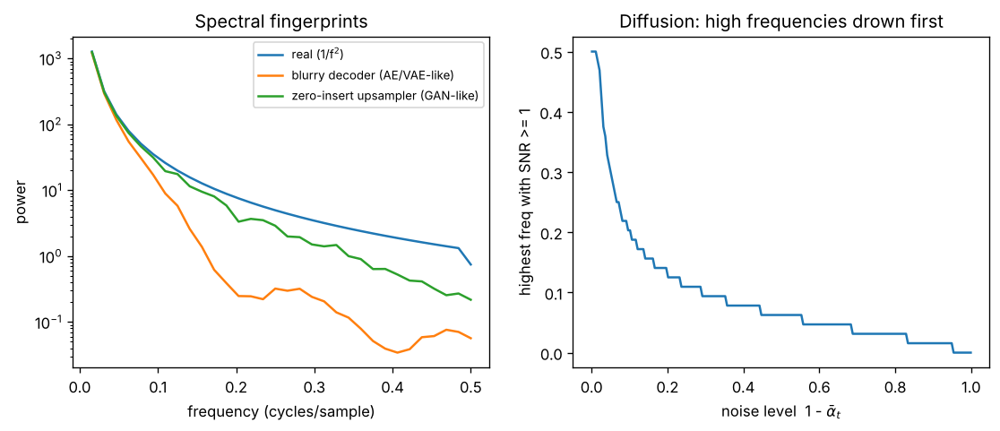

# Day 145 — Consolidation Day: The Generative Thread (Autoencoder → VAE → GAN → Diffusion) and What Each Leaves in the Spectrum

*(No new concept number. Day 144 closed the optimisation thread; today's cross-phase thread is **"every generative family fails in a different, characteristic part of the frequency domain"**. This is the thread your research lives on.)*

## 🧠 CONCEPT OF THE DAY — EACH GENERATOR HAS A SPECTRAL FINGERPRINT

**Intuition.** Natural images have most of their energy at low frequencies (power falls roughly like $1/f^2$). A generator has to reproduce that whole spectrum, and each family cheats in a different place:

- **Autoencoder / VAE:** the decoder is trained with MSE, which predicts the *average* of plausible outputs. Averaging is a low-pass filter, so fine detail goes missing.
- **GAN:** the generator builds images by upsampling (transposed conv, zero-insertion). Upsampling leaves periodic replicas of the low band in the high band. The discriminator fixes what it can see, not necessarily what it cannot.
- **Diffusion:** the forward process adds white noise, which has equal power at all frequencies. Real signal is weak at high frequency, so high frequencies are buried first and recovered last (coarse-to-fine generation).

**The math.** Let $S(k)$ be the power of the data at frequency bin $k$ and $\sigma^2$ the (flat) noise power.

MSE-optimal decoder: the best guess under uncertainty is the conditional mean,

$$\hat x(z)=\mathbb{E}[x\mid z]$$

so whatever detail in $x$ is not determined by $z$ averages out. The ELBO makes this worse for a VAE because the KL term deliberately limits what $z$ can carry:

$$\mathcal{L}=\mathbb{E}_{q(z|x)}\big[\|x-\hat x(z)\|^2\big]+\beta\,\mathrm{KL}\big(q(z|x)\,\|\,p(z)\big)$$

GAN minimax (Day 81): $\min_G\max_D\ \mathbb{E}[\log D(x)]+\mathbb{E}[\log(1-D(G(z)))]$. Upsampling by 2 with zero insertion followed by a kernel $h$ gives

$$Y(\omega)=H(\omega)\,X(2\omega)$$

so $X$'s low band appears again, mirrored, in the upper half of the spectrum; the kernel $H$ only partly removes it.

Diffusion forward step with $\bar\alpha_t=\prod_s(1-\beta_s)$:

$$x_t=\sqrt{\bar\alpha_t}\,x_0+\sqrt{1-\bar\alpha_t}\,\varepsilon,\qquad \varepsilon\sim\mathcal N(0,I)$$

and the per-frequency signal-to-noise ratio is

$$\mathrm{SNR}_k(t)=\frac{\bar\alpha_t\,S(k)}{(1-\bar\alpha_t)\,\sigma^2}$$

Since $S(k)$ decreases with $k$, $\mathrm{SNR}_k$ crosses 1 at a cutoff frequency that moves *down* as $t$ grows: the denoiser at large $t$ can only decide low-frequency structure, at small $t$ it fills in texture.



`graph_DAY_145.py` (64-sample synthetic 1-D signals, seed 42, nothing downloaded) prints the numbers behind the plot. Left: a 5-tap moving-average "decoder" has **54.8× less** power than the real signals at $f=0.4$ cycles/sample. The zero-insert-then-3-tap upsampler has **0.28×** the real power at $f=0.4$ (0.53 vs 1.88): the high band is no longer the real high band but a filtered mirror of the low band, so its *shape* is wrong. Right: SNR stays at least 1 up to $f=0.203$ at $\bar\alpha=0.9$, $f=0.062$ at 0.5, $f=0.016$ at 0.1, and nothing survives at 0.01.

**Three key connections.**

1. **Blur is a statistical consequence, not a bug (Phase 8, Days 78–80).** Any decoder trained with a pointwise squared error returns a conditional mean, hence a low-pass image. VAEs also bottleneck $z$ by design. Sharpness must come from somewhere else: an adversarial loss (GAN), a perceptual loss, or iterative refinement (diffusion).
2. **GAN artifacts come from the architecture, not the loss (Days 43, 81–82).** The upsampling operator adds structured, periodic energy at known frequencies, which is exactly why a spectral classifier can spot GAN output even when a human cannot. Wasserstein/gradient-penalty fixes stability, but does nothing about the spectral replica.
3. **Diffusion turns generation into a per-frequency schedule (Days 83–87).** Because the forward SNR decays high-frequency-first, the reverse process commits to layout at high noise and texture at low noise. Latent diffusion (Day 87) then adds a decoder, so a VAE's upsampling fingerprint is back in the final pixels. This is the bridge to Day 88 (spectral signatures of generated images).

**Why it matters / where it leads.** "Why are VAE samples blurry and GAN samples sharp but unstable?" is a standard generative-model screen, and "can you detect generated images?" is your research question. The roadmap itself ended at concept 112, so consolidation continues with the systems and efficiency thread next.

**Interview question:** *Your VAE decoder trained with MSE produces blurry faces, and a colleague proposes simply training longer. Explain from the loss why that will not work, and give two different ways to get sharper samples. Then say which of those you would expect to leave a periodic high-frequency artifact and why.*

*(Answer at the very bottom.)*

## 🐍 PYTHONIC EDGE

**Trick: boolean-mask band power with `rfftfreq`, vectorised over the batch.** Looping over bins in Python is slow and easy to get off by one; a frequency axis plus a mask expresses "energy between lo and hi" in three lines and works for any leading batch dimensions.

Bad way, nested Python loops:

```python
import numpy as np
def bp_loop(x, lo, hi):
    out = []
    for row in x:                                   # explicit loop over the batch
        P = np.abs(np.fft.rfft(row)) ** 2
        s = tot = 0.0
        for i, p in enumerate(P):                   # enumerate() yields (index, value) tuples
            tot += p
            if lo <= i / len(row) < hi:             # chained comparison; C++ needs lo <= v && v < hi
                s += p
        out.append(s / tot)
    return out
```

Clean way, one mask and `axis=-1`:

```python
import numpy as np                                  # C++: #include of a numeric lib; "as np" is an alias

def band_power(x, lo, hi):                          # def, no types; C++ would declare return and arg types
    P = np.abs(np.fft.rfft(x, axis=-1)) ** 2        # ** is exponentiation; C++ has pow(); axis=-1 is the last dim
    f = np.fft.rfftfreq(x.shape[-1])                # x.shape is a tuple; [-1] indexes from the end
    m = (f >= lo) & (f < hi)                        # & is elementwise on arrays (not 'and'); gives a bool array
    return P[..., m].sum(-1) / P.sum(-1)            # ... means "all leading dims"; m selects columns

rng = np.random.default_rng(0)                      # modern seeded generator object
x = rng.standard_normal((4, 64))                    # tuple argument for the shape
r = band_power(x, 0.25, 0.5)                        # shape (4,): one number per signal
assert r.shape == (4,)                              # assert: raises AssertionError if false
print(r.round(2))                                   # method call on the result array
```

For white noise the upper half of the band holds about half the energy (`[0.35 0.51 0.51 0.52]` with this seed), which makes a handy sanity check; for a real image the same call exposes the blur and the replica from the graph above. Ellipsis (`...`) and boolean-mask indexing have no C++ equivalent in the language itself.

## 📡 SIGNAL LAB

**Problem.** A GAN generator upsamples a feature signal by 2 using zero-insertion followed by the 3-tap kernel $h=[0.25,0.5,0.25]$. (a) At what frequency does the unwanted replica of the low band appear, for a component at $f_0=0.1$ cycles/sample of the *low-rate* signal? (b) How much does $h$ attenuate it? (c) Why is this useful for detection?

**Solution.**

(a) Zero-insertion by 2 compresses the spectrum: a component at $f_0$ (in cycles per *low-rate* sample) lands at $f_0/2=0.05$ cycles per high-rate sample, and its image (the replica) lands at $\tfrac12-\tfrac{f_0}{2}=0.45$. In general the image of frequency $f$ is at $\tfrac12-f$ (mirrored about the Nyquist midpoint).

(b) The kernel's magnitude response is $H(f)=\tfrac12+\tfrac12\cos(2\pi f)=\cos^2(\pi f)$. At $f=0.45$:

$$H(0.45)=\cos^2(0.45\pi)\approx 0.024$$

So the replica's amplitude is reduced about 40×, power about 1700×. A longer, better-designed kernel would do more, but a learned 3-tap kernel will not be perfect, and with *strided* convolutions the overlap pattern also modulates amplitude, giving the checkerboard.

(c) The "so what": GAN upsamplers leave energy at predictable bins, which appears as spikes in an azimuthally averaged 2-D power spectrum. A forensic classifier on log-spectra can therefore detect generators it never saw in training, as long as they share the same upsampling structure, and a generator that *wants* to evade it just needs a better reconstruction filter or to avoid zero-insertion (resize-then-conv).

## 🏋️ THE GAUNTLET

**Problem: Longest Window With At Most K Distinct Values.** Given an array $a$ of $n$ integers and an integer $k$, find the length of the longest **contiguous** subarray containing at most $k$ distinct values.

*Input:* first line $n,k$; second line $a_1\dots a_n$.
*Constraints:* $1\le k\le n\le 2\cdot10^5$, $1\le a_i\le10^9$.

*Example:* `7 2` / `1 2 1 2 3 3 3` → `4` (for instance `1 2 1 2`).

**Pattern:** two pointers / sliding window with a hash map of counts. **Target:** $O(n)$ expected time, $O(k)$ extra memory.

**Hints.**

1. For a fixed right end $r$, which left ends $l$ give a valid window? Is that set a prefix, a suffix, or something irregular?
2. When you extend $r$ by one and the window becomes invalid, can moving $l$ backwards ever help? What does that tell you about how $l$ moves overall?
3. You need to know the number of distinct values in the window in $O(1)$: keep a count per value and remove the entry when its count reaches 0, so `size()` is the distinct count.

*Solution is at the very bottom, under 🔓 GAUNTLET SOLUTION.*

## 🏗️ BLUEPRINT

no blueprint today.

## 🗺️ MARCHING ORDERS

Take one image from a generator you can run, compute its azimuthally averaged power spectrum next to a real image's, and mark where the curves diverge. That divergence is your fingerprint.

Tomorrow: Consolidation continues — a new cross-phase thread (efficiency: mixed precision, KV cache, quantization, batching and what each trades away).

---

🔓 GAUNTLET SOLUTION

```cpp
#include <bits/stdc++.h>
using namespace std;

int main() {
    int n, k;
    cin >> n >> k;
    vector<int> a(n);
    for (auto &x : a) cin >> x;
    unordered_map<int,int> cnt;                    // value -> count inside the window
    int best = 0, l = 0;
    for (int r = 0; r < n; ++r) {
        ++cnt[a[r]];                               // grow the window on the right
        while ((int)cnt.size() > k) {              // too many distinct values: shrink from the left
            if (--cnt[a[l]] == 0) cnt.erase(a[l]);
            ++l;
        }
        best = max(best, r - l + 1);
    }
    cout << best << "\n";
}
```

Time $O(n)$ (each index enters and leaves the window once), memory $O(k)$. Compiled and checked: the example prints `4`, `5 1` / `4 4 4 4 4` prints `5`, and `4 2` / `1 2 3 4` prints `2`.

💡 CONCEPT ANSWER

**Why training longer will not help.** With a squared-error loss the optimal decoder output is the conditional mean $\mathbb{E}[x\mid z]$. Fine texture that $z$ does not determine (and that the KL term discourages $z$ from carrying) is averaged away, which is a low-pass effect. Training longer only converges *to* that blurry mean. The loss is the limit, not the optimisation.

**Two ways to sharpen.** (1) Add an adversarial loss (VAE-GAN style) or a perceptual loss, so that the objective rewards realistic high-frequency statistics rather than the pixelwise mean. (2) Move to a model that samples rather than averages, for example a diffusion decoder or latent diffusion, or lower the KL weight $\beta$ so $z$ carries more detail.

**Which leaves a periodic artifact.** The adversarial route with a transposed-convolution or zero-insertion decoder: upsampling creates mirrored replicas of the low band (and checkerboard modulation from stride/kernel overlap), giving spectral peaks at predictable frequencies. Using resize-then-convolution in the decoder greatly reduces them.
