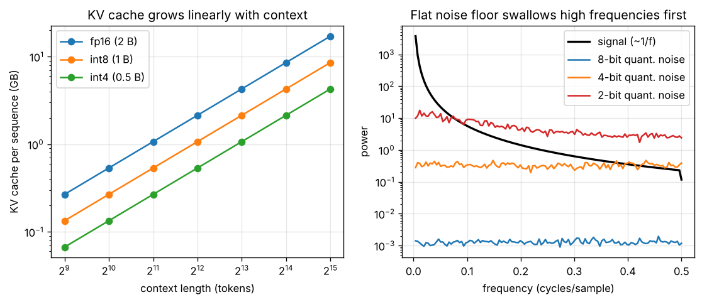

# Day 146 — Consolidation Day: The Efficiency Thread (Mixed Precision → Quantization → KV Cache → Batching) and What Each Trades Away

*(No new concept number. Day 145 closed the generative thread; today's cross-phase thread is **"every efficiency trick spends one resource to buy another"**: precision, memory, latency, or throughput.)*

## 🧠 CONCEPT OF THE DAY — NO FREE LUNCH IN THE SYSTEMS STACK

**Intuition.** Think of a restaurant kitchen. Fewer significant digits (low precision) is a smaller knife that cuts faster but less accurately. A KV cache is a prep table: you never re-chop what you chopped for the last order, but the table takes floor space. Batching is cooking for many tickets at once: the stove is busier, but each ticket waits longer. Each trick moves a bottleneck; none removes it.

**The math.** Four tradeoffs, one line each.

*Floating point.* A format with $m$ mantissa bits has relative rounding error about

$$\epsilon_{\text{mach}}\approx 2^{-m}$$

fp16 has $m=10$ (so $\epsilon\approx 10^{-3}$) and max value 65504; bf16 has $m=7$ but fp32's 8 exponent bits, so range is kept and precision is spent. fp16 needs loss scaling because small gradients underflow; bf16 usually does not.

*Uniform quantization.* A $b$-bit quantizer on range $[-R,R]$ has step $\Delta=2R/2^b$ and, for a signal that spreads over many levels, roughly uniform error with noise power

$$\sigma_q^2=\frac{\Delta^2}{12}$$

so every extra bit cuts noise power by 4× (about 6 dB).

*KV cache.* Per sequence, caching keys and values for $L$ layers, $H$ heads, head dimension $d$, length $T$, at $s$ bytes per element costs

$$\text{bytes}=2\,L\,H\,d\,T\,s$$

It converts per-token decode compute from $O(T^2)$ total recompute to $O(T)$ per step, and memory grows linearly in $T$.

*Batching.* With batch size $B$, decode is memory-bound (you stream the weights once per step), so step time is roughly flat in $B$ until compute saturates:

$$\text{throughput}\approx\frac{B}{t_{\text{step}}(B)},\qquad \text{latency per token}\approx t_{\text{step}}(B)$$

Throughput rises almost linearly with $B$ while $t_{\text{step}}$ is flat, then latency starts to rise too, and a larger $B$ also needs more KV memory.



`graph_DAY_146.py` (256-sample synthetic $1/f$ signals, seed 42, nothing downloaded) prints the numbers behind the plot. Left: at 32768 tokens one sequence's cache is **17.2 GB in fp16, 8.6 GB in int8, 4.3 GB in int4**, so memory, not compute, caps how many sequences fit. Right: the quantization noise floor is almost flat, while the signal falls like $1/f$. With 8 bits, signal exceeds noise at every frequency (SNR at $f=0.4$ is **25.2 dB**). With 4 bits, SNR at $f=0.4$ is **−0.4 dB** and the usable band ends near $f=0.42$. With 2 bits, the usable band ends at $f=0.094$ and SNR at $f=0.4$ is **−8.7 dB**.

**Three key connections.**

1. **Precision is a noise-floor decision (Days 96, 74).** Mixed precision keeps fp32 master weights and accumulators because sums of many small terms lose them in fp16, while matmuls tolerate low precision. Int8/int4 quantization (Day 74, QLoRA) is the same idea pushed harder: keep per-channel or per-group scales so the noise floor sits below the signal where it matters (outlier channels are the usual failure).
2. **KV cache and batching fight over the same bytes (Days 100–103).** Cache memory per sequence is fixed by the formula above, so max batch size is roughly (free memory) / (per-sequence cache). Quantizing the cache, grouped-query attention, and paged allocation (vLLM, Day 103) all raise the batch you can fit; continuous batching then keeps the GPU full as sequences finish at different times.
3. **Every trick has a quality bill (Days 97, 101, 111).** Gradient checkpointing trades ~30% more compute for activation memory; large batches trade latency; long context trades the $O(T)$ cache; low precision trades fidelity. Knowing *which resource* is the bottleneck (compute, memory bandwidth, memory capacity) tells you which trick to reach for.

**Why it matters / where it leads.** "The model fits but decoding is slow. What do you check?" is a very common systems-flavoured screen: the answer is arithmetic intensity, i.e. whether you are bandwidth-bound. The roadmap itself ended at concept 112, so consolidation continues; the next threads can revisit evaluation and failure modes.

**Interview question:** *You serve a 7B-parameter chat model on one GPU. Decoding is memory-bandwidth-bound and users complain about latency, but your GPU utilisation is low. Your colleague suggests quantizing weights to int4; another suggests raising the batch size. Explain what each changes, which one helps per-user latency versus total throughput, and what limits how far you can push the batch.*

*(Answer at the very bottom.)*

## 🐍 PYTHONIC EDGE

**Trick: ask the dtype what it can do (`np.finfo` / `torch.finfo`) instead of memorising limits.** Precision bugs (overflow to `inf`, an increment that silently does nothing) are found fastest by printing the format's `max`, `eps` and `tiny`, and by accumulating in a wider dtype explicitly.

Bad way, magic numbers and silent surprises:

```python
import numpy as np
x = np.float16(60000)
y = x * 2                                           # becomes inf with no error; easy to miss
if y > 65504:                                       # hard-coded limit copied from a blog post
    print("overflow?")                              # inf > 65504 is True, but NaN comparisons are False
```

Clean way, query the format and guard:

```python
import numpy as np                                  # "as np" is an import alias; C++ would use a namespace alias

def check_fp16(x):                                  # def with no types; C++ declares argument and return types
    info = np.finfo(np.float16)                     # passing a class (np.float16) as a value; C++ would need a template
    assert np.isfinite(x).all(), "inf/nan present" # assert raises AssertionError with an optional message
    assert abs(x).max() <= info.max, "overflow"     # chained attribute access; info.max is 65504
    return info.eps                                 # returns a plain float

eps = check_fp16(np.array([1.5, 3.0], dtype=np.float16))  # keyword argument dtype=...; no overload resolution needed
a = np.float16(2048) + np.float16(1)                # + between two numpy scalars of the same dtype
print(eps, a)                                       # prints 0.000977 2048.0: adding 1 to 2048 is lost in fp16
acc = np.full(4, 0.1, dtype=np.float16).sum(dtype=np.float32)  # dtype= keyword picks the accumulator width
print(round(float(acc), 3))                         # 0.4: float() converts a numpy scalar to a Python float
```

Spacing between fp16 numbers near 2048 is 2, so `2048 + 1` rounds back to 2048: that is why naive fp16 accumulation stalls and why mixed precision accumulates in fp32. The `dtype=` keyword on reductions is the idiomatic fix; there is no C++ equivalent short of choosing the accumulator type by hand.

## 📡 SIGNAL LAB

**Problem.** You quantize a feature signal with a uniform 4-bit quantizer on $[-1,1]$. (a) What is the noise power $\sigma_q^2$? (b) The signal is $x(n)=0.8\sin(2\pi\cdot 0.05\,n)$; what is its SNR in dB? (c) Same quantizer on a component at $f=0.4$ whose amplitude is $0.02$: what happens, and why does it matter for a frequency-domain researcher?

**Solution.**

(a) $\Delta=2/2^4=0.125$, so

$$\sigma_q^2=\frac{\Delta^2}{12}=\frac{0.015625}{12}\approx 1.30\times10^{-3}$$

(b) A sine of amplitude $A$ has power $A^2/2=0.32$, so $\mathrm{SNR}=0.32/1.30\times10^{-3}\approx 246$, i.e. about **23.9 dB** (the textbook rule is $6.02b+1.76\approx 25.8$ dB for a full-scale sine; ours is 0.8 of full scale, which costs $20\log_{10}(1/0.8)\approx 1.9$ dB).

(c) The component's power is $0.02^2/2=2\times10^{-4}$, which is **below** the noise power $1.3\times10^{-3}$ by about 8 dB, so its SNR is about **−8 dB**: it is buried. The noise is roughly white, so it is the same at every frequency.

**So what.** Quantization (and any low-precision arithmetic) adds a nearly flat noise floor. Natural signals fall off with frequency, so the high-frequency detail crosses below the floor first: the same mechanism as diffusion burying fine detail under noise (Day 145). For generative forensics, this means a model run at int4/fp16 changes the *tail* of the power spectrum, and a detector trained on fp32 outputs may see a shifted fingerprint. Always record the inference precision when you build a detection dataset.

## 🏋️ THE GAUNTLET

**Problem: Balanced Batches.** You have $n$ requests that must be served **in the given order**, request $i$ costing $a_i$ tokens. Split them into at most $k$ **contiguous** batches. A batch's cost is the sum of its requests, and the slowest batch decides latency. Minimise the largest batch cost.

*Input:* first line $n,k$; second line $a_1\dots a_n$.
*Constraints:* $1\le k\le n\le 10^5$, $1\le a_i\le 10^9$ (the sum can reach $10^{14}$).

*Example:* `5 2` / `7 2 5 10 8` → `18` (split `7 2 5 | 10 8`).

**Pattern:** binary search on the answer with a greedy feasibility check. **Target:** $O(n\log S)$ time where $S=\sum a_i$, $O(1)$ extra memory.

**Hints.**

1. Suppose someone gives you a cap $M$ on batch cost. Can you decide, in one pass, whether $k$ batches suffice? What is the greedy rule for where to cut?
2. If cap $M$ works, does $M+1$ work? What does that monotonic structure let you do, and what are the smallest and largest values the answer can possibly take?
3. Search over $M$ between $\max a_i$ and $\sum a_i$; count batches greedily (start a new batch only when adding the next request would exceed $M$); shrink the range toward the smallest feasible $M$. Use 64-bit integers.

*Solution is at the very bottom, under 🔓 GAUNTLET SOLUTION.*

## 🏗️ BLUEPRINT

**Key tradeoff: static batching versus continuous batching.** Static batching waits to fill a batch and then runs it until the longest sequence finishes, so short requests sit idle and latency is set by the slowest member. Continuous batching admits new requests and retires finished ones at every decode step, which raises GPU utilisation and cuts queueing delay, at the price of a scheduler and a KV-cache allocator that can handle ragged lengths (paging). Pick static only for offline, uniform-length jobs.

## 🗺️ MARCHING ORDERS

Pick any model you run, compute its KV cache per token from $2LHds$, and work out how many concurrent 4k-token chats fit in your GPU's free memory. That one number is your real batch limit.

Tomorrow: Consolidation continues — a new cross-phase thread (evaluation and failure modes: benchmarks, leakage, calibration, and why metrics lie).

---

🔓 GAUNTLET SOLUTION

```cpp
#include <bits/stdc++.h>
using namespace std;

int main() {
    int n, k;
    cin >> n >> k;
    vector<long long> a(n);
    for (auto &x : a) cin >> x;
    long long lo = *max_element(a.begin(), a.end());   // cap must fit the biggest single request
    long long hi = accumulate(a.begin(), a.end(), 0LL); // one batch holds everything
    while (lo < hi) {
        long long mid = lo + (hi - lo) / 2, cur = 0;
        int parts = 1;
        for (long long x : a) {
            if (cur + x > mid) { ++parts; cur = 0; }    // greedy: cut only when forced
            cur += x;
        }
        if (parts <= k) hi = mid;                       // feasible: try a smaller cap
        else lo = mid + 1;                              // infeasible: need a larger cap
    }
    cout << lo << "\n";
}
```

Time $O(n\log S)$, memory $O(n)$ for the input. Compiled and checked: the example prints `18`, `4 4` / `1 2 3 4` prints `4`, and `3 1` / `1 1 1` prints `3`.

💡 CONCEPT ANSWER

**What each change does.** Decoding one token streams all the weights from memory once, so with a small batch it is bandwidth-bound and the arithmetic units sit idle (hence the low utilisation). *Int4 weights* shrink the bytes streamed by about 4× versus fp16, so each step is faster: this helps **per-user latency** directly (and also throughput), at some quality cost. *A larger batch* reuses the same weight read for many sequences, so step time barely rises while tokens per step multiply: this helps **total throughput** and utilisation, but does not reduce, and may slightly raise, per-user latency.

**What limits the batch.** First, KV-cache memory: each sequence needs $2LHdTs$ bytes, so free memory divided by that is the ceiling (quantizing the cache, grouped-query attention or paging raise it). Second, once the batch is large enough that the step becomes compute-bound, step time grows with $B$ and latency degrades; there is also a latency SLO to respect. The best answer combines both: quantize for latency, batch continuously for throughput, and size the batch against the cache budget.
