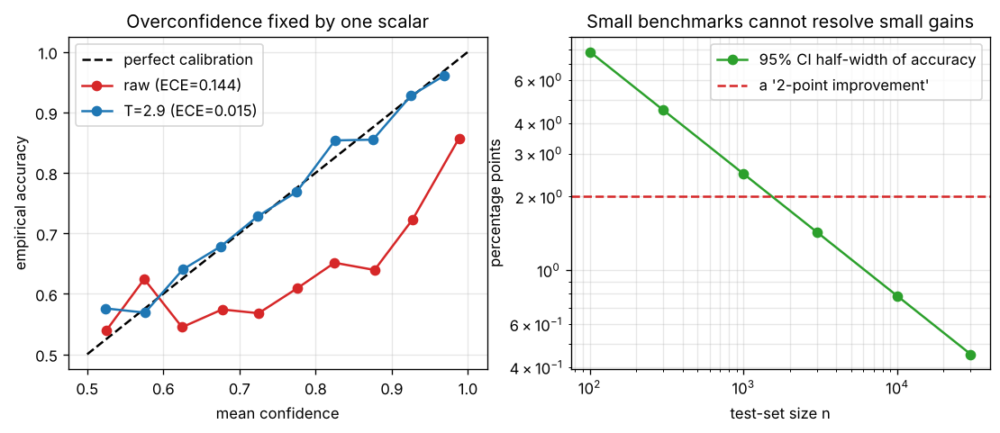

# Day 147 — Consolidation Day: The Evaluation Thread (Calibration → Benchmark Noise → Leakage) and Why Metrics Lie

*(No new concept number. Day 146 closed the efficiency thread; today's cross-phase thread is **"a metric is a measurement with error bars and a threat model"**.)*

## 🧠 CONCEPT OF THE DAY — A NUMBER IS NOT A TRUTH

**Intuition.** A benchmark score is a bathroom scale: it can be miscalibrated (reads 3 kg high), noisy (varies by 1 kg between steps), or measuring the wrong thing (you stood on it holding a suitcase). Models fail evaluation in exactly those three ways: **confidence is miscalibrated**, **the test set is too small to resolve the gain**, and **the test set leaks the answer**.

**The math.** One line per failure mode.

*Calibration.* Bin predictions by confidence; the expected calibration error is

$$\mathrm{ECE}=\sum_{m=1}^{M}\frac{|B_m|}{n}\,\bigl|\mathrm{acc}(B_m)-\mathrm{conf}(B_m)\bigr|$$

where $B_m$ is the set of examples in bin $m$, $\mathrm{acc}$ is the fraction correct in the bin and $\mathrm{conf}$ the mean predicted confidence. Modern nets are usually overconfident; **temperature scaling** fixes it with one scalar $T>0$ fit on a held-out set:

$$p_T(y\mid x)=\mathrm{softmax}\!\left(\frac{z}{T}\right)$$

with $z$ the logits. $T>1$ softens, and the argmax (so accuracy) never changes.

*Benchmark noise.* Accuracy $\hat p$ on $n$ i.i.d. test items has standard error $\sqrt{\hat p(1-\hat p)/n}$, so a 95% interval is

$$\hat p\pm 1.96\sqrt{\frac{\hat p(1-\hat p)}{n}}$$

*Leakage and Goodhart.* If test items (or near-duplicates, or a shortcut feature correlated with the label) appear in training, then $\text{test score}\neq\text{generalization}$. Goodhart's law: once a metric becomes the target, it stops measuring what you cared about.



`graph_DAY_147.py` (4000 synthetic examples, seed 42, nothing downloaded) prints the numbers behind the plot. Left: the raw model has accuracy **0.746** but mean confidence **0.884**, so **ECE = 0.144**; one fitted temperature **T = 2.9** drops ECE to **0.015** and mean confidence to **0.739**, with identical accuracy. Right: at 80% accuracy the 95% half-width is **7.8 points at n=100, 2.5 at n=1000, 0.78 at n=10000**. A "2-point improvement" on a 1000-item benchmark is inside the noise (and a paired comparison of two models needs a paired test, not two overlapping intervals).

**Three key connections.**

1. **Calibration is the softmax story finished (Days 5, 31, 72).** Cross-entropy trains probabilities, but overfitting (Days 22–23) drives logits up, so confidence outruns accuracy. Label smoothing (Day 31) pushes the other way; RLHF-tuned models (Day 72) are often *less* calibrated. Any system that thresholds on confidence (RAG abstention, agent tool-gating, Days 108–109) needs calibration, not just accuracy.
2. **Leakage is the generalization gap in disguise (Days 22, 29, 67–70).** Train/test overlap, benchmark contamination in web-scale pretraining, and prompt-format overfitting all make test error *look* like low variance. Data augmentation and early stopping (Days 29–30) only help if validation is honestly held out.
3. **Metrics are proxies with failure modes (Days 95, 112).** IoU/NMS thresholds change detection mAP; accuracy hides class imbalance; ROC-AUC hides the operating point. Always ask: *what shortcut would a lazy model take to score well here?*

**Why it matters / where it leads.** "Your model hits 94% offline and disappoints in prod; why?" is a standard senior screen: look for distribution shift, leakage, calibration and a metric that does not match the product goal. Tomorrow's thread can revisit failure modes of optimisation and training.

**Interview question:** *Your classifier scores 94% on the benchmark but behaves poorly in production, and its "95% confident" predictions are right only about 80% of the time. List the distinct reasons the offline number can mislead, say which fixes touch accuracy versus only confidence, and describe how you would check for leakage.*

*(Answer at the very bottom under 💡 CONCEPT ANSWER.)*

## 🐍 PYTHONIC EDGE

**Trick: never trust evaluation code that forgets `eval()`; make the safe path the only path with a context manager that restores state.** Dropout stays active in train mode, so metrics come out noisy and biased; and a bare `model.eval()` leaves the model stuck in eval mode for the next training step.

**Bad way:**

```python
net.train(False)                             # forget this and dropout stays on during evaluation
score = [net(x) for _ in range(3)]           # list comprehension (no C++ equivalent): builds a list inline
# net.train(True)                            # easy to forget: later training runs in eval mode
```

**Clean way** (runnable with numpy only; torch's `nn.Module` has the same `.train(mode)` / `.training` API):

```python
from contextlib import contextmanager        # import X from Y: C++ #include is textual, Python binds names
import numpy as np                           # import X as Y: alias, no C++ analogue besides namespace alias

class Net:                                   # C++: class Net { ... }; here no base class in parentheses
    def __init__(self, p_drop=0.5):          # constructor; self is C++'s this, but explicit; default arg value
        self.training = True                 # instance attr set in body (C++: declare in header, init in body)
        self.p_drop = p_drop
        self.rng = np.random.default_rng(42)
    def forward(self, x):                    # in torch you call net(x); never call forward() directly
        if self.training:                    # no parentheses/braces around the condition: indentation is the block
            x = x * (self.rng.random(x.shape) > self.p_drop)  # elementwise * and > on arrays, no loop
        return x.sum()
    def train(self, mode=True):              # same name/signature as torch.nn.Module.train
        self.training = mode
        return self                          # returning self allows chaining
    def __call__(self, x):                   # dunder: makes net(x) valid; torch's wraps forward() with hooks
        return self.forward(x)

@contextmanager                              # decorator: a function that takes a function and returns a new one
def evaluating(model):
    was_training = model.training            # remember state so we can restore it
    model.train(False)
    try:
        yield model                          # yield: pause here; the body of the `with` runs now
    finally:
        model.train(was_training)            # runs even if the body raises (C++ RAII destructor)

net, x = Net(), np.ones(1000)
noisy = [net(x) for _ in range(3)]           # _ is a throwaway name; range() is a lazy object, not a loop header
with evaluating(net) as m:                   # `with ... as`: scope-bound setup/teardown
    clean = [m(x) for _ in range(3)]
print(noisy, clean, net.training)            # noisy ~ [497, 495, 494]; clean = [1000.0]*3; training is True again
```

We ran it: the three noisy values are 497, 495 and 494 (dropout noise), the clean ones are all 1000, and `net.training` is `True` afterwards. In real PyTorch add `torch.inference_mode()` inside the `with` as well (it disables autograd, saving memory).

## 📡 SIGNAL LAB

**Problem.** You build a real-vs-generated image detector. Real images were stored as JPEG (8×8 block DCT, coarse quantization); generated images were saved as PNG. A 1-D model of one image row: take a random-walk signal $s[n]$ of length 512, split it into blocks of 8, DCT each block, quantize coefficients with step 20, invert. (a) Where do you expect spectral peaks in the *jump* signal $|r[n+1]-r[n]|$? (b) Why is that a leakage problem, not a feature?

**Solution.**

(a) Each block is reconstructed independently, so the reconstruction is smooth *inside* a block and has a discontinuity at every block boundary, i.e. once every 8 samples. A periodic impulse train with period 8 has harmonics at $f=k/8$ cycles/sample. We ran it (seed 42): the mean absolute jump is **1.78 at block boundaries versus 0.066 inside blocks**, while the original random walk has 0.76 versus 0.78 (no structure). The three strongest peaks of the jump spectrum sit at **$f\approx0.125,\,0.25,\,0.375$**, i.e. $k/8$.

(b) A detector can reach near-perfect accuracy by looking for that comb of peaks, which says "this file was JPEG-compressed", not "this image was generated". Test accuracy is then a *format* detector, and it collapses as soon as fakes are re-encoded as JPEG (as they are on social platforms).

**So what.** For frequency-domain forensics, always balance the compression history, resize history and format across real and fake classes (or augment with random re-compression), and evaluate on an out-of-distribution split where the shortcut is absent. A reliability diagram is cheap too: if the confident-and-wrong cases cluster by file format, you found the shortcut.

## 🏋️ THE GAUNTLET

**Problem: Ranking Quality.** A detector gave each of $n$ test images an integer score $s_i$, with label $y_i\in\{0,1\}$ (1 = positive). Count correctly ranked (positive, negative) pairs: a pair $(p,q)$ with $y_p=1,\ y_q=0$ scores **1** if $s_p>s_q$, **½** if $s_p=s_q$, and 0 otherwise. This is the numerator of ROC-AUC. To avoid fractions, print **twice** the total.

*Input:* `n`, then $n$ lines `s_i y_i`. *Output:* one integer.

*Constraints:* $1\le n\le 2\cdot10^5$, $|s_i|\le10^9$, the answer can reach about $2\cdot10^{10}$ (use 64-bit integers).

*Example:* `4` / `1 0` / `2 1` / `2 0` / `3 1` → `7` (pos score 2 beats the neg at 1 and ties the neg at 2: 2+1; pos score 3 beats both negs: 4).

**Pattern:** sort plus sweep with group-aware prefix counting (the same trick as the Mann–Whitney U statistic). **Target:** $O(n\log n)$ time.

**Hints.**

1. Brute force over all pairs is $O(n^2)$. If the items were sorted by score, what could you say about every negative that appears *before* a given positive?
2. Sweep from low to high score while keeping a running count of negatives seen so far. What does each positive then contribute?
3. Ties are the trap: process each run of equal scores as one group, so negatives *inside* the group are not yet in your running count when you score its positives. Per group, a positive contributes 2 per strictly-lower negative and 1 per tied negative.

*Solution is at the very bottom, under 🔓 GAUNTLET SOLUTION.*

## 🏗️ BLUEPRINT

**Key tradeoff: offline benchmark gate versus online shadow evaluation.** A fixed offline test set is cheap, reproducible and comparable across runs, but it is stale and can be gamed or contaminated. Shadow/online evaluation (run the candidate on live traffic without serving it, then A/B) measures the real distribution, but is slow, noisy and needs large $n$ (see the CI plot). Gate releases on both: offline for regressions, online for the decision.

## 🗺️ MARCHING ORDERS

Take the last model you trained and draw its reliability diagram. If the curve sits below the diagonal, you have a one-parameter fix waiting for you.

Tomorrow: Consolidation continues — a new cross-phase thread (optimisation and training failure modes: vanishing/exploding gradients, bad init, bad LR, and how to read them from loss curves).

---

🔓 GAUNTLET SOLUTION

```cpp
#include <bits/stdc++.h>
using namespace std;

int main() {
    int n;
    scanf("%d", &n);
    vector<pair<long long, int>> v(n);                    // (score, label)
    for (auto &p : v) scanf("%lld %d", &p.first, &p.second);
    sort(v.begin(), v.end());                             // group equal scores together
    long long negBelow = 0, ans = 0;                      // ans = 2 * (wins + 0.5 * ties)
    for (int i = 0; i < n;) {
        int j = i;
        long long pos = 0, neg = 0;
        while (j < n && v[j].first == v[i].first) {       // one tie group
            (v[j].second ? pos : neg)++;
            ++j;
        }
        ans += 2 * pos * negBelow + pos * neg;            // strictly-lower negatives count 2, tied count 1
        negBelow += neg;
        i = j;
    }
    printf("%lld\n", ans);
}
```

Time $O(n\log n)$, memory $O(n)$. Compiled and checked: the example prints `7`, and `3` / `5 1` / `5 0` / `5 1` prints `2`. Dividing the output by $2\,P\,N$ (with $P,N$ the numbers of positives and negatives) gives ROC-AUC.

💡 CONCEPT ANSWER

**Why an offline number can mislead.** (1) *Leakage or contamination:* test items, near-duplicates or a shortcut feature (file format, watermark, background) shared with training. (2) *Distribution shift:* production inputs differ from the test set (new sources, compression, seasonality). (3) *Noise:* a small test set has wide error bars, so the "94%" may be 91–97%; selecting the best of many runs on the same test set adds optimistic bias. (4) *Metric mismatch:* accuracy hides class imbalance and ignores the cost of different errors; the product may care about precision at a fixed recall or a worst-group score. (5) *Miscalibration:* confidence does not match correctness, which breaks any threshold or abstention logic.

**Fixes.** Temperature scaling (or isotonic/Platt scaling) fixes **only confidence**: it divides the logits by a scalar fit on held-out data, so the argmax and accuracy are unchanged, and ECE drops (our demo: 0.144 to 0.015). Cleaning the split, deduplicating, adding out-of-distribution or per-slice evaluation, and training with better data or augmentation change **accuracy**.

**Checking for leakage.** Hash or embed-and-nearest-neighbour search between train and test (exact and near-duplicate overlap); split by group (user, source, patient, time) rather than at random; train a "which split is this from?" classifier, since high accuracy means the splits differ systematically; ablate suspected shortcut features (e.g. re-encode every image in the same format) and see whether the score collapses; and keep a final untouched holdout that is evaluated once.
