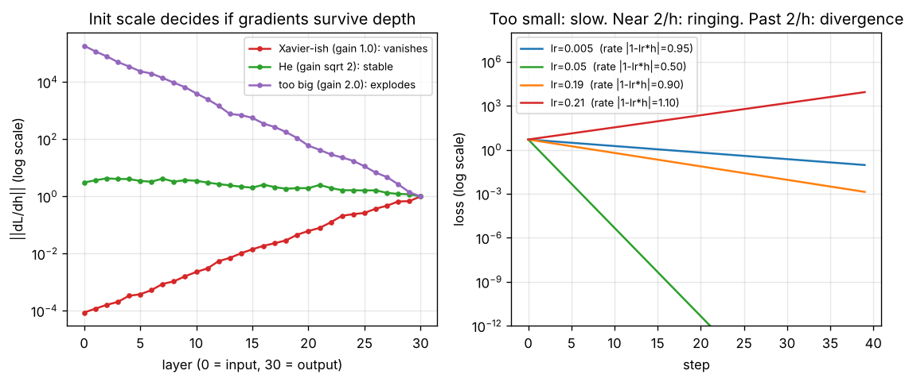

# Day 148 — Consolidation Day: The Optimisation-Failure Thread (Init → Gradient Flow → Learning Rate → Loss Curves)

*(No new concept number. Day 147 closed the evaluation thread; today's cross-phase thread is **"training is a dynamical system: it is stable only inside a window of scales"**.)*

## 🧠 CONCEPT OF THE DAY — TRAINING HAS A STABILITY WINDOW

**Intuition.** Training a deep net is steering a long chain of amplifiers. If each stage multiplies the signal by slightly less than 1, the gradient dies before it reaches the early layers; slightly more than 1, it blows up. The learning rate is the gain of the *outer* loop in the same way: too small and nothing happens, past a threshold the iteration oscillates and diverges. Initialization, normalization, residual connections, clipping and LR schedules are all tools for keeping those gains near 1.

**The math.** Two facts cover most of it.

*Gradient flow through depth.* For $L$ layers with Jacobians $J_\ell=\partial h_\ell/\partial h_{\ell-1}$, backprop multiplies them:

$$\frac{\partial \mathcal L}{\partial h_0}=\left(\prod_{\ell=L}^{1}J_\ell\right)^{\!\top}\frac{\partial \mathcal L}{\partial h_L}$$

so the gradient norm scales roughly like $\rho^{L}$, where $\rho$ is the typical per-layer gain. With ReLU and weights of variance $\sigma^2/n_{\text{in}}$, the per-layer variance gain is $\sigma^2/2$, which is why **He init** uses $\sigma^2=2$ and why anything else compounds exponentially in depth.

*Learning-rate stability.* On a quadratic with curvature $h$ (the Hessian's largest eigenvalue in general), gradient descent is

$$w_{t+1}=(1-\eta h)\,w_t$$

with $\eta$ the learning rate. It converges iff $|1-\eta h|<1$, i.e.

$$\eta<\frac{2}{h}$$

The fastest rate is at $\eta=1/h$; between $1/h$ and $2/h$ the iterate overshoots and rings; beyond $2/h$ it diverges.



`graph_DAY_148.py` (numpy only, seed 42, nothing downloaded) prints the numbers. Left, a 30-layer width-64 ReLU net: the gradient norm reaching the input layer is **8.7e-05** with gain 1 (Xavier-like, too small for ReLU), **3.1** with He ($\sqrt2$), and **1.9e+05** with gain 2. Right, curvature $h=10$ so the limit is $\eta=0.2$: after 40 steps the loss is **9e-02** at $\eta=0.005$ (crawling), **1.7e-23** at $0.05$ (healthy), **1.4e-03** at $0.19$ (ringing, barely stable), and **8.5e+03** at $0.21$ (diverged).

**Three key connections.**

1. **Init, vanishing and exploding gradients are one phenomenon (Days 18–21).** Zeros fail by symmetry; Xavier balances forward and backward variance for tanh/sigmoid (Days 2, 18); He fixes the factor of 2 lost to ReLU (Days 3, 19); clipping (Day 21) is the emergency brake when the gain exceeds 1 anyway. Residual connections (Days 41, 60) rewrite $J_\ell$ as $I+\text{small}$, so the product stays near 1 and 100+ layers train.
2. **The LR window is why schedules, warmup and adaptive methods exist (Days 11, 13–17).** Momentum and Adam change the effective step per direction; warmup keeps early, high-curvature steps below $2/h$ while Adam's second-moment estimate is still noisy; cosine decay shrinks $\eta$ as the loss landscape sharpens. A spiky loss curve usually means "briefly past $2/h$", not "bad data".
3. **Loss curves are the diagnostic panel (Days 22–23, 27–28, 96).** Flat from step 0: dead init or LR too small. `NaN` within a few steps: $\eta>2/h$ or exploding gradients (also fp16 overflow, Day 96). Smooth train loss with rising val loss: variance, not optimisation (Days 22, 24–30). Normalization (Days 27–28) widens the window by keeping $J_\ell$ well scaled.

**Why it matters / where it leads.** "Your 40-layer net's loss does not move; what do you check, in order?" is a classic screen: print per-layer gradient norms, check init scale and activation statistics, try an overfit-one-batch test, then add normalization or residuals. Tomorrow's thread looks at the regularization family as one idea: constraining the function class.

**Interview question:** *You are training a deep ReLU network and the loss is flat at its initial value. Gradient norms at the first layer are around 1e-8 and at the last layer around 1e-1. Explain quantitatively why this happens, and list the fixes in the order you would try them, saying what each changes in the per-layer gain.*

*(Answer at the very bottom under 💡 CONCEPT ANSWER.)*

## 🐍 PYTHONIC EDGE

**Trick: a gradient-health report built from a dict comprehension and a `key=` function, instead of index-juggling loops.** In PyTorch the dict would be `{n: p.grad.norm() for n, p in model.named_parameters() if p.grad is not None}`; the pattern is identical.

**Bad way:**

```python
names = ["layer0", "layer1", "layer2"]       # parallel lists: C++ would use two std::vector or a struct
norms = []                                   # empty list literal, no type declaration
for i in range(len(names)):                  # range() is a lazy object; C++-style index loop is un-Pythonic
    norms.append(np.linalg.norm(grads[names[i]]))   # easy to desync names and norms
```

**Clean way** (runnable with numpy only):

```python
import numpy as np                           # import X as Y: alias (C++ namespace alias is the closest)

def grad_report(grads, floor=1e-6, ceil=1e3):          # default args; no overloads in Python
    norms = {name: float(np.linalg.norm(g)) for name, g in grads.items()}   # dict comprehension: no C++ equivalent
    bad = [n for n, v in norms.items() if not floor < v < ceil]             # chained comparison: floor < v < ceil
    return norms, bad                                  # tuple return; caller unpacks: norms, bad = fn()

rng = np.random.default_rng(42)                        # explicit generator object instead of global seed state
grads = {f"layer{i}": rng.standard_normal(8) * s       # f"..." f-string builds the key; dict built by comprehension
         for i, s in enumerate([1.0, 1e-9, 1e5])}      # enumerate yields (index, value) tuples, unpacked in the for
norms, bad = grad_report(grads)                        # tuple unpacking (C++17 structured binding)
worst = max(norms, key=lambda k: abs(np.log10(norms[k])))   # key= takes a first-class callable; lambda = inline function
print(bad, worst)                                      # ['layer1', 'layer2'] layer1
assert "layer0" not in bad                             # `in` is a membership test; assert needs no macro
```

We ran it: `bad` is `['layer1', 'layer2']` and `worst` is `layer1`, since $|\log_{10}(10^{-9})|=9>5$. Real PyTorch note: a model class would subclass `nn.Module` (`class Net(nn.Module):`, C++ `class Net : public Module`), call `super().__init__()` first, and you invoke it as `net(x)` so `__call__` runs hooks around `forward()`.

## 📡 SIGNAL LAB

**Problem.** Stack $L=20$ linear convolution layers, each with the smoothing kernel $k=[0.25,\,0.5,\,0.25]$ (no nonlinearity, to isolate the effect). (a) What is the per-layer gain at frequency $f$ cycles/sample? (b) What fraction of the gradient amplitude survives at $f=0.05,\ 0.1,\ 0.25,\ 0.5$ after 20 layers? (c) What does that say about which frequencies a deep smoothing network can learn from gradients?

**Solution.**

(a) The frequency response of $k$ is $H(f)=0.5+0.5\cos(2\pi f)$, real and non-negative, equal to 1 at DC and 0 at Nyquist. Backprop through a convolution is correlation with the same (here symmetric) kernel, so the gradient is multiplied by $H(f)$ per layer in the Fourier domain.

(b) After $L$ layers the amplitude factor is $H(f)^{20}$. We ran it (numpy, 256-point grid): $f=0$ gives **1.0**; $f=0.05$ gives $0.975^{20}=\mathbf{0.60}$; $f=0.1$ gives $0.902^{20}=\mathbf{0.126}$; $f=0.25$ gives $0.5^{20}=\mathbf{9.5\times10^{-7}}$; $f=0.5$ gives **0** exactly.

(c) The gradient signal reaching early layers is a *low-pass filtered* version of the output error: high-frequency components vanish exponentially in depth, exactly like the ReLU gain-below-1 case but frequency by frequency. A kernel with $H(f)>1$ in some band would explode there instead. Vanishing gradients are a spectral statement.

**So what.** This is one mechanism behind the **spectral bias** of networks (low frequencies are learned first) and a reason generators struggle to reproduce high-frequency detail: the gradient telling them about it arrives attenuated. For generated-image forensics, missing or mis-scaled high-frequency energy in fakes is partly a training-dynamics artifact, and skip paths (U-Net, Day 94) restore a gain-1 route for those bands.

## 🏋️ THE GAUNTLET

**Problem: Stable Gradient Window.** You log the gradient norm $g_i>0$ at each of $n$ training steps. A contiguous segment is *stable* if its largest value is at most $K$ times its smallest value. Find the length of the longest stable segment.

*Input:* `n K`, then $n$ integers $g_1\dots g_n$. *Output:* one integer.

*Constraints:* $1\le n\le 2\cdot10^5$, $1\le g_i\le10^9$, $1\le K\le10^9$. (Think about overflow when comparing against $K\cdot g$.)

*Example:* `6 2` / `1 2 4 3 6 5` → `4` (the segment `4 3 6 5` has max 6 ≤ 2·3).

**Pattern:** two pointers (sliding window) with monotonic deques for window max and min. **Target:** $O(n)$ time, $O(n)$ memory.

**Hints.**

1. If a segment is stable, is every sub-segment of it stable? What does that tell you about moving the left end as the right end advances?
2. You need the max and min of the *current* window quickly after every push and every shrink. A heap with lazy deletion works in $O(n\log n)$; can you do better by discarding elements that can never be the max (or min) again?
3. Keep two deques of indices: one with decreasing values (front = max), one with increasing values (front = min). When the left pointer passes a deque's front index, pop it. Compare with `K * min` in 64-bit.

*Solution is at the very bottom, under 🔓 GAUNTLET SOLUTION.*

## 🏗️ BLUEPRINT

no blueprint today.

## 🗺️ MARCHING ORDERS

Next time a run looks wrong, print per-layer gradient norms for one step before touching any hyperparameter: ten seconds of data beats an hour of guessing.

Tomorrow: Consolidation continues — a new cross-phase thread (regularization as constraining the function class: weight decay, L1, dropout, normalization, augmentation, early stopping, label smoothing).

---

🔓 GAUNTLET SOLUTION

```cpp
#include <bits/stdc++.h>
using namespace std;

int main() {
    int n;
    long long K;
    scanf("%d %lld", &n, &K);
    vector<long long> g(n);
    for (auto &x : g) scanf("%lld", &x);
    deque<int> mx, mn;                                    // indices; values decreasing / increasing
    int l = 0, best = 0;
    for (int r = 0; r < n; r++) {
        while (!mx.empty() && g[mx.back()] <= g[r]) mx.pop_back();
        mx.push_back(r);
        while (!mn.empty() && g[mn.back()] >= g[r]) mn.pop_back();
        mn.push_back(r);
        while (g[mx.front()] > K * g[mn.front()]) {       // window invalid: shrink from the left
            l++;
            if (mx.front() < l) mx.pop_front();
            if (mn.front() < l) mn.pop_front();
        }
        best = max(best, r - l + 1);
    }
    printf("%d\n", best);
}
```

Each index enters and leaves each deque once, so the whole sweep is $O(n)$. Validity is monotone (a sub-segment of a stable segment is stable), which is what makes the two-pointer shrink correct. `K * g` is at most $10^{18}$, which fits in `long long`. We compiled it and checked it against a brute force on 300 random small cases, plus the example (prints `4`).

💡 CONCEPT ANSWER

**Why.** Backprop multiplies one Jacobian per layer, so the gradient norm scales like $\rho^{L}$ with $\rho$ the typical per-layer gain. Going from $10^{-1}$ at the top to $10^{-8}$ at the bottom means $\rho^{L}\approx10^{-7}$; for $L=40$ that is $\rho\approx10^{-7/40}\approx0.67$ per layer. For a ReLU net with weight variance $\sigma^2/n_{\text{in}}$ the variance gain per layer is $\sigma^2/2$ (half the units are zeroed), so an init with $\sigma^2=1$ (Xavier-style) gives a variance gain of 0.5, i.e. amplitude about 0.71 per layer. That matches. Early layers get essentially zero update, so the loss stays flat.

**Fixes, in the order I would try them.**

1. *Check and fix the init:* use He ($\sigma^2=2$), which restores the per-layer variance gain to 1. Verify by printing activation and gradient statistics per layer at step 0.
2. *Add normalization (BatchNorm/LayerNorm):* re-centres and re-scales activations each layer, so the gain no longer depends on the weight scale.
3. *Add residual connections:* $h_{\ell}=h_{\ell-1}+F(h_{\ell-1})$ makes each Jacobian $I+\partial F$, so the product stays near 1 regardless of depth.
4. *Adjust the optimizer/LR:* Adam rescales per-parameter steps so small gradients still move weights, and warmup avoids early instability. This treats the symptom (tiny updates) rather than the gain.
5. *Gradient clipping* is for the opposite failure (exploding), not this one.

Confirm the diagnosis first by overfitting a single batch: if even that does not move, the problem is signal propagation, not generalization.
