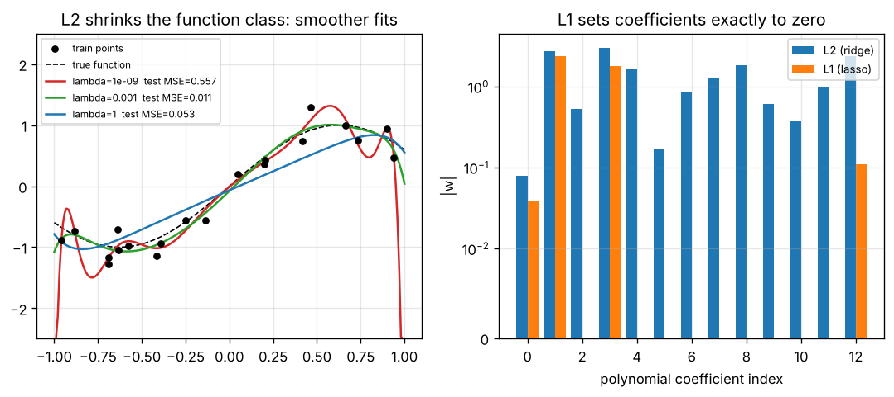

# Day 149 — Consolidation Day: The Regularization Thread (Constraining the Function Class)

*(No new concept number. Day 148 closed the optimisation-failure thread; today's cross-phase thread is **"every regulariser is a way of saying which functions we refuse to consider"**.)*

## 🧠 CONCEPT OF THE DAY — REGULARIZATION SHRINKS THE FUNCTION CLASS

**Intuition.** Fitting 20 noisy points with a degree-12 polynomial is like hiring a tailor who can bend the cloth anywhere: the suit fits your measurements perfectly and looks absurd. Regularization is a rule that says "prefer simple cuts". Weight decay, L1, dropout, normalization, augmentation, early stopping and label smoothing look unrelated, but each one removes or penalizes a family of wiggly functions, trading a little bias for a lot less variance (Day 22).

**The math.** Penalized training minimizes

$$\min_w \; \mathcal L_{\text{data}}(w) + \lambda\,\Omega(w)$$

where $\lambda\ge 0$ is the penalty strength and $\Omega$ is the penalty. The two classic choices differ in what their gradient does near zero.

*L2 (Day 24):* $\Omega=\tfrac12\|w\|_2^2$ gives the gradient step

$$w \leftarrow (1-\eta\lambda)\,w-\eta\nabla\mathcal L_{\text{data}}$$

with $\eta$ the learning rate: weights decay *proportionally* to their size, so they shrink but never hit exactly zero.

*L1 (Day 25):* $\Omega=\|w\|_1$ has the proximal (soft-threshold) update

$$w_i \leftarrow \operatorname{sign}(w_i)\,\max\!\big(|w_i|-\eta\lambda,\,0\big)$$

a *constant* pull toward zero, so any weight smaller than $\eta\lambda$ is set to exactly 0. That is sparsity.



`graph_DAY_149.py` (numpy only, seed 42) prints the numbers. Left: with $\lambda\approx0$ the fit interpolates the noise, test MSE **0.557** and $\|w\|_2=1170$; $\lambda=10^{-3}$ gives test MSE **0.0108** and $\|w\|_2=5.7$; $\lambda=1$ over-smooths to **0.0535** (the bias–variance U shape). Right: ridge keeps all **13** coefficients nonzero while lasso (ISTA) keeps only **4**, with train MSE 0.0328 vs 0.0271 and test MSE 0.0036 vs 0.0108 on this toy problem.

**Three key connections.**

1. **Explicit penalties vs implicit constraints (Days 24–25, 30).** L2 and L1 add a term to the loss. Early stopping constrains the function class *without* a term: with small init and gradient descent, stopping after $t$ steps behaves like ridge with $\lambda\propto 1/(\eta t)$ along each eigen-direction. Fewer steps, stronger regularization.
2. **Noise injection is regularization in disguise (Days 26, 29, 31).** Dropout multiplies activations by random masks, data augmentation applies random transformations to inputs, and label smoothing softens the targets. For small noise, each is approximately an L2-type penalty on the model's sensitivity to that perturbation, which is why augmentation that matches real invariances beats generic penalties.
3. **Normalization regularizes as a side effect (Days 27–28, 18–21).** BatchNorm's batch statistics inject noise (like dropout) and rescaling makes the function invariant to weight scale, so weight decay changes the *effective learning rate* rather than the function. This is why AdamW decouples decay from the adaptive step (Day 16) and why Day 148's stability window and today's penalty interact.

**Why it matters / where it leads.** "Why does L1 give sparse solutions and L2 not?" and "does weight decay do anything in a BatchNorm network?" are staple screens. Tomorrow's thread continues the cross-phase review.

**Interview question:** *Weight decay with strength $\lambda$ and L2 regularization in the loss are identical under plain SGD. Show that, then explain why they are NOT identical under Adam, and what AdamW changes.*

*(Answer at the very bottom under 💡 CONCEPT ANSWER.)*

## 🐍 PYTHONIC EDGE

**Trick: apply weight decay only to weights, not biases or norm parameters, using a comprehension and `**kwargs` to build optimizer parameter groups.** The groups pattern is exactly what `torch.optim.AdamW` expects.

**Bad way:**

```python
decay, no_decay = [], []                       # two empty lists; C++ would declare std::vector<Param*>
for i in range(len(names)):                    # index loop over parallel lists is un-Pythonic
    if names[i].endswith("bias") or "norm" in names[i]:   # `in` on a str is a substring test
        no_decay.append(params[i])
    else:
        decay.append(params[i])
```

**Clean way** (runnable with numpy only; real code passes `model.named_parameters()`):

```python
import numpy as np                                       # import X as Y alias; C++ namespace alias is closest

params = {"fc.weight": np.ones((2, 2)), "fc.bias": np.zeros(2), "norm.weight": np.ones(2)}   # dict literal

def is_no_decay(name):                                   # first-class function: can be passed around as a value
    return name.endswith("bias") or "norm" in name       # `in` membership test; `or` instead of ||

def make_groups(named, wd=0.1, **extra):                 # **extra collects keyword args into a dict
    decay = [p for n, p in named.items() if not is_no_decay(n)]   # list comprehension: no C++ equivalent
    plain = [p for n, p in named.items() if is_no_decay(n)]
    return [dict(params=decay, weight_decay=wd, **extra),        # ** unpacks a dict into keyword args
            dict(params=plain, weight_decay=0.0, **extra)]

groups = make_groups(params, wd=0.1, lr=1e-3)            # keyword arguments; order does not matter
n_decay, n_plain = (len(g["params"]) for g in groups)    # generator expression + tuple unpacking (like a structured binding)
assert (n_decay, n_plain) == (1, 2)                      # assert needs no macro; tuple compares elementwise
print(n_decay, n_plain)                                  # 1 2
```

We ran this logic: one decayed tensor, two undecayed. In PyTorch: `torch.optim.AdamW(groups)`; a model is `class Net(nn.Module):` (C++ `class Net : public Module`), `super().__init__()` runs the parent constructor first, and you call `net(x)` so `__call__` wraps `forward()` with hooks.

## 📡 SIGNAL LAB

**Problem.** Dropout with keep probability $1-p$, $p=0.5$, multiplies a signal $s[n]=\sin(2\pi f_0 n)$, $f_0=12/256$, by an i.i.d. mask $m[n]\in\{0,\,1/(1-p)\}$ (inverted dropout). (a) What is the mean and variance of $m$? (b) Describe the power spectrum of $s\cdot m$. (c) What does this say about what dropout does to a feature?

**Solution.**

(a) $\mathbb E[m]=1$ and $\operatorname{Var}(m)=p/(1-p)=1$ for $p=0.5$.

(b) Write $m=1+\epsilon$ with $\epsilon$ zero-mean, white, variance 1. Then $s\cdot m=s+s\epsilon$: the original sinusoid (a line at $f_0$) plus noise. Multiplying by white noise convolves its flat spectrum with the line, so the noise is **flat (white)** with level $\operatorname{Var}(\epsilon)\cdot\overline{s^2}=1\times0.5=0.5$ per bin. We ran it (N=256, average of 200 masks): the peak bin carries **64.6** (the coherent line, $\approx N/4=64$) and the broadband floor is **0.50** (analytic 0.5).

(c) Dropout leaves the signal's mean intact but buries it in a white noise floor whose level scales with $p/(1-p)$ and with the signal's power. A downstream layer therefore cannot rely on a single fragile feature; it must pool redundant evidence (an averaging, i.e. low-pass, behaviour) to recover the line, exactly the "no co-adaptation" story as a signal-to-noise ratio: here SNR per bin is about 129 for a perfect line, but a feature spread over few units sees far less.

**So what.** Noise-based regularizers inject a *white* floor, so they penalize models that depend on high-frequency, low-energy detail. For frequency-domain forensics this matters: a detector trained with heavy augmentation or dropout can learn to ignore the faint high-frequency fingerprints of generated images unless you deliberately preserve them (e.g. no blur/JPEG augmentation on the training branch you want to be sensitive).

## 🏋️ THE GAUNTLET

**Problem: Shortest Sparsity Budget.** You are given the magnitudes $a_1,\dots,a_n$ of a layer's weights (all positive). Find the length of the shortest contiguous segment whose L1 mass (sum) is at least $S$, or print $0$ if none exists.

*Input:* `n S`, then $n$ integers. *Output:* one integer.

*Constraints:* $1\le n\le 2\cdot10^5$, $1\le a_i\le10^9$, $1\le S\le10^{15}$.

*Example:* `8 15` / `5 1 3 5 10 7 4 9` → `2` (segment `5 10`).

**Pattern:** sliding window / two pointers (positivity makes the sum monotone). **Target:** $O(n)$ time, $O(1)$ extra memory.

**Hints.**

1. What happens to a segment's sum when you extend it to the right? When you drop its leftmost element? Why does positivity matter here?
2. For each right end $r$, what is the largest left end $l$ that still reaches sum $\ge S$? How does that $l$ compare with the best $l$ for $r-1$?
3. Keep a running sum. After adding $a_r$, while the sum minus $a_l$ is still $\ge S$, advance $l$. Record $r-l+1$ whenever the sum is $\ge S$. Use 64-bit integers.

*Solution is at the very bottom, under 🔓 GAUNTLET SOLUTION.*

## 🏗️ BLUEPRINT

no blueprint today.

## 🗺️ MARCHING ORDERS

Before adding a new regularizer, plot train vs val loss: if they are not diverging, you do not have a variance problem and more regularization will only cost you accuracy.

Tomorrow: Consolidation continues — a new cross-phase thread: sequence modelling (RNN forgetting, LSTM gates, attention as soft lookup, positional encoding, KV cache).

---

🔓 GAUNTLET SOLUTION

```cpp
#include <bits/stdc++.h>
using namespace std;

int main() {
    int n;
    long long S;
    scanf("%d %lld", &n, &S);
    vector<long long> a(n);
    for (auto &x : a) scanf("%lld", &x);
    long long sum = 0;
    int l = 0, best = INT_MAX;
    for (int r = 0; r < n; r++) {
        sum += a[r];
        while (sum - a[l] >= S) sum -= a[l++];   // shrink while still reaching the budget
        if (sum >= S) best = min(best, r - l + 1);
    }
    printf("%d\n", best == INT_MAX ? 0 : best);
}
```

💡 CONCEPT ANSWER

With plain SGD, L2 loss $\mathcal L+\tfrac{\lambda}{2}\|w\|^2$ has gradient $\nabla\mathcal L+\lambda w$, so the update is $w\leftarrow w-\eta\nabla\mathcal L-\eta\lambda w=(1-\eta\lambda)w-\eta\nabla\mathcal L$, which is exactly decoupled weight decay with coefficient $\eta\lambda$. Under Adam the update divides the *whole* gradient by $\sqrt{\hat v}+\epsilon$, where $\hat v$ is the second-moment estimate; so the $\lambda w$ term is also divided. Weights with large historical gradients get little effective decay, weights with small gradients get a lot, and the penalty becomes entangled with the adaptive scaling (it no longer corresponds to minimizing the L2-penalized loss). AdamW applies decay directly to the weights, $w\leftarrow w-\eta\big(\hat m/(\sqrt{\hat v}+\epsilon)+\lambda w\big)$, outside the adaptive normalization, so every weight decays at the same relative rate and $\lambda$ can be tuned independently of the learning rate's per-parameter scaling.
