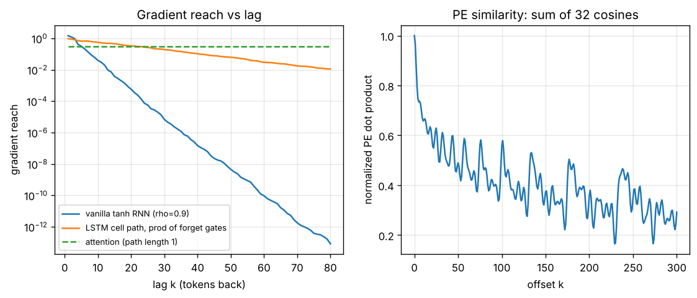

# Day 150 — Consolidation Day: The Sequence-Modelling Thread (How Models Remember)

*(No new concept number. Day 149 closed the regularization thread; today's cross-phase thread is **"every sequence model is a different answer to: how does information from token t−k reach token t?"**)*

## 🧠 CONCEPT OF THE DAY — MEMORY IS A PATH, AND PATHS DECAY

**Intuition.** Imagine passing a message down a line of 50 people (the RNN): each person whispers a slightly distorted copy, so by person 50 it is gone. An LSTM gives each person a notebook they copy *verbatim* unless told to erase (the cell state). Attention removes the line entirely: you walk straight to person 3 and read their note. The thread is about **path length** between a token and its consumer, and what each architecture multiplies along that path.

**The math.** For a vanilla RNN $h_t=\tanh(Wh_{t-1}+Ux_t)$ the gradient reach over lag $k$ is

$$\frac{\partial h_T}{\partial h_{T-k}}=\prod_{j=T-k+1}^{T}\operatorname{diag}(1-h_j^2)\,W$$

where $h_j$ is the hidden state and $W$ the recurrent matrix. Each factor has norm below $\rho(W)$ (times a $\tanh'\le1$ term), so the product shrinks geometrically (Days 20, 46, 47). The LSTM cell path replaces this with

$$\frac{\partial c_T}{\partial c_{T-k}}=\prod_{j=T-k+1}^{T} f_j$$

where $f_j\in(0,1)$ is the forget gate. If gates sit near 1 the product survives (Day 48). Attention connects $T$ to $T-k$ directly:

$$\alpha_{T,s}=\frac{\exp(q_T\cdot k_s/\sqrt d)}{\sum_{u}\exp(q_T\cdot k_u/\sqrt d)}$$

where $q,k$ are query and key vectors and $d$ the head dimension. The path length is 1 for every $k$ (Days 53–55). Position must be injected separately, since attention is permutation-equivariant (Days 58–59).



`graph_DAY_150.py` (numpy only, seed 42) prints the numbers. Left: at lag 50 the RNN's gradient norm is **4.56e-09** (spectral radius 0.9, hidden size 16), the LSTM path with forget gates around 0.95 retains **0.063**, and attention stays at its softmax weight, **0.30**, at every lag. Right: the positional-encoding dot product is **0.966** at offset 1, **0.658** at offset 10 and settles near **0.559** at offset 100 (the slow dimensions barely change, so about half the sum stays near 1).

**Three key connections.**

1. **RNN forgetting → gates → attention are one idea (Days 47, 48, 53).** Each step shortens or protects the multiplicative chain: gates keep the factor near 1; attention deletes the chain. Residual connections (Day 41) are the same trick in depth rather than in time.
2. **Attention solved reach but created cost and position problems (Days 58, 59, 63, 64).** Reach is free, but the score matrix is $O(n^2)$, and order must be added by sinusoids or rotations. FlashAttention fixes memory traffic, not the FLOP count.
3. **Inference turns the whole thread into a memory-management problem (Days 100, 111).** The KV cache stores one $(k,v)$ pair per past token: an RNN's fixed-size state became an $O(n)$ cache. Long-context techniques are attempts to get back toward a bounded state.

**Why it matters / where it leads.** "Why do transformers beat LSTMs on long dependencies?" is easy; the follow-up ("then why do they fail at retrieval in the middle of a long prompt?") is the real screen. Tomorrow's thread continues the cross-phase review.

**Interview question:** *Attention gives every token a path of length 1 to every other token, yet long-context models still miss facts buried in the middle of a long prompt. Using the softmax formula, explain a mechanism that makes direct access unreliable as $n$ grows, and name one fix.*

*(Answer at the very bottom under 💡 CONCEPT ANSWER.)*

## 🐍 PYTHONIC EDGE

**Trick: stream sliding context windows with a generator (`yield`) instead of materialising every window.** Overlapping windows over a long token stream multiply memory by `size/stride` if you build them all up front.

**Bad way:**

```python
def windows_bad(tokens, size, stride):
    out = []                                             # list grows to hold every window at once
    for start in range(0, len(tokens) - size + 1, stride):   # range() is a lazy object, not a filled vector
        out.append(tokens[start:start + size])           # slice [a:b] copies elements, end index exclusive
    return out                                           # caller pays the full memory cost immediately
```

**Clean way** (runnable with the standard library only):

```python
def windows(tokens, size, stride):                       # plain function; no type declarations needed
    for start in range(0, len(tokens) - size + 1, stride):   # range(start, stop, step): C++ needs a classic for loop
        yield tokens[start:start + size]                 # yield makes this a generator: one window per next() call

toks = list(range(10))                                   # list(...) consumes any iterable into a list
print(list(windows(toks, 4, 3)))                         # [[0,1,2,3],[3,4,5,6],[6,7,8,9]]

gen = windows(toks, 4, 3)                                # nothing runs yet: calling returns a generator object
first, second = next(gen), next(gen)                     # tuple unpacking from two calls; C++ would use two statements
assert first[-1] == 3 and second[0] == 3                 # [-1] is the last element; assert has no macro
```

We ran it: three windows, the overlap token `3` shared by the first two. Generators plug directly into `DataLoader`-style pipelines and `IterableDataset` (`class Stream(IterableDataset):` is `class Stream : public IterableDataset` in C++; `super().__init__()` runs the parent constructor; the dunder `__iter__` is what `for` calls, and a generator method satisfies it).

## 📡 SIGNAL LAB

**Problem.** The sinusoidal encoding for $d=64$ uses $\omega_i=10000^{-2i/d}$, $i=0,\dots,31$, so pair $i$ is a sinusoid of period $2\pi/\omega_i$ tokens.

(a) The dot product $PE(p)\cdot PE(p+k)$ is independent of $p$. Why, and what is it as a function of $k$?
(b) Does the fastest pair alias? (Nyquist for one-token sampling is a period of 2 tokens.)
(c) With a 512-token context, how many of the 32 pairs complete less than one full cycle?

**Solution.**

(a) Each pair contributes $\sin(\omega p)\sin(\omega(p+k))+\cos(\omega p)\cos(\omega(p+k))=\cos(\omega k)$ by the angle-difference identity, so

$$PE(p)\cdot PE(p+k)=\sum_{i=0}^{31}\cos(\omega_i k)$$

a function of the offset only. Positional encoding is therefore a **filter bank**: a sum of cosines at geometrically spaced frequencies, i.e. a translation-invariant kernel.

(b) The fastest pair has $\omega_0=1$ rad/token, period $2\pi\approx6.28$ tokens, above the Nyquist period of 2 tokens. No aliasing: the sampling theorem is respected by construction. Frequencies spaced geometrically from 1 down to $10^{-4}$ rad/token cover a wide range with 32 pairs, like a wavelet-style octave layout.

(c) A pair has period over 512 when $10000^{i/32}>512/2\pi\approx81.5$, i.e. $i>15.3$, so $i=16,\dots,31$: **16 of 32 pairs** (verified in the script; pair 16 has period 628, pair 15 has 471). Half the channels act as slow ramps that barely vary within the context, which is exactly why the plotted similarity plateaus near 0.56 instead of decaying to zero.

**So what.** Positional signals are a low-frequency-heavy basis, and attention only sees the offsets that basis can resolve. For a frequency-domain generative-forensics researcher this is the same lesson as spectral bias: a model fed a smooth basis resolves smooth structure first, and fine offsets (high-frequency detail) depend on the few fast channels. If you tokenize spectra or patches, decide which frequencies your positional basis can and cannot separate.

## 🏋️ THE GAUNTLET

**Problem: Split a Long Document.** You must split an array of $n$ token counts $a_1,\dots,a_n$ into exactly $k$ non-empty contiguous chunks so the largest chunk sum is as small as possible (each chunk must fit a context window). Print that minimum possible largest sum.

*Input:* `n k`, then $n$ integers. *Output:* one integer.

*Constraints:* $1\le k\le n\le 10^5$, $1\le a_i\le10^9$.

*Example:* `5 2` / `7 2 5 10 8` → `18` (chunks `7 2 5` and `10 8`).

**Pattern:** binary search on the answer with a greedy feasibility check. **Target:** $O(n\log(\sum a))$ time, $O(1)$ extra memory.

**Hints.**

1. Suppose someone hands you a cap $C$. Can you decide quickly whether *some* split into at most $k$ chunks has every chunk sum $\le C$?
2. If cap $C$ works, does $C+1$ work? What does that monotonicity let you search over, and what are the smallest and largest sensible caps?
3. For a fixed cap, start a new chunk only when adding the next element would exceed it. Count chunks. Binary search the smallest cap with count $\le k$ (using at most $k$ chunks is fine since you can always split further).

*Solution is at the very bottom, under 🔓 GAUNTLET SOLUTION.*

## 🏗️ BLUEPRINT

no blueprint today.

## 🗺️ MARCHING ORDERS

Next time a model "forgets" something in a long input, ask first whether the path is broken (gradients, gates) or crowded (softmax dilution): the fixes are different.

Tomorrow: Consolidation continues — a new cross-phase thread (suggested: generative modelling — autoencoders, VAE, GAN, diffusion, and what each leaves in the spectrum).

---

🔓 GAUNTLET SOLUTION

```cpp
#include <bits/stdc++.h>
using namespace std;

int main() {
    int n, k;
    scanf("%d %d", &n, &k);
    vector<long long> a(n);
    long long lo = 0, hi = 0;
    for (auto &x : a) { scanf("%lld", &x); lo = max(lo, x); hi += x; }
    auto chunks = [&](long long cap) {           // greedy: chunks needed if each sum <= cap
        int c = 1; long long cur = 0;
        for (long long x : a) {
            if (cur + x > cap) { c++; cur = 0; }
            cur += x;
        }
        return c;
    };
    while (lo < hi) {                            // smallest cap with chunks(cap) <= k
        long long mid = lo + (hi - lo) / 2;
        if (chunks(mid) <= k) hi = mid; else lo = mid + 1;
    }
    printf("%lld\n", lo);
}
```

We compiled and ran this: `5 2 / 7 2 5 10 8` prints `18`, and `4 3 / 1 2 3 4` prints `4`. (If fewer than $k$ chunks suffice, extra splits never increase the maximum, so "at most $k$" equals "exactly $k$" because $k\le n$.)

💡 CONCEPT ANSWER

Softmax **dilution**. With $n$ keys, if the relevant key's logit exceeds the others' by a gap $g$ and the rest are roughly equal, its weight is $\alpha\approx e^{g}/(e^{g}+n-1)$. For fixed $g$ this falls like $1/n$, so the needle's value is averaged with $n-1$ distractors and its contribution to the output shrinks, even though the path length is 1. To keep $\alpha$ constant the logit gap must grow like $\log n$, which the model was never trained to produce at lengths beyond its training distribution. Positional schemes compound this: sinusoidal or rotary phases at unseen offsets move the logits off-distribution, and "lost in the middle" appears when training data puts the answer mostly near the start or end. Fixes: sharpen or rescale attention with length (e.g. temperature scaling or a log-$n$ factor), position interpolation / RoPE scaling (YaRN), sparse or sliding-window plus global tokens, retrieval (RAG) that shortens the context, or training on long-range retrieval tasks.
