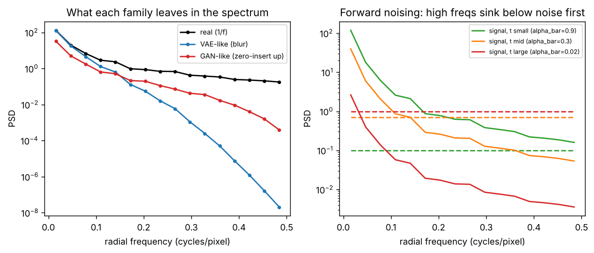

# Day 151 — Consolidation Day: The Generative-Modelling Thread (What Each Family Leaves in the Spectrum)

*(No new concept number. Day 150 closed the sequence-modelling thread; today's cross-phase thread is **"every generative model makes a choice about which frequencies it gets right, and the mistakes are structured, not random."** Covers Phase 8: Concepts 78–88.)*

## 🧠 CONCEPT OF THE DAY — EVERY GENERATOR HAS A SPECTRAL FINGERPRINT

**Intuition.** Think of four forgers copying a painting. The autoencoder-style forger squints and paints the *average* of what they saw, so fine brushwork goes soft. The GAN forger is coached by a detective and learns to fool them, but builds the canvas from a coarse grid of stamps, leaving a faint repeating pattern. The diffusion forger starts from static and removes it a little at a time, coarse structure first and fine texture last. The thread: **the loss, the architecture and the sampling procedure each imprint a signature on the power spectrum.**

**The math, three connections.**

1. *Likelihood losses average, so they blur (Concepts 78–80).* With a Gaussian decoder the VAE objective is

$$\mathcal{L}=\mathbb{E}_{q(z|x)}\big[\|x-\hat x(z)\|^2\big]+\beta\,D_{KL}\big(q(z|x)\,\|\,p(z)\big)$$

where $\hat x(z)$ is the decoder output, $q$ the encoder posterior and $\beta$ the KL weight. The MSE-optimal output is the conditional mean $\mathbb{E}[x\mid z]$. Averaging over plausible high-frequency details cancels them, so the decoder acts like a low-pass filter on the data.

2. *Upsampling layers imprint periodic structure (Concepts 80–82).* A stride-$s$ transposed convolution inserts $s-1$ zeros between samples. In the Fourier domain this *replicates* the spectrum $s$ times, so unless the kernel removes the replicas, energy appears at multiples of $f_s/s$ (checkerboard artifacts). The GAN game

$$\min_G\max_D\;\mathbb{E}_{x}[\log D(x)]+\mathbb{E}_{z}[\log(1-D(G(z)))]$$

has no term that penalizes missing or misplaced high-frequency energy unless $D$ learns to look there, so generators leave a stable fingerprint.

3. *Diffusion is a frequency curriculum (Concepts 83–87).* The forward process

$$x_t=\sqrt{\bar\alpha_t}\,x_0+\sqrt{1-\bar\alpha_t}\,\varepsilon,\qquad \varepsilon\sim\mathcal{N}(0,I)$$

keeps a fraction $\bar\alpha_t$ of the signal and adds white noise. Natural images have power $\propto 1/f^{2}$ while the noise PSD is flat, so the *signal-to-noise ratio is lowest at high frequencies*. Those frequencies sink below the noise floor first as $t$ grows, and the reverse process recovers coarse structure first and fine detail last.

The figure below is a synthetic 64×64 image with a $1/f$ amplitude spectrum. The left panel shows blur (VAE-like) and zero-insertion upsampling (GAN-like) against the real spectrum. The right panel shows signal PSD (solid) against noise PSD (dashed) at three noise levels: the crossover frequency moves inward as $\bar\alpha_t$ falls.



*Honest caveat:* in this tiny demo the GAN-like curve shows mainly a high-frequency deficit; the sharp spectral replicas of real transposed-conv generators show up on 2-D spectra and depend on the kernel and training. The point is that both families deviate from the $1/f$ line, in different ways.

**Why it matters / where it leads.** This is the basis of frequency-domain generative forensics: if the generator's spectrum differs from real data, a classifier on the log-PSD can detect it, and a generator trained with a spectral loss can try to hide it. It also leads to the next thread (efficiency and serving, Phase 10), where latent diffusion exists precisely because most of pixel space is high-frequency detail that is expensive to model.

**Interview question.** *You train a VAE on faces and the samples look blurry, but the GAN samples look sharp with a faint grid pattern. Explain both observations from the objectives and architectures, and say how you would measure each one.*

## 🐍 PYTHONIC EDGE — COMPUTE A RADIAL PSD WITHOUT PYTHON LOOPS

One useful NumPy idiom: vectorize binning with `np.bincount` instead of looping over pixels.

```python
import numpy as np  # import X as Y alias: no C++ equivalent (C++ uses #include / namespace aliases)

def radial_psd_bad(img, nbins=16):          # def: Python function; no type declarations needed
    P = np.abs(np.fft.fft2(img)) ** 2       # ** is exponentiation (C++ has no operator, uses pow())
    out = [0.0] * nbins                     # list repetition; C++ would be std::vector<double>(nbins, 0.0)
    cnt = [0] * nbins                       # same idea for counts
    for i in range(img.shape[0]):           # range() is a lazy object, not a macro or counter
        for j in range(img.shape[1]):       # nested loops in pure Python are ~100x slower than NumPy
            r = np.hypot(np.fft.fftfreq(img.shape[0])[i], np.fft.fftfreq(img.shape[1])[j])  # recomputed every pixel
            b = min(int(r / 0.5 * nbins), nbins - 1)   # min() builtin; int() cast looks like a function call
            out[b] += P[i, j]               # P[i, j] is tuple indexing; C++ would be P[i][j]
            cnt[b] += 1
    return [o / c for o, c in zip(out, cnt)]  # list comprehension + zip: no C++ equivalent

def radial_psd(img, nbins=16):
    fy = np.fft.fftfreq(img.shape[0])[:, None]   # [:, None] slice + new axis: reshape to a column, no loop
    fx = np.fft.fftfreq(img.shape[1])[None, :]   # [None, :] makes a row; broadcasting expands to 2-D
    r = np.hypot(fy, fx)                          # broadcasted (H, W) radius grid in one call
    b = np.minimum((r / 0.5 * nbins).astype(int), nbins - 1)  # astype(int) vectorized cast; no loop
    P = np.abs(np.fft.fft2(img)) ** 2             # power spectrum, ** again
    s = np.bincount(b.ravel(), weights=P.ravel(), minlength=nbins)  # keyword args (weights=, minlength=) by name
    c = np.bincount(b.ravel(), minlength=nbins)   # counts per bin
    return s / np.maximum(c, 1)                   # elementwise divide, max() avoids 0/0; negative index not needed here

# OOP flavour: wrap it as a callable object
class RadialPSD:                                  # class X: (C++: class X { ... };) ; no explicit base = object
    def __init__(self, nbins=16):                 # constructor; self is C++'s this but explicit
        self.nbins = nbins                        # instance attribute created on assignment (C++: declared in header)
    def __call__(self, img):                      # __call__ makes the instance callable like a function
        return radial_psd(img, self.nbins)        # delegate to the plain function
psd = RadialPSD(8)                                # constructing: no 'new', no braces
spec = psd(np.random.default_rng(42).standard_normal((64, 64)))  # psd(...) invokes __call__; seeded generator object
assert spec.shape == (8,)                         # assert: runtime check, raises AssertionError (C++ assert() is compile-time optional)
```

**Why it's cleaner:** the loop version recomputes `fftfreq` every pixel and runs in interpreted Python; the vectorized version builds the radius grid once with broadcasting and does a single `bincount`. Debugging tip: always check `c.min() > 0` so empty bins don't hide a bug as NaN.

## 📡 SIGNAL LAB — WHERE DOES DIFFUSION LOSE A TEXTURE?

**Problem.** A natural image has power spectrum $S(f)=A/f^{2}$ for $f\in[f_0,f_{max}]$. Forward diffusion with $\bar\alpha$ adds white noise of PSD $\sigma^2$, so the post-noise SNR is

$$\mathrm{SNR}(f)=\frac{\bar\alpha\,A/f^{2}}{(1-\bar\alpha)\,\sigma^2}.$$

At what frequency $f^\*$ does SNR drop to 1, and what happens to $f^\*$ as $\bar\alpha\to 0$?

**Solution.** Set $\mathrm{SNR}=1$ and solve:

$$f^{\*}=\sqrt{\frac{\bar\alpha\,A}{(1-\bar\alpha)\,\sigma^2}}.$$

At $\bar\alpha=0.9$, $f^\*$ is about $3\times\sqrt{A}/\sigma$. At $\bar\alpha=0.02$ it is about $0.14\times\sqrt{A}/\sigma$, so $f^\*$ falls by a factor of ~20. Everything above $f^\*$ is below the noise floor.

**So what.** The crossover $f^\*$ sweeps from high to low frequency as $t$ grows, so the denoiser learns coarse-to-fine structure in order. This is also why noise schedules matter for high-resolution images: at fixed $\bar\alpha_t$ a larger image has more high-frequency bins already buried, which is the motivation for shifting the schedule at higher resolution. For forensics: a generator's reverse process regenerates high-frequency content from a learned prior rather than copying it, which is exactly where its fingerprint lives.

## 🏋️ THE GAUNTLET — SUBARRAY SUM EQUALS K

**Problem.** You are given an array `a` of `n` integers (a signal's samples, possibly negative) and a target `k`. Count the number of *contiguous* subarrays whose sum equals `k`.

**Input:** `n k`, then `n` integers. **Output:** the count.

**Constraints:** $1\le n\le 2\cdot10^5$, $|a_i|\le 10^4$, $|k|\le 10^9$. The answer fits in `long long`.

**Examples.** `n=5, k=3, a=[1,2,1,-1,3]` → `5`. `n=3, k=0, a=[0,0,0]` → `6`.

**Hint 1.** A sliding window fails here. Why does negativity break the "grow right, shrink left" argument?

**Hint 2.** Write the sum of `a[i..j]` as a difference of two prefix sums. What must the earlier prefix equal for the subarray to sum to `k`?

**Hint 3.** Process left to right and keep a hash map of how many times each prefix sum has occurred so far. Don't forget the empty prefix.

**Pattern:** prefix sums + hash map. **Target complexity:** $O(n)$ time, $O(n)$ space. (Cumulative PSD is the same idea: band energy = difference of two cumulative sums.)

## 🏗️ BLUEPRINT

no blueprint today.

## 🗺️ MARCHING ORDERS

You now have a three-line summary of every generative family: blur, grid, noise ladder. Hold onto it, because every forensic detector you will ever build is looking for one of those three.

Tomorrow: Consolidation Day — Efficiency & serving thread (Phase 10: mixed precision, KV cache, batching, and what each trades away)

---

🔓 GAUNTLET SOLUTION

```cpp
#include <bits/stdc++.h>
using namespace std;

// Count subarrays with sum == k (values may be negative). O(n) time, O(n) space.
long long countSubarrays(const vector<int>& a, long long k) {
    unordered_map<long long, long long> seen;  // prefix sum -> times seen
    seen[0] = 1;                               // empty prefix
    long long pre = 0, ans = 0;
    for (int x : a) {
        pre += x;
        auto it = seen.find(pre - k);          // earlier prefix = pre - k  => subarray sums to k
        if (it != seen.end()) ans += it->second;
        ++seen[pre];
    }
    return ans;
}

int main() {
    int n; long long k;
    cin >> n >> k;
    vector<int> a(n);
    for (auto& x : a) cin >> x;
    cout << countSubarrays(a, k) << "\n";
}
```

Why it works: let $P_j$ be the prefix sum through index $j$. A subarray $(i,j]$ sums to $k$ iff $P_j-P_i=k$, i.e. $P_i=P_j-k$. For each $j$ we add the number of earlier prefixes equal to $P_j-k$, then record $P_j$. Seeding the map with `{0:1}` handles subarrays starting at index 0. Use `long long` for prefixes.

💡 CONCEPT ANSWER

**VAE blur:** with a Gaussian likelihood the decoder is trained under MSE, whose optimum is the conditional mean $\mathbb{E}[x\mid z]$. When many sharp images map to similar $z$ (the posterior is also pushed toward the prior by the KL term), averaging them cancels high-frequency detail, so the output is a low-pass filtered image. *Measure it:* compare radially averaged PSD of reconstructions with real images; you will see a high-frequency roll-off. A sharper decoder likelihood, a smaller $\beta$, a perceptual or adversarial loss, or a larger latent all reduce it.

**GAN grid:** the adversarial objective only rewards what the discriminator can see, and the generator's transposed convolutions (stride > 1) zero-insert and replicate the spectrum, leaving periodic peaks at multiples of $f_s/s$ and sometimes a checkerboard. Nothing in the loss forces those to vanish. *Measure it:* look at the 2-D log-magnitude spectrum, or the azimuthal PSD average, for isolated peaks; compare against real images; or train a spectrum-based classifier. Fixes: resize-then-convolve, low-pass filtering before upsampling, anti-aliased upsampling, or a spectral loss.
