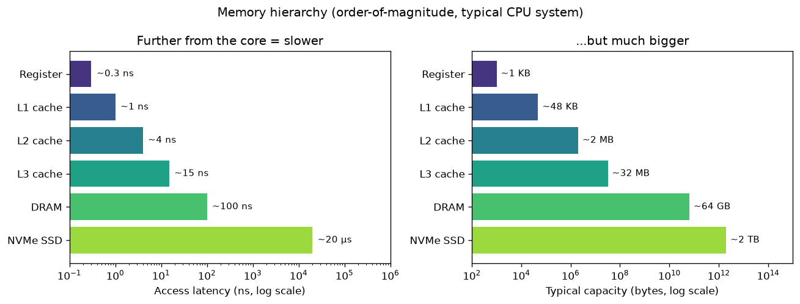

# Day 153 — কাছের জিনিস দ্রুত, দূরের জিনিস বড়

> 📅 2026-11-02 (আগাম লেখা) · Track B: Phase 12 (হার্ডওয়্যারের ভিত্তি) · Track A: CSE 4711 Week 2

---

## ⚙️ গভীর পাঠ (Deep Dive) — Concept 116: Memory hierarchy: registers → cache → DRAM → HBM, locality

### 💡 Intuition: পড়ার টেবিল থেকে গুদাম পর্যন্ত

পরীক্ষার আগের রাতে তোমার বইগুলো কোথায় থাকে?
- **হাতে খোলা পাতা:** সঙ্গে সঙ্গে পড়া যায়, কিন্তু একসঙ্গে মাত্র এক-দুই পাতা।
- **টেবিলে:** হাত বাড়ালেই পাওয়া যায়; পাঁচ-ছয়টা বই ধরে।
- **ঘরের তাকে:** উঠে গিয়ে আনতে হয়; কয়েকশো বই।
- **IUT লাইব্রেরি:** হেঁটে যেতে ১০ মিনিট; হাজার হাজার বই।

যত দূরে, তত বড় আর তত ধীর। কম্পিউটারের memory ঠিক এভাবেই সাজানো, কারণ **দ্রুত memory দামি আর আকারে ছোট হতে বাধ্য।** কৌশলটা হলো: যেটা এখন বা শিগগিরই লাগবে, সেটা কাছের স্তরে রাখো।

### 🔧 Mechanism

**১. স্তরগুলো (CPU, আনুমানিক মান):**



| স্তর | Latency (≈) | আকার (≈) | কে নিয়ন্ত্রণ করে |
|---|---|---|---|
| Register | < 1 ns | ~1 KB প্রতি core | compiler |
| L1 cache | ~1 ns | ~32–64 KB প্রতি core | hardware |
| L2 cache | ~4 ns | ~1–2 MB প্রতি core | hardware |
| L3 cache | ~10–20 ns | কয়েক দশ MB, সব core ভাগ করে | hardware |
| DRAM (main memory) | ~100 ns | দশ থেকে শত GB | OS + hardware |
| NVMe SSD | দশ µs-এর ঘরে | TB | OS (file system) |

Register থেকে DRAM-এ ≈ **100 গুণ** ধীর। এক DRAM access-এর সময়ে একটা core কয়েকশো instruction চালাতে পারত।

**২. GPU-র hierarchy (H100, published spec):**

| স্তর | আকার (≈) | মন্তব্য |
|---|---|---|
| Register file | 256 KB প্রতি SM | সবচেয়ে দ্রুত; প্রতিটা thread-এর নিজের |
| Shared memory / L1 (on-chip SRAM) | 228 KB পর্যন্ত shared memory প্রতি SM | **programmer নিজে** নিয়ন্ত্রণ করে ← মূল পার্থক্য |
| L2 cache | 50 MB (পুরো chip-এ) | সব SM ভাগ করে |
| HBM3 | 80 GB, ≈ 3.35 TB/s | GPU-র "main memory" |

(SM = streaming multiprocessor, GPU-র একটা "core cluster"। H100 SXM-এ 132টা। Concept 122-এ বিস্তারিত।)

CPU-তে cache নিজে থেকে চলে; GPU-তে shared memory-তে কী রাখবে সেটা তুমি ঠিক করো। FlashAttention-এর পুরো কৌশল এই একটা ক্ষমতার ওপর দাঁড়িয়ে।

**৩. Cache line ও locality।** Memory থেকে ডেটা একটা একটা byte করে আসে না; আসে **cache line** ধরে (CPU-তে সাধারণত 64 byte)। একটা `float` (4 byte) চাইলেও পাশের 15টা সঙ্গে চলে আসে। দুই ধরনের locality-ই cache-কে কাজে লাগায়:
- **Temporal locality:** যেটা এইমাত্র ব্যবহার করেছ, সেটা শিগগিরই আবার ব্যবহার করবে (যেমন loop counter, একটা tile-এর weight)।
- **Spatial locality:** যেটা ব্যবহার করেছ, তার পাশেরটা শিগগিরই ব্যবহার করবে (যেমন array-তে পরপর এগোনো)।

**৪. গড় access সময় (AMAT):**

$$
\text{AMAT} = t_{\text{hit}} + r_{\text{miss}} \times t_{\text{miss penalty}}
$$

- $t_{\text{hit}}$ = cache-এ পেলে সময়
- $r_{\text{miss}}$ = কত ভাগ access-এ cache-এ পাওয়া যায় না
- $t_{\text{miss penalty}}$ = না পেলে নিচের স্তর থেকে আনার বাড়তি সময়

Miss penalty বিশাল বলে miss rate-এর সামান্য পরিবর্তনও সময়কে অনেক বদলে দেয়।

### 🧮 খাতা-কলমের হিসাব (back-of-envelope)

একটা $N \times N$ `float` matrix, $N = 4096$, row-major-এ রাখা (C/C++-এর ধরন)। মোট আকার $4096^2 \times 4 = 64$ MB — L3-এর চেয়ে অনেক বড়। দুইভাবে সব element যোগ করি:

```cpp
// (A) row ধরে                          // (B) column ধরে
for (i) for (j) s += M[i][j];           for (j) for (i) s += M[i][j];
```

**মডেল:** cache line 64 byte = 16টা float; $t_{\text{hit}} \approx 1$ ns, miss penalty ≈ 100 ns।

- **(A):** পরপর 16টা access-এ একটা miss → $r_{\text{miss}} = 1/16$।
  AMAT ≈ $1 + \frac{1}{16}\times 100 \approx 7.3$ ns।
  মোট ≈ $16.8\times10^6 \times 7.3$ ns ≈ **0.12 s**।
- **(B):** পরপর দুই access-এর দূরত্ব একটা পুরো row = $4096 \times 4 = 16$ KB। প্রতিটা access নতুন cache line, আর পরের column-এ ফেরার আগেই আগের line-গুলো cache থেকে বেরিয়ে যায় → $r_{\text{miss}} \approx 1$।
  AMAT ≈ $1 + 100 = 101$ ns।
  মোট ≈ $16.8\times10^6 \times 101$ ns ≈ **1.7 s**।

**একই FLOPs, একই ফলাফল — ≈ 14 গুণ সময়ের পার্থক্য,** শুধু ডেটা কোন ক্রমে পড়ছি তার জন্য। (বাস্তবে hardware prefetcher (B)-কে কিছুটা বাঁচায়, তাই পার্থক্য কম-বেশি হয়; কিন্তু দিকটা সবসময় একই।)

গতকালের সূত্রে বললে: (B)-তে আমরা প্রতিটা দরকারি 4 byte-এর জন্য 64 byte সরাচ্ছি — **কার্যকর bandwidth-এর 15/16 অংশ নষ্ট।**

### 🔬 গবেষণার সীমানা (research frontier)
- FlashAttention-এর মূল দাবি "IO-aware": attention-এর বিশাল $N\times N$ matrix কখনো HBM-এ লেখে না, tile ধরে SRAM-এই রেখে দেয়। FLOPs একই বা বেশি, কিন্তু byte অনেক কম (Concept 131)।
- LLM serving-এ KV cache এখন নিজেই একটা hierarchy-তে থাকে: HBM → CPU DRAM → SSD। DeepSeek-এর 3FS file system-এর ব্যবহারের তালিকায় inference-এর KV cache রাখাও আছে। কোন KV কোন স্তরে থাকবে, সেটা একটা সক্রিয় গবেষণার প্রশ্ন।

### ❓ Interview প্রশ্ন
> **"Two matrix-multiply implementations do exactly the same number of FLOPs, but one is 10× faster. Explain why, and how you would write the fast one."**

*(কী যাচাই করা হচ্ছে: locality, data reuse আর tiling বোঝো কি না।)* উত্তর নিচে।

---

## 🎓 কোর্স কর্নার — CSE 4711 Week 2: UCS, IDS ও search algorithm-গুলোর তুলনা

### 📘 যা জানতেই হবে

**Uniform Cost Search (UCS):** fringe একটা **priority queue**, priority = $g(n)$ = start থেকে এই node পর্যন্ত মোট খরচ। সবসময় সবচেয়ে সস্তা node আগে expand করে। (Dijkstra-র সঙ্গে প্রায় একই; পার্থক্য হলো goal পেলেই থামে।)

**কেন UCS optimal:** goal test হয় expand-এর সময়। কোনো node যখন expand হয়, fringe-এর বাকি সব node-এর $g$ তার সমান বা বেশি। খরচ ঋণাত্মক নয়, তাই তাদের মধ্য দিয়ে গেলে খরচ আর কমবে না। তাই প্রথম যে goal expand হয়, সেটাই সবচেয়ে সস্তা।
⚠️ Goal test যদি fringe-এ **ঢোকানোর** সময় করা হতো, এই যুক্তি ভেঙে যেত — exam-এ প্রায়ই এই ফাঁদ থাকে।

**Iterative Deepening Search (IDS):** depth limit 0, 1, 2, … দিয়ে বারবার DFS চালায়। এতে DFS-এর কম memory আর BFS-এর completeness দুটোই পাওয়া যায়।

| | BFS | DFS | UCS | IDS |
|---|---|---|---|---|
| Complete? | হ্যাঁ | না* | হ্যাঁ, যদি প্রতিটা step cost ≥ $\varepsilon > 0$ | হ্যাঁ |
| Optimal? | সমান খরচে হ্যাঁ | না | হ্যাঁ | সমান খরচে হ্যাঁ |
| Time | $O(b^d)$ | $O(b^m)$ | $O(b^{1+\lfloor C^*/\varepsilon \rfloor})$ | $O(b^d)$ |
| Space | $O(b^d)$ | $O(bm)$ | $O(b^{1+\lfloor C^*/\varepsilon \rfloor})$ | $O(bd)$ |

\* সসীম graph-এ graph search হলে complete। $C^*$ = optimal সমাধানের খরচ, $\varepsilon$ = সবচেয়ে ছোট step cost।

### ✍️ হাতে-কলমে সমাধান (hand-trace)

**গতকালের রাফির map** (S থেকে G; directed edge, খরচসহ):

S→A 1 · S→B 5 · A→C 3 · A→D 2 · B→D 1 · B→G 6 · C→G 4 · C→S 1 · D→G 4

**প্রশ্ন [CO1]:** UCS graph search চালাও। প্রতিটা ধাপে fringe দেখাও; expansion order আর ফেরত আসা path লেখো। সমান $g$ হলে state-এর নাম অনুযায়ী alphabetical।

Fringe-এ লিখছি `path(g)`, ছোট $g$ আগে।

| ধাপ | তোলা | Closed (পরে) | Fringe (পরে) |
|---|---|---|---|
| 0 | — | {} | S(0) |
| 1 | S(0) → expand | {S} | S-A(1), S-B(5) |
| 2 | S-A(1) → expand | {S,A} | S-A-D(3), S-A-C(4), S-B(5) |
| 3 | S-A-D(3) → expand | {S,A,D} | S-A-C(4), S-B(5), S-A-D-G(7) |
| 4 | S-A-C(4) → expand | {S,A,D,C} | S-B(5), S-A-C-S(5), S-A-D-G(7), S-A-C-G(8) |
| 5 | S-B(5) → expand *(B ও S দুটোরই g=5; alphabetical-এ B আগে)* | {S,A,D,C,B} | S-A-C-S(5), S-B-D(6), S-A-D-G(7), S-A-C-G(8), S-B-G(11) |
| 6 | S-A-C-S(5) → **S closed, skip** | — | S-B-D(6), S-A-D-G(7), S-A-C-G(8), S-B-G(11) |
| 7 | S-B-D(6) → **D closed, skip** | — | S-A-D-G(7), S-A-C-G(8), S-B-G(11) |
| 8 | S-A-D-G(7) → **goal!** | | |

- Expansion order: **S, A, D, C, B, G**
- ফেরত আসা path: **S → A → D → G**, খরচ **7** ✅ optimal

**গতকালের সঙ্গে তুলনা:**

| Algorithm | Path | খরচ | Expand হওয়া node |
|---|---|---|---|
| BFS | S-B-G | 11 | 6 |
| DFS | S-A-C-G | 8 | 4 |
| UCS | S-A-D-G | **7** | 6 |

DFS সবচেয়ে কম কাজ করেছে কিন্তু ভুল উত্তর দিয়েছে; UCS-ই একমাত্র যে খরচের নিশ্চয়তা দেয়।

**খেয়াল করো (ধাপ 3):** S-A-D-G(7) fringe-এ ঢুকেছে, কিন্তু UCS তখনই থামেনি। সেই মুহূর্তে থামলে এখানে ঠিক উত্তরই আসত, কিন্তু সাধারণভাবে নিশ্চয়তা থাকত না — যেমন যদি S-B-G-এর খরচ 6-এর বদলে 1 হতো (মোট 6), তাহলে আগে-ঢোকা 7 ভুল উত্তর হতো।

### 🧠 Formulate & justify [CO3]

তানভীর একটা puzzle solver বানাচ্ছে। Branching factor $b = 10$; সবচেয়ে অগভীর সমাধান depth $d$-এ; সব চালের খরচ সমান। তার কাছে মাত্র 1 GB RAM, আর প্রতিটা node রাখতে ≈ 100 byte লাগে।

তানভীর বলে: *"IDS একই node বারবার expand করে, তাই এটা BFS-এর চেয়ে অনেক ধীর। আমি BFS-ই নেব।"*

1. $d = 5$ ধরে BFS আর IDS কতগুলো node generate করে, হিসাব করো। IDS কত শতাংশ বেশি কাজ করে? **[CO1, 3]**
2. $d = 10$ হলে তানভীরের মেশিনে কোনটা ব্যবহার করা উচিত? সিদ্ধান্ত ও যুক্তি দাও। **[CO3, 4]**

*(উত্তর নিচে।)*

### 🔗 সেতু (bridge)
UCS-এর priority queue আর memory hierarchy-র মিলটা দেখো: দুটোই "সবচেয়ে সস্তা/সবচেয়ে কাছের জিনিস আগে" নীতিতে চলে। আর IDS-এর শিক্ষা — **মনে রাখার চেয়ে আবার হিসাব করা সস্তা হতে পারে** — ঠিক Concept 157-এর activation recomputation-এর মূল কথা: memory বাঁচাতে কিছু FLOP আবার খরচ করো।

---

## 🏋️ দ্য গন্টলেট (The Gauntlet) — Free Rides

**Problem.** ঢাকায় $n$ টা স্টপ আর $m$ টা দুইমুখী রাস্তা আছে; রাস্তা $i$ স্টপ $u_i$ আর $v_i$-কে যুক্ত করে, ভাড়া $w_i$। তোমার কাছে $k$ টা ফ্রি-রাইড কুপন আছে; একটা কুপন দিয়ে যেকোনো একটা রাস্তা বিনা ভাড়ায় পার হওয়া যায় (প্রতি রাস্তায় সর্বোচ্চ একটা কুপন)। স্টপ 1 থেকে স্টপ $n$-এ যেতে **সর্বনিম্ন মোট ভাড়া** কত? যাওয়া অসম্ভব হলে `-1`।

**Input:** প্রথম লাইনে $n\ m\ k$; তারপর $m$ টা লাইনে $u\ v\ w$।
**Output:** একটা সংখ্যা।

**Constraints:** $2 \le n \le 10^5$, $1 \le m \le 2\cdot10^5$, $0 \le k \le 10$, $1 \le w \le 10^9$।

```
Sample input
4 4 1
1 2 5
2 4 5
1 3 2
3 4 10

Sample output
2
```

*(1→3 ভাড়া দিয়ে (2), তারপর 3→4 কুপনে (0)।)*

**🪜 তিনটা hint:**
1. "এখন কোন স্টপে আছি" যথেষ্ট নয় — "কয়টা কুপন খরচ করেছি" ছাড়া ভবিষ্যৎ ঠিক হয় না। গতকালের Parcel Robot-এর state-এর কথা মনে করো।
2. State = $(v, j)$, যেখানে $j$ = ব্যবহৃত কুপন। প্রতিটা রাস্তা দুই রকম transition দেয়: $(u,j) \to (v,j)$ খরচ $w$, আর $(u,j)\to(v,j+1)$ খরচ 0।
3. খরচ অসমান, তাই BFS চলবে না — এই $(k+1)$ স্তরের graph-এ UCS/Dijkstra চালাও। উত্তর = $\min_j \text{dist}(n, j)$। `long long` ভুলো না।

**Pattern:** Layered graph / state-augmented Dijkstra (UCS)
**Target complexity:** $O((n + m)\, k \log(nk))$

---

## 📄 পেপার কর্নার
শুক্রবার পেপার কর্নার।

## 🔭 রিসার্চ রাডার
বুধবার রিসার্চ রাডার।

## 🏗️ ব্লুপ্রিন্ট — 70B model, একটা 80 GB GPU: কোথায় রাখবে weight?

**সমস্যা:** 70B parameter, bf16 → $70\times10^9\times2 = 140$ GB। H100-এর HBM 80 GB। পুরোটা ঢোকে না। তিনটা পথ, তিনটা আলাদা স্তরের bandwidth:

| পথ | Weight কোথায় | প্রতি token-এ পড়ার সময় (batch 1, ≈) | কী হারাও |
|---|---|---|---|
| CPU offload | বাকিটা CPU RAM-এ, PCIe Gen5 x16 দিয়ে আনো (≈ 64 GB/s) | ≈ 60 GB ÷ 64 GB/s ≈ **1 s** (শুধু PCIe অংশ) | গতি — ব্যবহারের অযোগ্য |
| Quantize to 4-bit | 70B × 0.5 byte ≈ 35 GB, পুরোটা HBM-এ | ≈ 35 GB ÷ 3.35 TB/s ≈ **10 ms** | কিছু accuracy (Concept 143) |
| 2টা GPU-তে tensor parallel | প্রতিটায় 70 GB, NVLink দিয়ে যুক্ত | ≈ 70 GB ÷ 3.35 TB/s ≈ **21 ms** (দুই GPU একসঙ্গে পড়ে) | দ্বিগুণ হার্ডওয়্যার + communication (Concept 150) |

**মূল trade-off:** hierarchy-তে এক ধাপ নিচে নামা মানে bandwidth ≈ 50 গুণ কমে যাওয়া। তাই বাস্তবে প্রায় সবাই weight-কে **ছোট করে (quantize)** বা **ভাগ করে (parallelize)** HBM-এর ভেতরেই রাখে; offload শুধু শেষ উপায়। (Activation আর KV cache-এর জায়গাও লাগবে — এই হিসাবে ধরা হয়নি।)

## 🗺️ পরের পথ
গতি আসে ঠিক জায়গায় ঠিক জিনিস রাখা থেকে — অ্যালগরিদমে যেমন, হার্ডওয়্যারেও তেমন।

**পরের পাঠ:** Concept 117 — Arithmetic intensity & the roofline model (আজ ও গতকালের দুই ধারণা এক graph-এ মিলবে)
**কোর্স কর্নার:** Week 2 চলবে — search problem formulation আর tree vs graph search-এর আরও exam-ধাঁচের অনুশীলন। Week 3 থেকে A* ও heuristic, যেটা এই কোর্সের সবচেয়ে বেশি আসা প্রশ্ন ⭐।

---

## 🔓 গন্টলেটের সমাধান

```cpp
#include <bits/stdc++.h>
using namespace std;

int main() {
    int n, m, k;
    scanf("%d %d %d", &n, &m, &k);
    vector<vector<pair<int, long long>>> adj(n + 1);
    for (int i = 0; i < m; i++) {
        int u, v; long long w;
        scanf("%d %d %lld", &u, &v, &w);
        adj[u].push_back({v, w});
        adj[v].push_back({u, w});
    }

    const long long INF = LLONG_MAX / 4;
    // d[v][j] = স্টপ v-তে j টা কুপন খরচ করে পৌঁছানোর সর্বনিম্ন ভাড়া
    vector<vector<long long>> d(n + 1, vector<long long>(k + 1, INF));
    using T = tuple<long long, int, int>;
    priority_queue<T, vector<T>, greater<T>> pq;
    d[1][0] = 0;
    pq.push({0, 1, 0});

    while (!pq.empty()) {
        auto [du, u, j] = pq.top();
        pq.pop();
        if (du > d[u][j]) continue;            // পুরনো entry: graph search-এর closed check
        for (auto [v, w] : adj[u]) {
            if (du + w < d[v][j]) {              // ভাড়া দিয়ে
                d[v][j] = du + w;
                pq.push({d[v][j], v, j});
            }
            if (j < k && du < d[v][j + 1]) {     // কুপন দিয়ে
                d[v][j + 1] = du;
                pq.push({du, v, j + 1});
            }
        }
    }

    long long ans = *min_element(d[n].begin(), d[n].end());
    printf("%lld\n", ans >= INF ? -1LL : ans);
}
```

*`if (du > d[u][j]) continue;` লাইনটাই আজকের Course Corner-এর "closed হলে skip" — lazy deletion দিয়ে graph search।*

## 💡 গভীর পাঠের উত্তর

**একই FLOPs, কিন্তু 10 গুণ দ্রুত — কেন?**
- Naive $C = AB$ (i-j-k loop, row-major)-এ ভেতরের loop $B$-কে **column ধরে** পড়ে → প্রায় প্রতিটা access cache miss (আজকের হিসাবের (B) কেস)।
- আরও বড় সমস্যা reuse-এর অভাব: $B$-এর প্রতিটা element মোট $n$ বার লাগে, কিন্তু matrix বড় হলে প্রতিবার DRAM থেকে আবার আনতে হয়। Bytes moved ≈ $O(n^3)$।

**দ্রুতটা কীভাবে লিখবে:**
1. **Loop order বদলাও** (i-k-j): ভেতরের loop $B$ আর $C$ দুটোকেই row ধরে পড়ে → spatial locality।
2. **Tiling/blocking:** matrix-কে $T\times T$ block-এ ভাগ করো, যাতে $A$, $B$, $C$-এর তিনটা block একসঙ্গে cache-এ ঢোকে ($3T^2 \times 4$ byte ≤ cache-এর আকার)। একটা block একবার আনলে $T$ বার ব্যবহার হয় → DRAM traffic ≈ $O(n^3/T)$।
3. ভেতরে SIMD/vectorization (Concept 118)।

GPU-তে একই কাজ: tile-গুলো shared memory-তে আনা (Concept 126)।

## 🎓 কোর্স কর্নার — উত্তর

**1. Node গণনা, $d = 5$, $b = 10$ [CO1, 3]**
- BFS: $10 + 10^2 + 10^3 + 10^4 + 10^5 = 111{,}110$
- IDS: depth $i$-এর node-গুলো $(d+1-i)$ বার generate হয়:
  $5\cdot10 + 4\cdot10^2 + 3\cdot10^3 + 2\cdot10^4 + 1\cdot10^5 = 123{,}450$
- IDS বেশি করে ≈ $123450/111110 - 1 \approx$ **11%**। কারণ: বেশিরভাগ node থাকে শেষ স্তরে, যেটা IDS মাত্র একবার generate করে।

**2. $d = 10$-এ কোনটা? [CO3, 4]**
- **সিদ্ধান্ত (1):** IDS। তানভীরের যুক্তি ভুল।
- **যুক্তি (3):**
  - BFS-কে fringe-এ $O(b^d)$ node রাখতে হয় → শেষ স্তরেই ≈ $10^{10}$ node × 100 byte ≈ **1 TB** — 1 GB RAM-এ অসম্ভব। BFS শেষ হওয়ার আগেই memory ফুরিয়ে যাবে।
  - IDS-এর memory $O(bd) = 10\times10 = 100$ টা node ≈ 10 KB মাত্র।
  - সময়ের হিসাবে IDS-এর বাড়তি খরচ মাত্র ≈ 11% (অংশ 1)। asymptotic time একই, $O(b^d)$।
  - দুটোই complete আর (সমান খরচে) optimal, তাই উত্তরের মানে কোনো ক্ষতি নেই।

*Mini rubric: সিদ্ধান্ত 1 · BFS memory-র হিসাব 1 · IDS memory 1 · 11% overhead-এর যুক্তি 1।*
