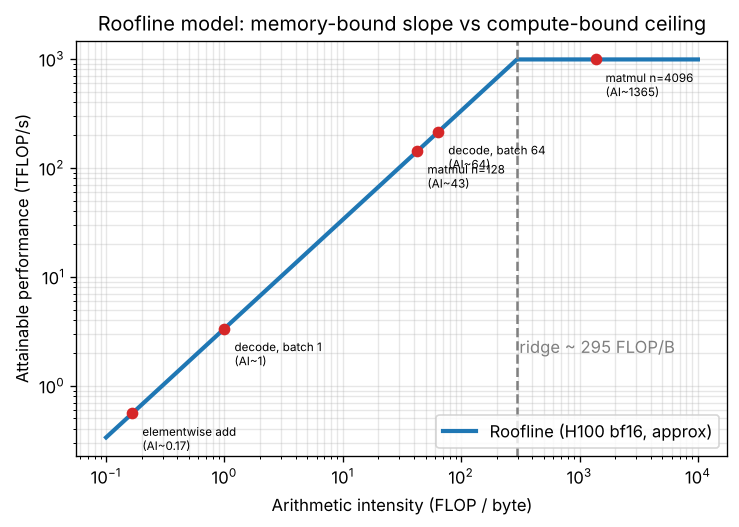

# Day 154 — কত FLOP, কত byte? Roofline-এর চোখে দুনিয়া

> 📅 2026-11-02 · Track B: Phase 12 (হার্ডওয়্যারের ভিত্তি) · Track A: CSE 4711 Week 2

---

## ⚙️ গভীর পাঠ (Deep Dive) — Concept 117: Arithmetic intensity ও Roofline model

### 💡 Intuition: রান্নাঘরের হিসাব

একজন বাবুর্চি প্রতি সেকেন্ডে সর্বোচ্চ ১০০টা সবজি কাটতে পারে (এটা তার **compute** ক্ষমতা)। কিন্তু বাজার থেকে সবজি আসে ঘণ্টায় মাত্র ২০ কেজি (এটা **data আনার গতি**)। এখন দুই রকম রান্না ভাবো:
- **সালাদ:** প্রতি কেজি সবজিতে সামান্য কাটাকুটি। বাবুর্চি বসে থাকে সবজির অপেক্ষায়। দোষ বাজারের, বাবুর্চির নয়।
- **ভুনা খিচুড়ি:** প্রতি কেজি উপকরণ নিয়ে অনেকক্ষণ কাজ। এবার বাবুর্চিই বোতলের গলা।

কোন রান্নায় কোন সীমা কাজ করবে, তা নির্ভর করে **"প্রতি কেজি উপকরণে কতটা কাজ"** এর ওপর। এই অনুপাতটাই arithmetic intensity।

### 🔧 Mechanism

**সংজ্ঞা।** একটা কাজে মোট $F$ টা FLOP (floating-point operation) হয় এবং memory থেকে মোট $B$ byte আসা-যাওয়া করে। তাহলে

$$
I = \frac{F}{B} \quad [\text{FLOP/byte}]
$$

**Roofline সূত্র।** মেশিনের peak compute $P$ (FLOP/s) আর memory bandwidth $W$ (byte/s) হলে, $I$ intensity-র কাজে সর্বোচ্চ কত গতি পাওয়া সম্ভব:

$$
\text{Perf}(I) = \min\left(P,\; I \cdot W\right)
$$

- $I \cdot W < P$ হলে data আনার গতিই সীমা: **memory-bound**।
- $I \cdot W \ge P$ হলে অঙ্ক কষার গতিই সীমা: **compute-bound**।
- দুই অবস্থার সীমারেখা, **ridge point**: $I^* = P / W$। এটা মেশিনের একটা সংখ্যা: "প্রতি byte আনলে কমপক্ষে এতগুলো FLOP না করলে compute unit অলস থাকবে।"



*(লেখচিত্রে দুই অক্ষই log scale। বাঁদিকের ঢাল = memory-bound, ডানের সমতল ছাদ = compute-bound।)*

**H100 SXM-এর আনুমানিক সংখ্যা (published spec):** bf16 dense peak $P \approx 989$ TFLOP/s, HBM3 bandwidth $W \approx 3.35$ TB/s। তাহলে

$$
I^* = \frac{989 \times 10^{12}}{3.35 \times 10^{12}} \approx 295 \ \text{FLOP/byte}
$$

অর্থাৎ HBM থেকে আনা **প্রতিটা byte-এর জন্য ≈ 300 FLOP** করতে না পারলে H100-এর ক্ষমতা পুরো কাজে লাগে না। মনে রাখার মতো ছবি: *computation সস্তা, data আনা দামি।*

**Algorithm-এর intensity হিসাব করার নিয়ম:** $B$ ধরো কেবল **ধীর স্তরের** (এখানে HBM) সঙ্গে লেনদেন; cache বা register-এর ভেতরের reuse গোনা হয় না। তাই একই কাজের $I$ নির্ভর করে তুমি data কতবার reuse করছ, অর্থাৎ **locality** (Concept 116) এর ওপর। Tiling মানে $B$ কমানো, মানে $I$ বাড়ানো।

### 🧮 খাতা-কলমের হিসাব (back-of-envelope)

সবকিছু bf16 (প্রতি সংখ্যা 2 byte) ধরে।

**ক) Elementwise add: $c = a + b$, $n$ টা element।**
- FLOP: $F = n$
- Byte: $a$ পড়ো ($2n$) + $b$ পড়ো ($2n$) + $c$ লেখো ($2n$) = $6n$ byte
- $I = n / 6n \approx 0.17$ FLOP/byte
- Attainable: $0.17 \times 3.35\ \text{TB/s} \approx 0.56$ TFLOP/s, যা peak-এর $0.56/989 \approx 0.06\%$। এই ধরনের operation কখনোই compute-bound হবে না।

**খ) বর্গ matmul: $C = AB$, সবাই $n \times n$।**
- FLOP: $F = 2n^3$ (প্রতি output element-এ $n$ গুণ + $n$ যোগ)
- Byte (আদর্শ অবস্থা, প্রতিটা matrix HBM থেকে একবার পড়া/লেখা): $B = 3 \cdot 2n^2 = 6n^2$
- $I = \dfrac{2n^3}{6n^2} = \dfrac{n}{3}$ FLOP/byte
- $n = 4096$: $I \approx 1365 > 295$ ⟹ **compute-bound** ✅
- $n = 128$: $I \approx 43 < 295$ ⟹ **memory-bound**: attainable $\approx 43 \times 3.35 \approx 143$ TFLOP/s, peak-এর মাত্র ≈ 14%।
- শিক্ষা: matmul বড় হলে intensity বাড়ে ($\propto n$), কারণ FLOP বাড়ে $n^3$ হারে আর data $n^2$ হারে। ছোট matmul GPU-তে অদক্ষ।

**গ) LLM decode (matrix × vector, batch $B_s$):** weight matrix $d \times d$, input $B_s$ টা vector।
- FLOP: $2 B_s d^2$
- Byte: weight পড়া $2d^2$ (প্রভাবশালী অংশ), activation $\approx 4 B_s d$ (নগণ্য)
- $I \approx \dfrac{2B_s d^2}{2d^2} = B_s$ FLOP/byte
- $B_s = 1$: $I \approx 1 \ll 295$। Decode আসলে weight-streaming: প্রতি token-এর জন্য পুরো weight HBM থেকে পড়তে হয়। Compute-bound হতে batch ≈ 295 লাগবে। (Concept 135-এ বিস্তারিত।)

**ঘ) Precision বদলালে:** bf16 → fp8 হলে byte অর্ধেক, তাই একই কাজের $I$ দ্বিগুণ। (Tensor core-এর peak-ও fp8-এ প্রায় দ্বিগুণ, তাই ridge point প্রায় একই জায়গায় থাকে। এটা সংখ্যা-নির্ভর, Concept 120-এ দেখব।)

### 🔬 গবেষণার সীমানা (research frontier)
- FlashAttention-এর মূল কথাই intensity বাড়ানো: $N \times N$ attention matrix HBM-এ না লিখে SRAM-এ রেখে কাজ করা, ফলে $B$ কমে। (Concept 131)
- DeepSeek-V3 FP8 training করে, আংশিক কারণ byte অর্ধেক করা। DeepSeek-V2-এর MLA-ও KV cache ছোট করে decode-এর byte কমায়।
- খোলা প্রশ্ন: bandwidth-এর বাধা না ডিঙিয়ে decode-কে কীভাবে compute-bound করা যায়: speculative decoding, বড় batch, নতুন hardware।

### ❓ Interview প্রশ্ন
> **"A 7B-parameter model in bf16 runs batch-1 decoding on one H100 (≈3.35 TB/s HBM). Ignoring the KV cache and everything else, what is the upper bound on tokens/second, and why can't you reach it by buying a GPU with more FLOPs?"**

*(কী যাচাই করা হচ্ছে: roofline দিয়ে memory-bound কাজের সীমা বের করতে পারো কি না।)* উত্তর নিচে।

---

## 🎓 কোর্স কর্নার — CSE 4711 Week 2: State space, tree search বনাম graph search

### 📘 যা জানতেই হবে

**State space:** সব সম্ভাব্য state-এর সেট + তাদের মধ্যের action/transition। Search tree এই graph-এর **সব path** এর unfold করা রূপ, তাই একই state বহুবার আসতে পারে।

| | Tree search | Graph search |
|---|---|---|
| Repeated state | আবার expand করে | **closed set**-এ থাকলে skip |
| Cycle থাকলে | DFS অসীম লুপে পড়তে পারে | সসীম state space-এ সবসময় থামে |
| Memory | কম (closed set নেই) | বেশি (closed set রাখতে হয়) |
| কাজের পরিমাণ | সর্বোচ্চ $O(b^d)$ | সর্বোচ্চ সব state একবার করে |

**Graph search কীভাবে চলে:** fringe থেকে node তোলো → goal হলে ফেরত দাও → state যদি closed set-এ থাকে, skip → না থাকলে closed set-এ ঢোকাও, successor-গুলো fringe-এ দাও।

⚠️ **Exam-ফাঁদ:** closed set-এ ঢোকে **expand করার সময়**, fringe-এ ঢোকানোর সময় নয়। তাই একই state-এর একাধিক path fringe-এ একসঙ্গে থাকতে পারে।
⚠️ UCS বা A\*-এ graph search-এ closed set ব্যবহার করলে optimality নির্ভর করে খরচ বা heuristic-এর শর্তের ওপর (A\*-এর ক্ষেত্রে consistency, Week 3-এ আসছে)।

### ✍️ হাতে-কলমে সমাধান (hand-trace)

**গল্প:** সাকিব ঢাকার একটা ছোট এলাকার রাস্তার map-এ একটা delivery robot চালাচ্ছে। চৌমাথা S, A, B, C, G; রাস্তা দুই-মুখী:

S–A · S–B · A–B · A–C · B–C · C–G

Robot S থেকে G-তে যাবে। প্রতিটা node-এর প্রতিবেশী alphabetical ক্রমে fringe-এ যায় (tie-breaking)। Goal test হয় fringe থেকে **তোলার** সময়। Path-কে অক্ষর-ক্রমে লিখছি (যেমন SAC)।

**প্রশ্ন [CO1]:** (ক) BFS **tree** search আর (খ) BFS **graph** search চালাও। প্রতিটার expansion সংখ্যা আর ফেরত আসা path বের করো।

প্রতিবেশী: S:{A,B} · A:{B,C,S} · B:{A,C,S} · C:{A,B,G} · G:{C}

**(ক) BFS tree search**

| Depth | Fringe-এ ঢোকা node (ক্রমানুসারে) | সংখ্যা |
|---|---|---|
| 0 | S | 1 |
| 1 | SA, SB | 2 |
| 2 | SAB, SAC, SAS, SBA, SBC, SBS | 6 |
| 3 (তোলার ক্রমে) | SABA, SABC, SABS, SACA, SACB, **SACG**, … | 16 |

- Depth 3-এর ৬ নম্বর node SACG তোলার সময় goal ধরা পড়ে।
- তার আগে expand হয়েছে: $1 + 2 + 6 + 5 = $ **14টা node**। Fringe-এ মোট ঢুকেছে **39টা** node (root সহ)।
- Path: **S → A → C → G** (ধাপ = 3)।

**(খ) BFS graph search** (closed set দিয়ে)

| তোলা | সিদ্ধান্ত | Closed (পরে) | Fringe-এ যোগ |
|---|---|---|---|
| S | expand | {S} | SA, SB |
| SA | expand | {S,A} | SAB, SAC, SAS |
| SB | expand | {S,A,B} | SBA, SBC, SBS |
| SAB | B closed ⟹ skip | | |
| SAC | expand | {S,A,B,C} | SACA, SACB, SACG |
| SAS, SBA, SBC, SBS | সব closed ⟹ skip | | |
| SACA, SACB | closed ⟹ skip | | |
| SACG | **goal** ✅ | | |

- Expand হয়েছে মাত্র **4টা** state: S, A, B, C। Fringe-এ ঢুকেছে মোট 12টা।
- Path: **S → A → C → G**, একই উত্তর।

**তুলনা:** দুটোই একই optimal path দেয়, কিন্তু tree search ≈ 3.5 গুণ বেশি expand করেছে (14 বনাম 4)। Graph বড় হলে এই ফারাক ঘাতাঙ্কীয় হারে বাড়ে।
**বোনাস [CO1]:** এই map-এ DFS tree search (alphabetical) চালালে S→A→B→A→B→… চিরকাল ঘুরবে, কখনো থামবে না। কারণ কোনো node-ই cycle থেকে বেরোনোর সুযোগ পায় না।

**Rubric (৫ marks):** সিদ্ধান্ত: দুই পদ্ধতিতেই path SACG (1) · tree-তে expansion সংখ্যা 14 (1.5) · graph-এ closed set ও 4 expansion (1.5) · skip করার কারণ ব্যাখ্যা (1)।

### 🧠 Formulate & justify [CO2, CO3]

সাকিবের robot-কে এবার একটা parcel তুলে গন্তব্যে পৌঁছাতে হবে: map-এ 6টা চৌমাথা আছে; parcel P চৌমাথায় আর গন্তব্য D চৌমাথায়। Robot চাইলে এক জায়গায় থেমেও থাকতে পারে (STAY)।

1. **[CO2, 3 marks]** State space formulate করো (state, action, goal, cost)। State space-এর আকার কত?
2. **[CO3, 2 marks]** STAY action কি রাখা উচিত? সিদ্ধান্ত ও যুক্তি দাও।

*(উত্তর নিচে।)*

### 🔗 সেতু (bridge)
Graph search-এর closed set মানে "আগে যা হিসাব হয়েছে তা আবার করো না": একই কথা LLM-এর prefix caching (Concept 141) আর tree search-এ transposition table-এ। আর memory বনাম পুনরায় হিসাবের এই বাণিজ্য আজকের roofline-এরই আরেক রূপ।

---

## 🏋️ দ্য গন্টলেট (The Gauntlet) — Tree বনাম Graph

একটা অনির্দেশিত (undirected) graph-এ $n$ টা state (1 থেকে $n$), $m$ টা edge। Start state $S$। একজন student ভাবছে tree search আর graph search কতটা তফাত করে।

- **Tree search** একই state বহুবার generate করে: $S$ থেকে শুরু করে যত সম্ভাব্য walk আছে, প্রতিটা একটা আলাদা tree node। Walk-এর দৈর্ঘ্য (edge সংখ্যা) 0 থেকে $D$ পর্যন্ত। Backtrack করে ফিরে আসাও (parent-এ ফেরা) একটা বৈধ ধাপ।
- **Graph search** প্রতিটা state একবারই expand করে।

তোমার কাজ: depth $D$ পর্যন্ত
1. tree search-এর মোট node সংখ্যা ($10^9 + 7$ দিয়ে mod), এবং
2. graph search-এ $S$ থেকে ≤ $D$ ধাপে পৌঁছানো যায় এমন distinct state-এর সংখ্যা

বের করো।

**Input:** প্রথম লাইনে $n, m, S, D$। পরের $m$ লাইনে $u\ v$ (edge)।
**Output:** একটা লাইনে দুটো সংখ্যা: tree node সংখ্যা (mod) এবং distinct state সংখ্যা।

**Constraints:** $1 \le n \le 2 \cdot 10^5$, $0 \le m \le 2 \cdot 10^5$, $0 \le D \le 500$। Multi-edge ও self-loop নেই।

**Sample**

```
4 4 1 3
1 2
1 3
2 3
2 4
```

```
18 4
```

(ব্যাখ্যা: depth 0..3-এ walk সংখ্যা 1, 2, 5, 10, মোট 18। চারটা state-ই 2 ধাপে পৌঁছানো যায়।)

**Hints**
1. 💡 Tree node মানে একটা আলাদা walk। "ঠিক $k$ ধাপে $v$-তে শেষ হওয়া walk কতগুলো?" এই প্রশ্নটা ছোট করে ভাবো: $k-1$ ধাপের তথ্য থেকে $k$ ধাপের তথ্য বানানো যায় কি?
2. 💡 প্রতিটা layer-এ প্রতিটা edge একবার দেখলেই চলে। পুরো walk-এর তালিকা বানানোর দরকার নেই, শুধু প্রতিটা শেষ-state পর্যন্ত গণনা রাখো।
3. 💡 দ্বিতীয় অংশের জন্য সাধারণ BFS দিয়ে ≤ $D$ দূরত্বের state গোনো। প্রথম অংশে কিছুই visited চিহ্নিত করো না, কারণ tree search-এ repetition-ই আসল ব্যাপার।

**Pattern:** layered DP on graph (walk counting) + BFS
**Target complexity:** $O(D \cdot (n + m))$ সময়, $O(n + m)$ memory

---

## 📄 পেপার কর্নার
শুক্রবার পেপার কর্নার।

## 🔭 রিসার্চ রাডার
বুধবার রিসার্চ রাডার।

## 🏗️ ব্লুপ্রিন্ট
আজ ব্লুপ্রিন্ট নেই।

---

## 🗺️ পরের পথ

আজ তুমি একটা সংখ্যা শিখলে, যা ভবিষ্যতের প্রতিটা optimization-এর দিকনির্দেশনা দেবে: **ridge point**। Kernel বা model নিয়ে যেকোনো প্রশ্নে আগে নিজেকে জিজ্ঞেস করো: "আমি ঢালের কোন দিকে?"

**আগামীকাল:** Concept 118 — CPU parallelism: SIMD, multicore, cache-tiled matmul
**Course Corner:** Week 2 শেষ অংশ — search problem formulate করা, branching factor ও depth, কোন algorithm recommend করবে।

---

## 🔓 গন্টলেটের সমাধান

```cpp
#include <bits/stdc++.h>
using namespace std;
const long long MOD = 1000000007LL;

int main() {
    int n, m, S, D;
    scanf("%d %d %d %d", &n, &m, &S, &D);
    vector<vector<int>> adj(n + 1);
    for (int i = 0; i < m; i++) {
        int u, v;
        scanf("%d %d", &u, &v);
        adj[u].push_back(v);
        adj[v].push_back(u);
    }
    // Tree search: cur[v] = number of walks of exactly k edges from S ending at v
    vector<long long> cur(n + 1, 0), nxt(n + 1, 0);
    cur[S] = 1;
    long long treeNodes = 1;
    for (int k = 1; k <= D; k++) {
        fill(nxt.begin(), nxt.end(), 0);
        long long layer = 0;
        for (int u = 1; u <= n; u++) {
            if (!cur[u]) continue;
            for (int v : adj[u]) nxt[v] = (nxt[v] + cur[u]) % MOD;
        }
        for (int v = 1; v <= n; v++) layer = (layer + nxt[v]) % MOD;
        treeNodes = (treeNodes + layer) % MOD;
        swap(cur, nxt);
    }
    // Graph search: states within distance <= D
    vector<int> dist(n + 1, -1);
    queue<int> q;
    dist[S] = 0;
    q.push(S);
    int cnt = 0;
    while (!q.empty()) {
        int u = q.front(); q.pop();
        cnt++;
        if (dist[u] == D) continue;
        for (int v : adj[u]) {
            if (dist[v] < 0) { dist[v] = dist[u] + 1; q.push(v); }
        }
    }
    printf("%lld %d\n", treeNodes, cnt);
}
```

(একটা সূক্ষ্মতা: `cur[u]` mod-এর পর শূন্য হয়ে গেলে `if (!cur[u]) continue;` ঐ state বাদ দেবে, কিন্তু তাতে যোগফল বদলায় না, কারণ শূন্য যোগ করলে কিছু বদলায় না।)

## 💡 গভীর পাঠের উত্তর

**Batch-1 decode, 7B bf16:**
- Weight-এর আকার ≈ $7 \times 10^9 \times 2\ \text{byte} = 14$ GB।
- প্রতিটা token তৈরি করতে সব weight একবার HBM থেকে পড়তে হয়। সময় ≥ $14\ \text{GB} / 3.35\ \text{TB/s} \approx 4.2$ ms।
- সর্বোচ্চ ≈ $1 / 4.2\ \text{ms} \approx 240$ token/s (KV cache, activation ধরলে কম)।
- **Intensity:** প্রতি token-এ FLOP ≈ $2 \times 7\times10^9 = 14$ GFLOP, byte ≈ 14 GB, তাই $I \approx 1$ FLOP/byte, ridge $\approx 295$-এর চেয়ে বহুগুণ নিচে। Compute unit 99%+ সময় বসে থাকে।
- **কেন বেশি FLOP কিনে লাভ নেই:** সীমা $I \cdot W$ ঢালে; ছাদ ($P$) উঁচু করলে ঢালের কিছু বদলায় না। উন্নতি আসে (ক) বেশি bandwidth, (খ) কম byte (quantization, fp8/int4), (গ) বেশি batch, যাতে প্রতি weight-read-এ বেশি কাজ হয়, বা (ঘ) speculative decoding।

## 🎓 কোর্স কর্নার — উত্তর

**Formulate (CO2):**
- **State:** (চৌমাথা $\ell \in \{1..6\}$, parcel তোলা হয়েছে কি না $h \in \{0,1\}$)। অর্থাৎ $6 \times 2 = $ **12টা state**।
- **Initial:** (Robot-এর শুরুর জায়গা, $h = 0$)। **Goal:** $(D, 1)$, অর্থাৎ parcel তোলা হয়ে গেছে আর robot D-তে।
- **Action:** পাশের চৌমাথায় যাওয়া। P-তে পৌঁছালে $h$ নিজে থেকে 1 হয়ে যায় (বা আলাদা PICKUP action)।
- **Cost:** প্রতি রাস্তার দৈর্ঘ্য বা সময়।
- *Rubric:* state-এ শুধু location নয়, parcel-flag আছে (1) · 12 সংখ্যা (1) · goal ও action/cost ঠিক (1)।

**STAY (CO3):** **রাখা উচিত নয়** (1 mark)।
- Map স্থির, রাস্তার খরচ সময়ের ওপর নির্ভর করে না, তাই অপেক্ষা করলে কোনো লাভ নেই: কোনো optimal path-এ STAY থাকে না (1)।
- STAY প্রতিটা state-এ একটা self-loop ঢোকায়: branching factor বাড়ে, tree search-এ অসংখ্য অকেজো node তৈরি হয়, DFS-এ অসীম লুপের ঝুঁকি বাড়ে। খরচ 0 হলে UCS-এর $\varepsilon > 0$ শর্তও ভাঙে (1)।
- ব্যতিক্রম: যদি সময় state-এর অংশ হয় (যেমন কোনো রাস্তা নির্দিষ্ট সময়ে বন্ধ, বা battery charge হয়), তখন STAY অর্থবহ।
