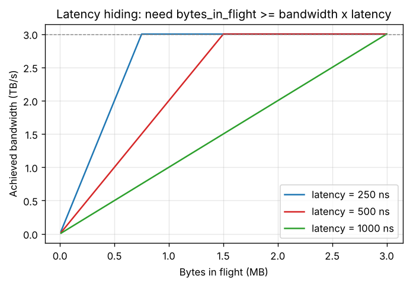

# Day 158 — GPU বনাম CPU: "দ্রুত উত্তর" নয়, "বিপুল থ্রুপুট" আর latency লুকানোর খেলা

> 📅 2026-11-06 (শুক্রবার) · Track B: Phase 12 (হার্ডওয়্যারের ভিত্তি) · Track A: CSE 4711 Week 2 · Paper Corner: Roofline

---

## ⚙️ গভীর পাঠ (Deep Dive) — Concept 121: GPU vs CPU — throughput machines ও latency hiding

### 💡 Intuition: একজন দ্রুত শেফ বনাম হাজার জন ধীর শেফ

দুই ধরনের রেস্টুরেন্ট কল্পনা করো।

- **CPU-রেস্টুরেন্ট:** ৮ জন অসাধারণ দক্ষ শেফ। একটা অর্ডারের উত্তর (latency) খুব দ্রুত আসে। কারণ তাদের হাতের কাছে বড় বড় ফ্রিজ (cache) আছে, আর তারা আগে থেকে অনুমান করে (branch prediction, out-of-order execution) যাতে কখনো বসে থাকতে না হয়।
- **GPU-রেস্টুরেন্ট:** হাজার হাজার সাধারণ শেফ। একজনের একটা পদ রান্না তুলনামূলক ধীর, কিন্তু পুরো রান্নাঘর প্রতি সেকেন্ডে বিপুল সংখ্যক পদ বের করে। কেউ ফ্রিজ থেকে মাল আনতে গেলে (memory wait) পাশের শেফ কাজ চালিয়ে যায়, ফলে **রান্নাঘর কখনো থামে না**।

CS-এর ভাষায়: CPU **latency-optimized**, GPU **throughput-optimized**। CPU প্রশ্ন করে "একটা কাজ কত কম সময়ে শেষ করা যায়?", GPU প্রশ্ন করে "প্রতি সেকেন্ডে মোট কত কাজ শেষ করা যায়?"। Deep learning-এ আমরা কোটি কোটি স্বাধীন গুণ-যোগ করি, কোনো একটার তাড়াহুড়ো নেই, তাই দ্বিতীয় প্রশ্নটাই আমাদের।

### 🔧 Mechanism

**১. একই chip-এর "বাজেট" ভিন্নভাবে খরচ।** Chip-এ জায়গা সীমিত। CPU তা খরচ করে বড় cache, জটিল control logic আর branch predictor-এ, যাতে **একটা thread** দ্রুত হয়। GPU সেই জায়গা খরচ করে **বেশি সংখ্যক গণনা-একক** আর **বিশাল register file**-এ, যাতে **অনেক thread একসাথে** জীবিত থাকতে পারে।

| | CPU | GPU |
|---|---|---|
| লক্ষ্য | একটা thread-এর latency কমানো | মোট throughput বাড়ানো |
| Thread সংখ্যা (একসাথে জীবিত) | দশের ঘরে | হাজার থেকে লক্ষের ঘরে |
| Memory latency সামলায় | বড় cache + prediction | অন্য thread-এ বদলে গিয়ে |
| Thread বদলানোর খরচ | বেশ ভারী (context switch) | প্রায় শূন্য (register আগেই বরাদ্দ) |
| ভালো কাজ | branch-ভারী, ক্রমিক, জটিল logic | একই কাজ বিপুল data-তে (data-parallel) |

**২. Latency hiding: আসল কৌশল।** Memory থেকে data আনতে অনেক সময় লাগে (latency)। GPU সেই অপেক্ষার সময় **অন্য thread-গুচ্ছের কাজ** চালায়। অর্থাৎ latency কমানো হয় না, **লুকানো হয়**। এর মাপকাঠি হলো Little's law (queueing theory-র একটা সরল সূত্র, তুমি অ্যালগোরিদম কোর্সে হয়তো queue-এর বিশ্লেষণে দেখেছ):

$$
\text{in-flight} = \text{throughput} \times \text{latency}
$$

এখানে in-flight মানে যতগুলো অনুরোধ (বা byte) একই সময়ে "পথে" আছে, throughput মানে প্রতি সেকেন্ডে কতটা শেষ হচ্ছে, latency মানে একটা অনুরোধের শুরু থেকে শেষ পর্যন্ত সময়। পাইপে পানির উদাহরণ: পাইপের মুখ থেকে প্রান্ত পর্যন্ত পানি পৌঁছাতে ২ সেকেন্ড লাগে (latency), আর প্রতি সেকেন্ডে ১০ লিটার বের হতে হবে (throughput)। তাহলে পাইপের ভেতরে সবসময় ২০ লিটার পানি থাকতে হবে। **Memory bandwidth পুরোটা ব্যবহার করতে হলে, ঠিক ততটা data সবসময় "পথে" রাখতে হবে।**

**৩. কীভাবে "পথে" রাখে?** প্রতিটা thread একটা load ছোড়ে, তারপর **অপেক্ষা করে**। যথেষ্ট thread থাকলে সবসময় কেউ না কেউ load ছুড়ছে, ফলে memory pipeline সবসময় ভরা। যথেষ্ট thread না থাকলে (কম **occupancy**, Concept 127-এ বিস্তারিত) pipeline ফাঁকা পড়ে থাকে, আর bandwidth-এর সিংহভাগ নষ্ট হয়।



গ্রাফের ঢালু অংশে bandwidth আসলে **in-flight bytes-এর দ্বারা সীমিত**, আর সমতল অংশে hardware-এর সর্বোচ্চ bandwidth-এর দ্বারা। Latency যত বেশি, সমতল অংশে পৌঁছাতে তত বেশি byte "পথে" লাগে।

**৪. কিন্তু দাম আছে।**

- GPU-র এক thread একা চালালে CPU-র চেয়ে **ধীর**। শক্তি আসে সংখ্যায়।
- কাজে **যথেষ্ট স্বাধীন parallelism** লাগে। ছোট batch বা ছোট matrix হলে GPU-র বড় অংশ বসে থাকে।
- Thread-দের branch আলাদা হলে (divergence) সুবিধা কমে, এটা Concept 122-এর বিষয়।
- Latency-sensitive ক্রমিক কাজ (যেমন একটা LLM-এর decode-এ প্রতিটা token আগেরটার ওপর নির্ভর করে) GPU-র জন্য স্বাভাবিকভাবে কঠিন। Concept 135-এ এই দ্বন্দ্ব আবার ফিরবে।

### 🧮 খাতা-কলমের হিসাব (back-of-envelope)

**প্রশ্ন:** একটা GPU-র HBM bandwidth ≈ 3 TB/s আর memory latency ধরলাম ≈ 500 ns (এটা **বোঝার জন্য ধরা সংখ্যা**; আসল latency hardware ও অবস্থাভেদে আলাদা, তবে "কয়েকশো ns" সাধারণ ধারণা)। পুরো bandwidth ব্যবহারে কত byte সবসময় in-flight থাকতে হবে?

$$
\text{in-flight} = 3\times10^{12}\ \tfrac{\text{B}}{\text{s}} \times 500\times10^{-9}\ \text{s} = 1.5\times10^{6}\ \text{B} \approx 1.5\ \text{MB}
$$

প্রতিটা অনুরোধ ধরি 128 B (একটা cache line-এর মতো আকার)। তাহলে একসাথে লাগে

$$
\frac{1.5\times10^{6}\ \text{B}}{128\ \text{B}} \approx 1.2\times10^{4}\ \text{টা অনুরোধ}
$$

H100 SXM-এ SM-এর সংখ্যা 132। তাই প্রতি SM-এ গড়ে ≈ $1.2\times10^4 / 132 \approx 90$টা অনুরোধ সবসময় বাকি থাকতে হবে। একটা warp (32 thread) যদি একসাথে 128 B লোড করে, তাহলে এই কাজ ঢাকতে প্রতি SM-এ কয়েক ডজন warp জীবিত রাখা দরকার।

**তুলনা, একটা CPU core।** ধরি একটা core একসাথে ≈ 10টা cache-miss বাকি রাখতে পারে (সাধারণ আকারের সংখ্যা, ≈), প্রতিটা 64 B, latency ≈ 100 ns:

$$
\frac{10 \times 64\ \text{B}}{100\ \text{ns}} = 6.4\ \tfrac{\text{GB}}{\text{s}}
$$

একটা core-এর memory bandwidth তাই ≈ 6 GB/s-এর ঘরে, যেখানে পুরো GPU কয়েক TB/s। পার্থক্যের মূল কারণ: **একসাথে কতগুলো অনুরোধ উড়ছে**।

### 🔬 গবেষণার সীমানা (research frontier)

Latency hiding এখন শুধু "বেশি thread" দিয়ে হয় না। Hopper-এ asynchronous copy (TMA) ও warp specialization দিয়ে কিছু warp শুধু data আনে আর অন্যরা শুধু গণনা করে, এই কৌশল FlashAttention-3-এর কেন্দ্রে (Concept 132)। একই ধারণা cluster-স্তরে DeepSeek-V3-এর DualPipe-এ: communication-এর অপেক্ষা compute দিয়ে ঢাকা (Concept 152)। "অপেক্ষা লুকাও, মুছো না" নীতিটা পুরো stack-এ বারবার ফিরে আসে।

### ❓ Interview প্রশ্ন

**Q.** *A memory-bound GPU kernel reaches only about 30% of peak HBM bandwidth even though each thread's code is optimal. Latency is ≈ 500 ns and peak bandwidth ≈ 3 TB/s. Using Little's law, explain what is likely wrong and name two ways to fix it.*

(এখানে যাচাই হচ্ছে: latency hiding ও Little's law বোঝা; উত্তর নিচে।)

---

## 🎓 কোর্স কর্নার — CSE 4711 Week 2: Depth-limited ও Iterative-deepening search (IDS)

### 📘 যা জানতেই হবে

- **Depth-limited search (DLS):** DFS, কিন্তু depth $\ell$-এর বেশি গেলে থামে (cutoff)। অসীম পথের সমস্যা মেটায়। কিন্তু goal $\ell$-এর নিচে থাকলে পায় না, তাই **incomplete**।
- **Iterative deepening search (IDS):** $\ell = 0, 1, 2, \dots$ ক্রমে DLS চালায় যতক্ষণ goal না মেলে।
- **IDS-এর গুণ:** BFS-এর মতো **complete** (branching factor $b$ সসীম হলে) ও **optimal** (যখন step cost সব সমান), আবার DFS-এর মতো **space $O(bd)$**।
- **Time:** $O(b^d)$, শুধু ধ্রুবকে BFS-এর চেয়ে সামান্য বেশি।
- **কেন বারবার দোহরানো লাভজনক?** কারণ গাছের বেশিরভাগ node শেষ স্তরে। শেষ স্তর ছাড়া বাকিগুলো বারবার বানালে মোট খরচ সামান্যই বাড়ে।

$$
N_{\text{IDS}} = \sum_{i=0}^{d} (d+1-i)\, b^{i}, \qquad N_{\text{BFS}} = \sum_{i=0}^{d} b^{i}
$$

এখানে $b$ = branching factor, $d$ = shallowest goal-এর depth, $i$ = স্তর। IDS-এ স্তর $i$-এর node $(d+1-i)$ বার তৈরি হয়।

| Algorithm | Complete? | Optimal? | Time | Space |
|---|---|---|---|---|
| BFS | হ্যাঁ | হ্যাঁ (unit cost) | $O(b^d)$ | $O(b^d)$ |
| DFS | না (cycle/অসীম গভীরতায়) | না | $O(b^m)$ | $O(bm)$ |
| DLS | না | না | $O(b^\ell)$ | $O(b\ell)$ |
| IDS | হ্যাঁ | হ্যাঁ (unit cost) | $O(b^d)$ | $O(bd)$ |

($m$ = সর্বোচ্চ গভীরতা।)

### ✍️ হাতে-কলমের সমাধান (hand-trace)

**গল্প:** ইশরাত IUT-র একটা নতুন ভবনে "ক্যান্টিন" খুঁজছে। ঘরগুলো একটা গাছের মতো (প্রবেশপথ $S$ থেকে করিডর বেরিয়েছে)। ভবনে দুটো ক্যান্টিন আছে: $C$ (প্রবেশপথের একদম পাশে) ও $E$ (দুই করিডর ভেতরে)। **Tie-break: ascending branch number** (ছোট branch আগে)।

গাছ (branch number ব্র্যাকেটে):

- $S$ → $A$(1), $B$(2), $C$(3)
- $A$ → $D$(1), $E$(2)
- $D$ → $H$(1)
- $B$ → $F$(1)
- $C$, $E$, $F$, $H$ পাতা। Goal = $\{C, E\}$। Goal test **expansion (pop)-এর সময়**।

**(a) [CO1, 4 marks] Plain DFS (tree search) চালাও। Expansion order ও ফেরত path লেখো।**

Stack-এ ডানদিক থেকে push করি যাতে বাঁয়ের branch আগে pop হয়।

| ধাপ | Pop করা node | Goal? | Stack (শীর্ষ বাঁয়ে) |
|---|---|---|---|
| 1 | $S$ | না | $A, B, C$ |
| 2 | $A$ | না | $D, E, B, C$ |
| 3 | $D$ | না | $H, E, B, C$ |
| 4 | $H$ | না | $E, B, C$ |
| 5 | $E$ | **হ্যাঁ** | থামো |

Expansion order: **$S, A, D, H, E$** (৫টা)। Path: $S \to A \to E$ (depth 2)। *(Rubric: order ২, path ১, ৫ ধাপের উল্লেখ ১।)*

লক্ষ করো, কাছের ক্যান্টিন $C$ (depth 1) থাকতে DFS depth 2-এরটা ফেরত দিল। অর্থাৎ **DFS shallowest নয়**।

**(b) [CO1, 5 marks] IDS চালাও। প্রতিটা iteration-এ expansion order ও মোট expansion সংখ্যা দেখাও।**

- $\ell = 0$: pop $S$ (goal নয়, limit-এ পৌঁছেছি, আর নামি না)। **১টা expansion।**
- $\ell = 1$: pop $S$ → children push; pop $A$ (depth 1 = limit, নামি না); pop $B$ (একইভাবে); pop $C$ → **goal!** Order: $S, A, B, C$, **৪টা expansion।**

Path: $S \to C$ (depth 1), মোট expansion $1 + 4 = \mathbf{5}$। *(Rubric: প্রতিটা iteration-এর order ১+২, সঠিক path ১, মোট ১।)*

**(c) [CO3, 3 marks] এখানে IDS কি DFS-এর চেয়ে ভালো? সিদ্ধান্ত ও যুক্তি দাও।**

**সিদ্ধান্ত: হ্যাঁ, ভালো** (1 mark)। দুজনেই ৫টা node expand করেছে, কিন্তু IDS **shallowest goal ($C$, depth 1)** ফেরত দিয়েছে, DFS দিয়েছে depth 2-এর $E$ (2 marks)। এখানে খরচ সমান ছিল কাকতালীয়ভাবে। সাধারণভাবে IDS-এর space $O(bd)$ বলে DFS-এর মতোই সস্তা, আর BFS-এর মতো optimal।

**(d) [CO1, 3 marks] $b = 4$, $d = 6$। IDS ও BFS কতগুলো node তৈরি করে? অনুপাত কত?**

$$
N_{\text{IDS}} = 7\cdot1 + 6\cdot4 + 5\cdot16 + 4\cdot64 + 3\cdot256 + 2\cdot1024 + 1\cdot4096 = 7279
$$

$$
N_{\text{BFS}} = \frac{4^{7}-1}{4-1} = 5461
$$

অনুপাত $7279/5461 \approx 1.33 = \frac{b}{b-1}$। অর্থাৎ বারবার দোহরানোর বাড়তি খরচ মাত্র ≈ ৩৩%, আর $b$ বাড়লে আরও কমে। *(Rubric: IDS ১, BFS ১, অনুপাত ও ব্যাখ্যা ১।)*

### 🧩 Formulate & justify (CO2/CO3)

**গল্প:** সালমার ড্রোন একটা বিশাল ভবনে (প্রতিটা ঘর থেকে গড়ে ≈ 30টা পথ বেরোয়) সবচেয়ে কাছের চার্জিং স্টেশন খুঁজছে। স্টেশন কত গভীরে আছে জানা নেই, তবে ≤ 8 ধাপের মধ্যে আছে। ড্রোনের memory-তে বড়জোর ≈ $10^{6}$টা node ধরে। প্রতিটা পথের খরচ সমান (১ ধাপ)।

**(i) [CO2, 2 marks]** Search problem formulate করো। **STAY/NoOp action** রাখবে কি?

**(ii) [CO3, 4 marks]** BFS, DFS, IDS-এর মধ্যে কোনটা সুপারিশ করবে? সংখ্যাসহ যুক্তি দাও। *(মডেল উত্তর নিচে।)*

### 🔗 সেতু (bridge)

IDS-এর মূল কথা "জায়গা বাঁচাতে হিসাব আবার করো" (recompute instead of store)। এটাই আধুনিক training-এর **activation recomputation / gradient checkpointing** (Concept 157): মাঝের activation memory-তে না রেখে backward-এ আবার forward চালানো। আর Week 3-এ এসে এর heuristic-সংস্করণ **IDA\*** পাবে। আজকের Deep Dive-এর সাথে মিল: "compute সস্তা, data সরানো/রাখা ব্যয়বহুল।"

---

## 🏋️ দ্য গন্টলেট (The Gauntlet) — Iterative Deepening Bookkeeper

**সমস্যা।** একটা rooted tree দেওয়া আছে, root = node $1$, মোট $n$টা node। প্রতিটা node-এর children ঠিক সেই ক্রমে যেভাবে edge-গুলো input-এ এসেছে (ছোট branch আগে)। কিছু node **goal**। তুমি এই গাছে **Iterative Deepening Search** চালাও:

- $\ell = 0, 1, 2, \dots$ ক্রমে depth-limited DFS (tree search, কোনো visited set নেই)।
- DFS-এ stack থেকে node pop করার সময় goal test করা হয়, এবং pop করা প্রতিটা node এক **expansion** হিসেবে গোনা হয় (goal-টাও গোনা হয়)।
- Node-এর depth $< \ell$ হলে তার children push হয়; depth $= \ell$ হলে হয় না।
- Children এমনভাবে push হয় যাতে ছোট branch আগে pop হয়।
- Goal পেলেই পুরো IDS থামে।

আউটপুট করো: shallowest goal-এর depth $d$, **সব iteration মিলিয়ে মোট expansion সংখ্যা**, এবং root থেকে পাওয়া goal পর্যন্ত path। কোনো goal না থাকলে $-1$।

**Input:** প্রথম লাইনে $n$। পরের $n-1$ লাইনে `p c` (parent, child)। তারপর $k$, তারপর $k$টা goal node।
**Output:** `d total` এক লাইনে, পরের লাইনে path (node আইডি space দিয়ে)। Goal না থাকলে শুধু `-1`।
**Constraints:** $1 \le n \le 2\times10^{5}$, $1 \le k \le n$। (গাছ লম্বা পথের মতো হতে পারে, $d$ প্রায় $n$ পর্যন্ত। সরাসরি সিমুলেশন TLE খাবে।)

**Sample input:**
```
8
1 2
1 3
1 4
2 5
2 6
3 7
5 8
2
4 6
```

**Sample output:**
```
1 5
1 4
```

**Hints (ধাপে ধাপে):**

1. **হিন্ট ১:** যে iteration-গুলোতে goal মেলে না ($\ell < d$), সেগুলোতে DFS ঠিক কোন node-গুলো pop করে? ক্রমটা না, শুধু *সংখ্যাটা* ভাবো।
2. **হিন্ট ২:** $\ell < d$ হলে iteration $\ell$ ঠিক ততগুলো node pop করে যতগুলোর depth $\le \ell$। একবার BFS বা depth-count করে এই সংখ্যাগুলোর prefix sum বানাও।
3. **হিন্ট ৩:** শুধু শেষ iteration ($\ell = d$) আসলে সিমুলেট করতে হবে: একটা সত্যিকারের iterative DFS (recursion নয়, গভীরতা $2\times10^5$ হতে পারে), যে প্রথম goal-এ থামে। বাকিটা সূত্র।

**Pattern:** Tree counting + prefix sums + একটা মাত্র সিমুলেশন (simulate only what you must)।
**Target complexity:** $O(n)$ সময়, $O(n)$ memory। উত্তর 64-bit লাগবে (মোট expansion $\approx n^2/2$ পর্যন্ত যেতে পারে)।

---

## 📄 পেপার কর্নার

### Roofline: An Insightful Visual Performance Model for Multicore Architectures

**লেখক:** Samuel Williams, Andrew Waterman, David Patterson · **সাল:** 2009 · **Venue:** Communications of the ACM, vol. 52, no. 4।

**সমস্যা কী ছিল?** Multicore যুগে প্রশ্ন উঠল, "আমার kernel কেন ধীর, আর কতটা দ্রুত *হতে পারত*?" তখন কোনো সহজ, দৃশ্যমান উত্তর ছিল না। প্রোগ্রামার অনুমান করে optimize করত, কখনো ভুল জায়গায়।

**মূল কৌশল:** একটা kernel-এর কাজ দুটো সংখ্যায় ধরা: **arithmetic intensity** $I$ (প্রতি byte memory traffic-এ কত FLOP) আর hardware-এর দুটো ছাদ: সর্বোচ্চ গণনা-গতি $P_{\text{peak}}$ ও সর্বোচ্চ memory bandwidth $B$। তখন

$$
P \le \min\bigl(P_{\text{peak}},\ I \cdot B\bigr)
$$

Log-log গ্রাফে এটা একটা "ছাদের" মতো দেখায়: বাঁয়ে ঢালু অংশ (memory-bound), ডানে সমতল (compute-bound), মাঝের কোণা "ridge point"। Kernel-এর বিন্দু ছাদের কোথায় তা দেখেই বোঝা যায় কী করলে লাভ।

**কী ছাড়তে হয় (trade-off):** মডেলটা কঠোরভাবে সরল। এটা latency, cache-এর আচরণ বা instruction mix আলাদা করে ধরে না। কাগজে ceiling (যেমন SIMD বা prefetch ছাড়া) যোগ করে কিছুটা উন্নত করা হয়েছে, কিন্তু এটা মূলত একটা **উপরের সীমা**, সঠিক ভবিষ্যদ্বাণী নয়।

**রোডম্যাপের সাথে সংযোগ:** এটা সরাসরি Concept 117 (arithmetic intensity ও roofline)-এর ভিত্তি, আর আজকের Little's law-এর পরিপূরক: roofline বলে *কোন ছাদে* আছো, Little's law বলে *ছাদ ছুঁতে* কতটা concurrency লাগবে। পরে LLM decode-এর memory-bound চরিত্র (Concept 135) বোঝায় এটাই প্রধান যন্ত্র।

**মূল কাগজ পড়ার সময় ভাবো:**

1. Ridge point-এর অবস্থান কীভাবে বলে দেয় একটা machine "balanced" কি না? কাগজের কোন machine-গুলোতে এটা কীভাবে আলাদা?
2. Arithmetic intensity মাপার সময় "কোন memory level-এর traffic" গোনা হবে, তার ওপর roofline কীভাবে বদলায়?
3. কাগজের ceiling-গুলো (SIMD, ILP, prefetch) আজকের GPU-তে কোন জিনিসগুলোর সাথে মেলে (Tensor Core ব্যবহার না করা, coalescing না থাকা)?

---

## 🔭 রিসার্চ রাডার

বুধবার রিসার্চ রাডার।

## 🏗️ ব্লুপ্রিন্ট

আজ ব্লুপ্রিন্ট নেই।

---

## 🗺️ পরের পথ

GPU-কে "ধীর শেফের বিশাল বাহিনী" হিসেবে দেখতে পারলে আগামী পাঠের SM, warp আর divergence নিজে থেকেই জায়গামতো বসে যাবে।

**আগামীকাল:** Concept 122 — GPU architecture: SMs, warps, SIMT, divergence।
**কোর্স কর্নার:** Week 2-এর শেষ ঝালাই: DFS/BFS/UCS-এর expansion order ও "কোন algorithm সুপারিশ করবে" (CO3) ধরনের প্রশ্ন। Week 3 (A\* ও heuristic ⭐) শুরু ৯ নভেম্বর থেকে।

---

## 🔓 গন্টলেটের সমাধান

```cpp
#include <bits/stdc++.h>
using namespace std;
int main(){
    int n;
    scanf("%d", &n);
    vector<vector<int>> ch(n + 1);
    for (int i = 0; i < n - 1; i++) {
        int p, c;
        scanf("%d %d", &p, &c);
        ch[p].push_back(c);          // input order = branch order
    }
    int k;
    scanf("%d", &k);
    vector<char> goal(n + 1, 0);
    for (int i = 0; i < k; i++) { int g; scanf("%d", &g); goal[g] = 1; }

    // 1) depth of every node + number of nodes per depth (BFS, root = 1)
    vector<int> dep(n + 1, -1), par(n + 1, 0);
    vector<long long> cnt(n + 2, 0);
    queue<int> q;
    q.push(1); dep[1] = 0;
    int d = -1;
    while (!q.empty()) {
        int u = q.front(); q.pop();
        cnt[dep[u]]++;
        if (goal[u] && d == -1) d = dep[u];   // BFS order: first goal seen = shallowest
        for (int v : ch[u]) { dep[v] = dep[u] + 1; par[v] = u; q.push(v); }
    }
    if (d == -1) { printf("-1\n"); return 0; }

    // 2) iterations l = 0..d-1 contain no goal: each expands ALL nodes with depth <= l
    long long total = 0, prefix = 0;
    for (int l = 0; l < d; l++) { prefix += cnt[l]; total += prefix; }

    // 3) last iteration l = d: DFS preorder, depth-limited, stop at first goal
    vector<int> st; st.push_back(1);
    long long last = 0; int found = -1;
    while (!st.empty()) {
        int u = st.back(); st.pop_back();
        last++;
        if (goal[u]) { found = u; break; }
        if (dep[u] < d)
            for (int i = (int)ch[u].size() - 1; i >= 0; i--) st.push_back(ch[u][i]);
    }
    total += last;

    vector<int> path;
    for (int v = found; v != 0; v = par[v]) path.push_back(v);
    reverse(path.begin(), path.end());
    printf("%d %lld\n", d, total);
    for (size_t i = 0; i < path.size(); i++) printf("%d%c", path[i], i + 1 == path.size() ? '\n' : ' ');
    return 0;
}
```

**কেন কাজ করে:** $d$ হলো shallowest goal-এর depth, তাই $\ell < d$ হলে কোনো goal পৌঁছানো যায় না এবং সেই iteration depth $\le \ell$-এর সব node pop করে। শেষ iteration-এ প্রথম goal preorder-এ থামে। এই সূত্রে মোট খরচ $O(n)$। (ছোট random গাছে brute-force সিমুলেশনের সাথে মিলিয়ে যাচাই করা হয়েছে।)

## 💡 গভীর পাঠের উত্তর

**Little's law অনুযায়ী** 3 TB/s ধরে রাখতে ≈ 1.5 MB data সবসময় in-flight থাকতে হবে। Kernel ≈ 30% bandwidth পাচ্ছে মানে প্রায় ≈ 0.45 MB-ই in-flight, অর্থাৎ **memory pipeline যথেষ্ট ভরছে না**: concurrency কম (কম occupancy: কম warp জীবিত, বা প্রতিটা thread একটার পর একটা load ছাড়ছে, পরের load আগের শেষের অপেক্ষায়)।

**সমাধান (যেকোনো দুটো):**

1. **Occupancy বাড়াও:** thread block-প্রতি register বা shared memory ব্যবহার কমাও, যাতে প্রতি SM-এ আরও warp জীবিত থাকে।
2. **Thread-প্রতি বেশি independent load ছোড়ো** (memory-level parallelism / loop unrolling): একই thread পরপর কয়েকটা load একসাথে ছাড়ে, তারপর অপেক্ষা করে।
3. **Wider / vectorized load** (যেমন 16 B-এর load) ব্যবহার করো, যাতে প্রতিটা অনুরোধে বেশি byte যায়।
4. **Async copy (cp.async / TMA)** দিয়ে data আনা ও গণনা overlap করো।

মূল শিক্ষা: bandwidth কম মানে সবসময় "memory ধীর" নয়; অনেক সময় "আমরা memory-কে যথেষ্ট কাজ দিচ্ছি না"।

## 🎓 কোর্স কর্নার — উত্তর

**Formulate & justify (ড্রোন):**

**(i) Formulation [CO2, 2 marks]:** State = ড্রোনের বর্তমান ঘর (ভবনের গ্রাফের একটা node)। Initial = ড্রোনের শুরুর ঘর। Action = বর্তমান ঘর থেকে বেরোনো প্রতিটা বৈধ করিডর (প্রতিটা 1 ধাপ)। Transition = ওই করিডরের অপর প্রান্তের ঘর। Goal test = ঘরে চার্জিং স্টেশন আছে কি না। Step cost = 1। **STAY/NoOp রাখা উচিত নয়**: এটা state বদলায় না, তাই কেবল অসীম লুপ ও বাড়তি branching তৈরি করে এবং কোনো solution-এ সাহায্য করে না (tree search-এ অর্থহীন cycle)। *(Rubric: state/initial/action/goal/cost ১, STAY বাদ + কারণ ১।)*

**(ii) সুপারিশ [CO3, 4 marks]:** **সিদ্ধান্ত: IDS** (1 mark)। যুক্তি (3 marks):

- **BFS** shallowest ও optimal, কিন্তু frontier-এ $\approx b^d = 30^{8} \approx 6.6\times10^{11}$ node ধরে। Memory-র সীমা $10^6$-এর বহু ঊর্ধ্বে, তাই অসম্ভব।
- **DFS** সস্তা ($O(bm)$), কিন্তু cycle/অসীম গভীরতায় incomplete এবং কাছের স্টেশন থাকতেও দূরেরটা ফেরত দিতে পারে (optimal নয়)।
- **IDS** space $O(bd) \approx 30 \times 8 = 240$ node, memory সীমার ভেতরে। Step cost সব 1, তাই optimal ও complete। Overhead $\approx b/(b-1) = 30/29 \approx 1.03$, মাত্র ≈ ৩%।
- *ঝুঁকি:* পথের খরচ অসম হলে IDS আর optimal নয়; তখন UCS বা (Week 3-এর) IDA\*।

**Mini rubric:** সিদ্ধান্ত ১; BFS-এর memory সংখ্যাসহ ১; DFS-এর অসুবিধা ১; IDS-এর space ও overhead সংখ্যাসহ ১।
