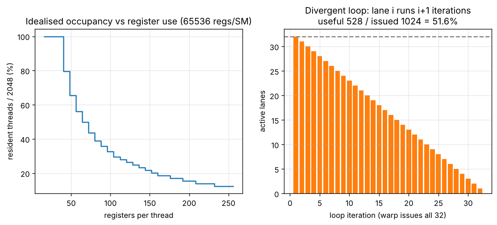

# Day 159 — GPU-র ভেতরে: SM, warp, SIMT আর divergence-এর দাম

> 📅 2026-11-07 (শনিবার) · Track B: Phase 12 (হার্ডওয়্যারের ভিত্তি) · Track A: CSE 4711 Week 2

---

## ⚙️ গভীর পাঠ (Deep Dive) — Concept 122: GPU architecture — SM, warp, SIMT ও divergence

### 💡 Intuition: একজন কোচ, ৩২ জন দৌড়বিদ

গতকাল দেখেছি GPU হলো throughput machine। আজ ভেতরে ঢুকি: এই হাজার হাজার "শেফ" আসলে কীভাবে সংগঠিত?

কল্পনা করো একটা স্কুলের PT ক্লাস। একজন কোচ **একটাই হুকুম** দেন ("ডানে ঘোরো!"), আর ৩২ জন ছাত্র একসাথে সেটা করে। প্রত্যেকের পায়ের নিচের মাটি (data) আলাদা, কিন্তু হুকুম (instruction) এক। এই ৩২ জনের দলের নাম **warp**। কোচ হলো warp scheduler।

CS-এর ভাষায় এটা **SIMT** (Single Instruction, Multiple Threads): একটা instruction ৩২টা thread-এ একসাথে চলে, প্রতিটা thread-এর নিজস্ব register ও নিজস্ব data। যদি দলের কেউ কেউ ভিন্ন হুকুম চায় (`if/else`), কোচ প্রথমে একদলকে হুকুম দেন, বাকিরা দাঁড়িয়ে থাকে; তারপর অন্যদলকে। এটাই **divergence**, আর এর দাম আমরা আজ মাপব।

### 🔧 Mechanism

**১. স্তরবিন্যাস (hierarchy)।** GPU-তে আছে অনেকগুলো **SM** (Streaming Multiprocessor)। SM হলো GPU-র "কোর-ক্লাস্টার", প্রায় একটা ছোট স্বাধীন কম্পিউটার। প্রতিটা SM-এর নিজস্ব register file, shared memory (SRAM) আর কয়েকটা warp scheduler আছে।

| স্তর | কী | সংখ্যা (H100 SXM-এর জন্য, ≈) |
|---|---|---|
| Thread | সবচেয়ে ছোট কাজের একক | SM-এ সর্বোচ্চ 2048 জীবিত |
| Warp | ৩২ thread, একসাথে একই instruction | SM-এ সর্বোচ্চ 64 warp |
| Block | programmer-এর বানানো thread-দল, একটা SM-এ থাকে | SM-এ একাধিক block |
| SM | register file + shared memory + scheduler | পুরো GPU-তে ≈ 132 |

(A100-এ ≈ 108 SM। এগুলো প্রকাশিত spec; model/SKU ভেদে ভিন্ন হতে পারে।)

**২. Scheduling: প্রতি cycle-এ একটা warp বাছাই।** SM-এ অনেক warp *resident* (register দখল করে বসে আছে)। প্রতি cycle-এ scheduler এমন একটা warp বেছে নেয় যার পরের instruction চলার জন্য **প্রস্তুত** (operand এসে গেছে)। কোনো warp memory-র জন্য অপেক্ষা করলে অন্য warp চলে। এই context switch **প্রায় বিনামূল্যে**, কারণ প্রতিটা warp-এর register আগে থেকেই register file-এ বসানো, কোনো save/restore লাগে না। গতকালের latency hiding এভাবেই কাজ করে।

**৩. Register file-ই আসল সীমা।** SM-এর register file সীমিত (≈ 65,536টা 32-bit register)। যত বেশি register প্রতি thread নেয়, তত কম thread একসাথে জীবিত থাকে, তত কম latency লুকানো যায়। এই অনুপাতের নাম **occupancy** = resident warp ÷ সর্বোচ্চ সম্ভব warp।

$$
\text{resident threads per SM} \approx \min\!\left(2048,\ \left\lfloor \frac{65536}{R} \right\rfloor\right)
$$

এখানে $R$ = প্রতি thread-এ ব্যবহৃত register সংখ্যা। (আসলে allocation granularity ও shared-memory সীমাও আছে; এটা সরলীকৃত মডেল।)



**৪. Divergence কীভাবে কাজ করে।** একটা warp-এ `if (cond) A; else B;` এ যদি কিছু lane-এ `cond` সত্য, কিছুতে মিথ্যা হয়, হার্ডওয়্যার একটা **active mask** রেখে প্রথমে A চালায় (মিথ্যা-lane-গুলো মাস্ক করা, তারা কিছু লেখে না), তারপর B চালায়। শেষে সবাই আবার একসাথে (reconverge)। সময় লাগে $t_A + t_B$, $\max$ নয়।

$$
\text{lane utilization} = \frac{\text{useful lane-slots}}{32 \times \text{issued instructions}}
$$

লক্ষ করো: divergence **warp-এর ভেতরে** দাম লাগায়। দুটো আলাদা warp আলাদা পথে গেলে কোনো ক্ষতি নেই, কারণ প্রতিটা warp-এর নিজস্ব instruction stream (program counter)।

> নতুন architecture-এ (Volta থেকে) প্রতিটা thread-এর আলাদা program counter আছে ("independent thread scheduling"), তাই divergent অংশে deadlock-এর ঝুঁকি কমেছে। কিন্তু একই cycle-এ একই warp-এর ভিন্ন পথের instruction চলে না, **throughput-এর দাম একই থাকে**।

### 🧮 খাতা-কলমের হিসাব (back-of-envelope)

**(ক) Occupancy।** ধরো kernel প্রতি thread-এ $R = 64$ register নেয়।

$$
\left\lfloor \frac{65536}{64} \right\rfloor = 1024 \text{ thread} = \frac{1024}{32} = 32 \text{ warp}
$$

সর্বোচ্চ 64 warp-এর মধ্যে 32টা, অর্থাৎ **occupancy = 50%**। $R = 128$ হলে 512 thread = 16 warp = **25%**। $R \le 32$ হলে 2048 thread, পূর্ণ 100%।

**(খ) পুরো GPU-তে জীবিত thread।** $132 \text{ SM} \times 2048 \approx 2.7 \times 10^{5}$ thread (≈ 270 হাজার)। তুলনায় একটা CPU-তে দশের ঘরে।

**(গ) Divergence-এর দাম।** ধরো প্রতিটা lane $i$ ($i = 0, \dots, 31$) একটা লুপ $i+1$ বার চালায় (data-নির্ভর trip count)। Warp ততক্ষণ লুপ চালাতে থাকে যতক্ষণ সবচেয়ে ধীর lane শেষ না হয়, অর্থাৎ **32 iteration**। প্রতি iteration-এ 32 lane-slot issued:

$$
\text{issued} = 32 \times 32 = 1024, \qquad \text{useful} = \sum_{i=1}^{32} i = 528
$$

$$
\text{utilization} = \frac{528}{1024} \approx 51.6\%
$$

মানে প্রায় অর্ধেক হার্ডওয়্যার বসে বসে মাস্ক হয়ে আছে। `if/else` দুই সমান ভাগে হলে তা-ই: অংশটা **২× ধীর**। আর ৩২-মুখী `switch` যেখানে প্রতি lane আলাদা case নেয়, সেখানে ওই অংশ **৩২× ধীর** হতে পারে।

### 🔬 গবেষণার সীমানা (research frontier)

- **Warp specialization:** FlashAttention-3 (Hopper) কিছু warp-কে "producer" (memory থেকে tile আনা) আর কিছুকে "consumer" (matmul) বানায়। এখানে ভিন্ন warp ভিন্ন কাজ করে, তাই divergence-এর ক্ষতি ছাড়াই কাজ ভাগ হয়। (বিস্তারিত Concept 132-এ।)
- DeepSeek-V3 রিপোর্ট অনুযায়ী (আমার জানা মতে) communication-এর জন্য কিছু SM আলাদা করে রাখা হয়, বাকি SM গণনা করে। অর্থাৎ SM এখন scheduling-এর একক, শুধু হার্ডওয়্যার ইউনিট নয়।
- খোলা প্রশ্ন: irregular কাজ (sparse attention, MoE routing) কীভাবে warp-এর ভেতরে divergence ছাড়াই গুছিয়ে দেওয়া যায়?

### ❓ Interview প্রশ্ন

**Q.** *Kernel A uses `if (threadIdx.x % 2 == 0) f(); else g();`. Kernel B uses `if ((threadIdx.x / 32) % 2 == 0) f(); else g();`. Both have 256 threads per block and `f`, `g` cost the same. Which one suffers from warp divergence, and by how much?*

(এখানে যাচাই হচ্ছে: warp = ৩২টা পরপর thread, এই সীমানা ধরে divergence বোঝা; উত্তর নিচে।)

---

## 🎓 কোর্স কর্নার — CSE 4711 Week 2: UCS-এর hand-trace, graph search ও goal-test কখন

### 📘 যা জানতেই হবে

- **Uniform-Cost Search (UCS):** fringe হলো **priority queue**, যার key হলো path cost $g(n)$। সবচেয়ে কম $g$-এর node আগে expand হয়।
- **Complete** যদি প্রতিটা step cost $\ge \epsilon > 0$ হয়। **Optimal**, কারণ node expand হওয়ার সময় তার $g$ সবচেয়ে কম।
- **Goal test অবশ্যই pop (expansion)-এর সময়।** Generate-এর সময় test করলে সস্তা কিন্তু ভুল পথ ফেরত আসতে পারে (নিচে দেখবে)।
- **Time/Space:** $C^*$ = optimal cost হলে প্রায় $O\!\left(b^{\,1+\lfloor C^*/\epsilon \rfloor}\right)$।
- **Graph search-এ:** expanded node closed set-এ থাকে। একই node fringe-এ একাধিকবার থাকতে পারে (পুরনো, বেশি দামের entry "stale")। Stale entry pop হলে ফেলে দাও, তা expansion নয়।
- UCS = $h \equiv 0$ ধরে A*; আর unit cost হলে BFS-এর মতো আচরণ।

### ✍️ হাতে-কলমের সমাধান (hand-trace)

**গল্প:** রাফি ঢাকা ($S$) থেকে সিলেট ($G$) যাবে। মাঝখানে শহর $A, B, C, D$। সড়কগুলো দ্বিমুখী, দৈর্ঘ্য (ঘণ্টা) নিচে। **Tie-break: alphabetical।** Graph search ব্যবহার করো (closed set আছে), goal test pop-এর সময়।

| সড়ক | খরচ | সড়ক | খরচ |
|---|---|---|---|
| $S$–$A$ | 1 | $B$–$C$ | 2 |
| $S$–$B$ | 4 | $B$–$D$ | 5 |
| $S$–$G$ | 10 | $C$–$G$ | 3 |
| $A$–$B$ | 2 | $D$–$G$ | 1 |
| $A$–$C$ | 6 | | |

**(a) [CO1, 6 marks] UCS (graph search) চালাও। প্রতি ধাপে fringe দেখাও। Expansion order, ফেরত path ও cost লেখো।**

Fringe-এর entry: `node(g)`। `*` = stale।

| ধাপ | Pop | কাজ | Fringe (সাজানো) |
|---|---|---|---|
| 1 | $S(0)$ | $A1, B4, G10$ push | $A1, B4, G10$ |
| 2 | $A(1)$ | $B$ via $A$ = 3 (< 4), $C$ = 7 | $B3, B4, C7, G10$ |
| 3 | $B(3)$ | $C$ = 5 (< 7), $D$ = 8 | $B4^*, C5, C7, D8, G10$ |
| 4 | $B(4)$ | $B$ closed, **stale, ফেলে দাও** | $C5, C7, D8, G10$ |
| 5 | $C(5)$ | $G$ = 8 (< 10) | $C7^*, D8, G8, G10$ |
| 6 | $C(7)$ | stale, ফেলে দাও | $D8, G8, G10$ |
| 7 | $D(8)$ | tie $D8$ vs $G8$: alphabetical, $D$ আগে। $G$ via $D$ = 9 (> 8, বাদ) | $G8, G10$ |
| 8 | $G(8)$ | **Goal!** | থামো |

Expansion order: **$S, A, B, C, D, G$** (৬টা)। Path: $S \to A \to B \to C \to G$, **cost = 8**। *(Rubric: order ২, path ১, cost ১, fringe-এ stale-এর সঠিক হ্যান্ডলিং ২।)*

**(b) [CO3, 3 marks] কেউ বলল "$G$ generate হওয়া মাত্র goal test করলেই তো হয়, সময় বাঁচে।" এই পদ্ধতিতে কোন path আসত? কেন ভুল?**

**সিদ্ধান্ত: ভুল (suboptimal) path আসত** (1 mark)। ধাপ 1-এ $S$ expand করার সময়ই $G$ (cost 10) generate হয়, সেটাই ফেরত যেত: $S \to G$, cost 10 > 8 (1 mark)। কারণ generate হওয়া মানে "কোনো একটা পথ পাওয়া", সবচেয়ে সস্তা পথ নয়। Pop হওয়া মানে fringe-এ এর চেয়ে সস্তা কিছু নেই (1 mark)।

**(c) [CO1, 2 marks] Tie-break $G$ আগে হলে expansion সংখ্যা কত হতো?**

ধাপ 7-এ $G8$ আগে pop হলে $D$ expand হতো না: **৫টা** ($S, A, B, C, G$)। অর্থাৎ tie-break expansion সংখ্যা বদলায়, কিন্তু cost 8 বদলায় না। *(Rubric: সংখ্যা ১, কারণ ১।)*

**(d) [CO1, 2 marks] $b = 3$, সব সড়ক $\ge 1$ ঘণ্টা, $C^* = 8$। UCS-এর worst-case node সংখ্যার সীমা কত?**

$$
b^{\,1+\lfloor C^*/\epsilon \rfloor} = 3^{1+8} = 3^{9} = 19683
$$

*(Rubric: সূত্র ১, মান ১।)*

### 🧩 Formulate & justify (CO2/CO3)

**গল্প:** তাসনিমের delivery robot একটা শহরের সড়ক-নেটওয়ার্কে (প্রতিটা সড়কের দৈর্ঘ্য ভিন্ন, ১ থেকে ৫০০ মিটার) গুদাম থেকে গ্রাহকের কাছে সবচেয়ে ছোট পথ খুঁজবে। Robot-এর memory সীমিত নয়।

**(i) [CO3, 3 marks]** BFS, IDS ও UCS-এর মধ্যে কোনটা সুপারিশ করবে? সিদ্ধান্ত ও যুক্তি দাও।
**(ii) [CO2, 3 marks]** এই সমস্যাকে search problem হিসেবে formulate করো (state, actions, transition, cost, goal test)। STAY/NoOp action রাখা উচিত কি না, যুক্তিসহ বলো।

*মডেল উত্তর নিচে।*

### 🔗 সেতু (bridge)

UCS-এর priority queue-তে এক node-এর পর অন্য node, প্রতিটা pop-এর পরের পথ data-নির্ভর। এই **irregular, branchy** কাজ SIMT-এর জন্য বাজে: warp-এর lane-গুলো ভিন্ন পথে যায়, ঠিক আজকের divergence। এজন্যই GPU-তে graph search/beam search-কে batch করে "সবাই একই ধাপে" বানাতে হয়। আর UCS-এ heuristic $h$ যোগ করলেই A*, যা Week 3।

---

## 🏋️ দ্য গন্টলেট (The Gauntlet) — UCS Inspector

**সমস্যা।** একটা **দ্বিমুখী (undirected)** weighted graph দেওয়া আছে: $n$টা node, $m$টা edge, প্রতিটা weight $\ge 1$। Start node $s$। কিছু node **goal**। তুমি **UCS (graph search)** চালাও:

- Fringe-এর ক্রম: $(g, \text{node id})$ ছোট আগে (tie-break: ছোট id)।
- Goal test হয় **pop-এর সময়**।
- Pop করা node আগেই closed হলে সেটা stale; ফেলে দাও, **expansion গোনা হবে না**।
- যে pop-এ প্রথম goal মেলে সেটাও expansion হিসেবে গোনা হয়।
- Parent বদলায় শুধু *কঠোরভাবে ছোট* $g$ পেলে।

আউটপুট: প্রথম লাইনে `cost expansions ways`, এখানে `ways` = $s$ থেকে ওই goal পর্যন্ত **সব shortest path-এর সংখ্যা** modulo $10^9+7$। দ্বিতীয় লাইনে UCS-এর parent-চেইন ধরে path। কোনো goal-এ পৌঁছানো না গেলে `-1`।

**Input:** প্রথম লাইনে `n m s`। দ্বিতীয় লাইনে $k$, তৃতীয় লাইনে $k$টা goal। তারপর $m$ লাইনে `u v w`।
**Constraints:** $1 \le n \le 2\times10^{5}$, $1 \le m \le 4\times10^{5}$, $1 \le w \le 10^{9}$। (দূরত্ব 64-bit লাগবে।)

**Sample input:**
```
6 9 1
1
6
1 2 1
1 3 4
2 3 2
2 4 6
3 4 2
3 5 5
4 6 3
5 6 1
1 6 10
```

**Sample output:**
```
8 6 1
1 2 3 4 6
```

**Hints (ধাপে ধাপে):**

1. **হিন্ট ১:** "stale entry ফেলে দাও" মানে priority queue থেকে পুরনো entry মুছতে হবে না। Pop করার পর কীভাবে বুঝবে এটা পুরনো?
2. **হিন্ট ২:** Shortest path গোনা: $v$-তে ঠিক সমান দাম পেলে $\text{ways}[v] \mathrel{+}= \text{ways}[u]$, কঠোরভাবে কম দাম পেলে $\text{ways}[v] = \text{ways}[u]$। এটা কেন নিরাপদ? কারণ সব weight $\ge 1$, তাই $u$ pop হওয়ার সময় তার সব predecessor আগেই settled।
3. **হিন্ট ৩:** Path বানাতে parent array ধরে পিছিয়ে যাও, তারপর reverse করো। Goal পেলেই সোজা থেমে যাও, বাকি fringe-এর দরকার নেই।

**Pattern:** Dijkstra with lazy deletion + shortest-path counting।
**Target complexity:** $O((n+m)\log n)$ সময়, $O(n+m)$ memory।

---

## 📄 পেপার কর্নার

শুক্রবার পেপার কর্নার।

---

## 🔭 রিসার্চ রাডার

বুধবার রিসার্চ রাডার।

---

## 🏗️ ব্লুপ্রিন্ট

আজ ব্লুপ্রিন্ট নেই।

---

## 🗺️ পরের পথ

GPU-র ভেতরের নকশা এখন তোমার চোখে: কোচ, ৩২ জনের দল, আর সবাইকে একই হুকুমে রাখার দাম। এই ছবিটা মাথায় থাকলে পরের প্রতিটা kernel-optimization গল্প সহজ হবে।

- **আগামীকাল: Concept 123 — GPU memory: HBM, shared memory/SRAM, registers, coalescing, bank conflicts**
- **Course Corner:** Week 2 শেষ ধাপ — search algorithm-গুলোর তুলনা ও "কোনটা সুপারিশ করবে" ধরনের প্রশ্ন। সোমবার (৯ নভেম্বর) থেকে Week 3: Informed search (greedy, A*)।
- ⏳ মিড-সেমিস্টার পরীক্ষা ১৪ ডিসেম্বর থেকে, আর ৭ ডিসেম্বর থেকে exam drill শুরু। হাতে এখনও সময় আছে, নিয়মিত থাকো।

---

🔓 গন্টলেটের সমাধান

```cpp
#include <bits/stdc++.h>
using namespace std;
typedef long long ll;
const ll MOD = 1000000007LL;

int main() {
    int n, m, s;
    scanf("%d %d %d", &n, &m, &s);
    int k; scanf("%d", &k);
    vector<char> isGoal(n + 1, 0);
    for (int i = 0; i < k; i++) { int g; scanf("%d", &g); isGoal[g] = 1; }
    vector<vector<pair<int,int>>> adj(n + 1);
    for (int i = 0; i < m; i++) {
        int u, v, w; scanf("%d %d %d", &u, &v, &w);
        adj[u].push_back({v, w});
        adj[v].push_back({u, w});   // undirected
    }
    const ll INF = LLONG_MAX / 4;
    vector<ll> d(n + 1, INF), cnt(n + 1, 0);
    vector<int> par(n + 1, 0);
    vector<char> closed(n + 1, 0);
    priority_queue<pair<ll,int>, vector<pair<ll,int>>, greater<pair<ll,int>>> pq;
    d[s] = 0; cnt[s] = 1; pq.push({0, s});
    ll expansions = 0;
    while (!pq.empty()) {
        auto [g, u] = pq.top(); pq.pop();
        if (closed[u] || g != d[u]) continue;   // stale entry: not an expansion
        closed[u] = 1;
        expansions++;
        if (isGoal[u]) {
            vector<int> path;
            for (int x = u; x != 0; x = par[x]) path.push_back(x);
            reverse(path.begin(), path.end());
            printf("%lld %lld %lld\n", g, expansions, cnt[u] % MOD);
            for (size_t i = 0; i < path.size(); i++)
                printf("%d%c", path[i], i + 1 == path.size() ? '\n' : ' ');
            return 0;
        }
        for (auto [v, w] : adj[u]) {
            if (closed[v]) continue;
            ll nd = g + w;
            if (nd < d[v]) { d[v] = nd; cnt[v] = cnt[u]; par[v] = u; pq.push({nd, v}); }
            else if (nd == d[v]) cnt[v] = (cnt[v] + cnt[u]) % MOD;
        }
    }
    puts("-1");
}
```

Sample-এ চালিয়ে যাচাই করা হয়েছে: আউটপুট `8 6 1` ও `1 2 3 4 6`।

💡 গভীর পাঠের উত্তর

**Kernel A-তে divergence হয়, Kernel B-তে হয় না।**

- **A:** `threadIdx.x % 2` জোড়/বিজোড় lane আলাদা করে, আর প্রতিটা warp-এ (৩২টা পরপর thread) জোড় ও বিজোড় দুই ধরনই আছে। তাই **প্রতিটা warp-ই** দুই পথ ক্রমানুসারে চালায়: সময় $t_f + t_g$, অর্থাৎ এই অংশ **২× ধীর** (lane utilization 50%)।
- **B:** `threadIdx.x / 32` হলো warp-এর নম্বর। একটা warp-এর ৩২ thread-এর সবার মান একই, তাই পুরো warp একই দিকে যায়। কোনো warp-এর ভেতরে divergence নেই; কিছু warp `f` চালায়, কিছু `g`, আর তারা স্বাধীনভাবে scheduled হয়। দাম **১×**।
- শিক্ষা: branch-এর শর্ত যেন warp-সীমানা (৩২-এর গুণিতক) ধরে একই থাকে, তা হলে divergence-এর দাম শূন্য। Data এমনভাবে সাজাও (sort/bucket) যাতে একই ধরনের কাজ একই warp-এ পড়ে।

🎓 কোর্স কর্নার — উত্তর

**(b) এর মডেল উত্তর:** ওপরে হাতে-কলমের অংশেই দেওয়া আছে।

**Formulate & justify (i) — [CO3, 3 marks]**

**সিদ্ধান্ত: UCS** (1 mark)। যুক্তি: সড়কের দৈর্ঘ্য ভিন্ন বলে BFS ও IDS "ধাপ সংখ্যা" কমায়, মিটার নয়। তারা শুধু unit-cost হলে optimal। UCS কম $g$ আগে expand করে বলে সবসময় সবচেয়ে ছোট দূরত্ব দেয় (1 mark)। Memory সীমিত না হওয়ায় UCS-এর বড় space খরচ ($O(b^{1+\lfloor C^*/\epsilon\rfloor})$) সমস্যা নয়; সব weight $\ge 1$ মিটার, তাই $\epsilon > 0$ শর্তে complete (1 mark)।

*Mini rubric: সিদ্ধান্ত ১ · BFS/IDS কেন optimal নয় ১ · memory ও completeness শর্ত ১।*

**Formulate & justify (ii) — [CO2, 3 marks]**

- **State:** robot-এর বর্তমান জংশন (node)। (চাইলে ব্যাটারি/ডেলিভারি-স্ট্যাটাস যোগ করা যায়, কিন্তু প্রশ্নে নেই।)
- **Actions:** বর্তমান জংশন থেকে প্রতিটা সংলগ্ন জংশনে যাওয়া।
- **Transition:** `go(v)` state-কে $v$ করে।
- **Cost:** সড়কের দৈর্ঘ্য (মিটার), সবসময় $> 0$।
- **Initial:** গুদামের জংশন। **Goal test:** বর্তমান জংশন = গ্রাহকের জংশন।
- **STAY/NoOp রাখবে না:** এটা state বদলায় না, cost > 0 হলে শুধু cycle বানায় (state space-এ self-loop), কোনো লাভ নেই। রাখলে tree search অসীম লুপে পড়তে পারে এবং branching factor অকারণে বাড়ে। (শুধু যদি অপেক্ষা করা কোনো কাজে লাগত, যেমন ট্রাফিক সময়-নির্ভর হলে, তখন সময়কে state-এ ঢুকিয়ে NoOp রাখা যুক্তিসংগত।)

*Mini rubric: state/actions/transition ১ · cost ও goal test ১ · NoOp-এর সিদ্ধান্ত ও যুক্তি ১।*
