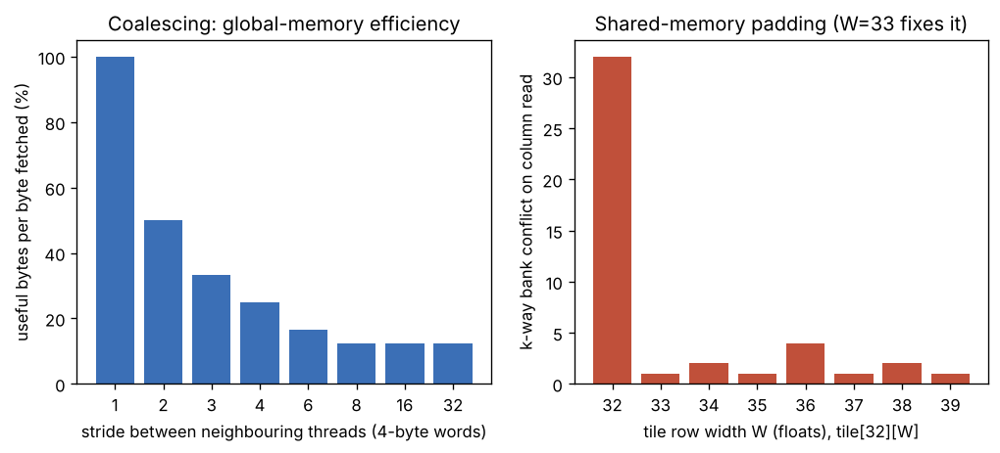

# Day 160 — GPU-র স্মৃতি: HBM থেকে register, coalescing আর bank conflict

> 📅 2026-11-08 (রবিবার) · Track B: Phase 12 (হার্ডওয়্যারের ভিত্তি) · Track A: CSE 4711 Week 2

---

## ⚙️ গভীর পাঠ (Deep Dive) — Concept 123: GPU memory — HBM, shared memory/SRAM, registers, coalescing, bank conflicts

### 💡 Intuition: লাইব্রেরি, তাক আর হাতের মুঠো

গতকাল দেখেছি GPU-র ভেতরে কোচ আর ৩২ জনের দল (warp)। আজ প্রশ্ন: ওই দলের হাতে **ডেটা** আসে কোথা থেকে?

ভাবো তুমি একটা বিশাল লাইব্রেরিতে পরীক্ষার প্রস্তুতি নিচ্ছ:

- **HBM** = শহরের ওপারের বিশাল গুদাম। জায়গা অনেক (80 GB), কিন্তু আনতে সময় লাগে।
- **L2 cache** = ভবনের কমন তাক, সব SM ভাগ করে ব্যবহার করে।
- **Shared memory (SRAM)** = তোমার ডেস্কের পাশের নিজস্ব তাক। ছোট, কিন্তু দ্রুত, আর **তুমি নিজে** ঠিক করো কী রাখবে।
- **Register** = তোমার হাতের মুঠো। সবচেয়ে দ্রুত, কিন্তু মুঠোয় ধরে খুব অল্প।

নিয়ম একটাই: **যত কাছের স্তর, তত দ্রুত ও তত ছোট।** আর পুরো বইয়ের মূলমন্ত্র মনে রাখো: গণনা সস্তা, ডেটা সরানো দামি।

### 🔧 Mechanism

**১. স্তরগুলো (H100 SXM-এর প্রকাশিত spec অনুযায়ী, সবই ≈):**

| স্তর | কার | আকার | গতি/latency (≈) |
|---|---|---|---|
| Register file | প্রতি thread-এর নিজস্ব | প্রতি SM-এ 64K × 4 B = 256 KB | ≈ ১ cycle |
| Shared memory / L1 | প্রতি SM-এর, block-এর thread-রা ভাগ করে | প্রতি SM-এ ≈ 228 KB পর্যন্ত (ভাগাভাগি করা) | ≈ 20–30 cycle |
| L2 cache | পুরো GPU-র | ≈ 50 MB | ≈ শ'খানেক cycle |
| HBM (global memory) | পুরো GPU-র | ≈ 80 GB | ≈ 3.35 TB/s bandwidth, latency ≈ কয়েকশো cycle |

(A100 ও অন্য SKU-তে সংখ্যা ভিন্ন। এখানে ধারণাটাই মূল, সংখ্যা নয়।)

**২. Coalescing: ৩২ জন একসাথে কোথা থেকে পড়ছে?**
Warp-এর ৩২টা thread একই instruction-এ ডেটা চায়। হার্ডওয়্যার এই ৩২টা ঠিকানা দেখে সেগুলোকে **ছোট ছোট খণ্ডে** (সাম্প্রতিক NVIDIA GPU-তে ≈ 32-byte sector, আর 128-byte cache line) ভাগ করে HBM থেকে আনে। প্রতিটা খণ্ডের জন্য একটা লেনদেন (transaction)। তাই:

- ৩২ thread পরপর ৩২টা `float` পড়লে ঠিকানা 128 byte জুড়ে লেগে থাকে, সেটা **4টা sector**, সবটাই কাজে লাগে।
- Thread-গুলো ফাঁক রেখে পড়লে (stride) একই 128 byte কাজ করতে **অনেক বেশি sector** আনতে হয়, বাকি byte ফেলা যায়।

stride $s$ (4-byte word-এ) হলে thread $i$ পড়ে byte $4si$, আর sector নম্বর $\lfloor 4si/32 \rfloor = \lfloor si/8 \rfloor$। কাজের দক্ষতা:

$$
\text{efficiency} = \frac{128\ \text{useful bytes}}{32\ \text{B} \times \#\text{sectors touched}}
$$

| stride $s$ | sector সংখ্যা | efficiency |
|---|---|---|
| 1 | 4 | 100% |
| 2 | 8 | 50% |
| 4 | 16 | 25% |
| $\ge 8$ | 32 | 12.5% |



**একটা চেনা উদাহরণ:** `struct { float f[8]; }` এর array (AoS) থেকে শুধু একটা field পড়লে stride = 8 word, আর efficiency 12.5%। Struct-of-arrays (SoA) করলে stride = 1। ডেটার **layout** বদলালেই একই কোডে ৮× bandwidth।

**৩. Shared memory ও bank:**
Shared memory ৩২টা **bank**-এ ভাগ করা। 4-byte word নম্বর $x$ থাকে bank $x \bmod 32$-এ। প্রতিটা bank প্রতি cycle-এ **একটা** word দিতে পারে।

- ৩২ thread ৩২টা **আলাদা bank** থেকে পড়লে: ১ cycle।
- একাধিক thread একই bank-এর **আলাদা word** চাইলে: **bank conflict**, serialize হয়ে সময় বাড়ে। $k$ জন হলে $k$-way conflict, মানে $k$× ধীর।
- একাধিক thread একই bank-এর **একই word** চাইলে: broadcast, **বিনামূল্যে**।

**৪. Classic ফাঁদ ও padding:** `__shared__ float tile[32][32]`-এ কলাম পড়লে thread $i$ পড়ে `tile[i][c]` = word $32i + c$, সবার bank $= c$। **৩২-way conflict**। সমাধান: `tile[32][33]`। তখন word $= 33i + c$, bank $= (i + c) \bmod 32$, সবাই আলাদা। খরচ: মাত্র এক কলাম বাড়তি memory (≈ 3%)।

**৫. Register:** সবচেয়ে দ্রুত, কিন্তু আগের দিনের occupancy-র সীমা মনে রেখো: বেশি register নিলে কম warp জীবিত থাকে। আর register ফুরিয়ে গেলে compiler মান "spill" করে ধীর memory-তে নামিয়ে দেয়।

### 🧮 খাতা-কলমের হিসাব (back-of-envelope)

**(ক) অন-চিপ বনাম অফ-চিপ।** 132 SM × 256 KB register ≈ 33 MB; 132 SM × ≈ 228 KB shared ≈ 30 MB। অর্থাৎ পুরো GPU-র দ্রুত অন-চিপ ঘরে মোট ≈ 60 MB, আর HBM-এ 80 GB:

$$
\frac{80\ \text{GB}}{\approx 60\ \text{MB}} \approx 1300\times
$$

এজন্যই FlashAttention-এর মতো কৌশল ডেটাকে ছোট tile-এ কেটে SRAM-এ রেখে কাজ করায়।

**(খ) 1 GB কপি।** 1 GB পড়া + 1 GB লেখা = 2 GB। সময়:

$$
\frac{2\ \text{GB}}{3.35\ \text{TB/s}} \approx 0.6\ \text{ms}
$$

**(গ) Stride-8 ফাঁদ।** একই কপি 12.5% efficiency-তে হলে ≈ $0.6 \times 8 \approx 4.8$ ms। কোডে একটা `* 8` সূচকেই ৮× ক্ষতি।

**(ঘ) Element-wise যোগ (`c = a + b`, fp32)।** প্রতি element-এ 1 FLOP, সরানো byte = 4 + 4 + 4 = 12 B। Arithmetic intensity $= 1/12 \approx 0.083$ FLOP/B। Bandwidth-সীমিত গতি:

$$
0.083\ \text{FLOP/B} \times 3.35\times10^{12}\ \text{B/s} \approx 2.8\times10^{11}\ \text{FLOP/s} \approx 0.28\ \text{TFLOP/s}
$$

fp32 peak দশ-বিশ TFLOP/s-এর ঘরে (≈ 60+), তাই ব্যবহার ১% এর নিচে। এটা পুরোপুরি memory-bound, আর তাই Concept 128-এ (kernel fusion) আমরা এই পুরো আলোচনায় ফিরব।

**(ঙ) Bank conflict।** ৩২-way conflict-এ একটা shared load লাগে 32 cycle, conflict-মুক্তে 1 cycle। tile transpose-এর ভেতরের লুপে এটা প্রায় সরাসরি kernel-এর গতিকে ৩২ দিয়ে ভাগ করতে পারে।

### 🔬 গবেষণার সীমানা (research frontier)

- FlashAttention-এর পুরো ধারণা এই হিসাবের ওপর দাঁড়ানো: N×N score matrix HBM-এ না লিখে SRAM-এ tile করে রাখা (Concept 131)।
- Hopper-এ HBM থেকে shared memory-তে ডেটা আনার জন্য আলাদা async copy ইউনিট (TMA) আছে, যাতে গণনার সাথে data movement ওভারল্যাপ হয়। FlashAttention-3 ও (আমার জানা মতে) DeepGEMM-এর মতো FP8 kernel এটা কাজে লাগায়।
- খোলা প্রশ্ন: সঠিক data layout ও swizzle (bank conflict এড়াতে ঠিকানা এলোমেলো করা) কম্পাইলার নিজে কীভাবে বেছে নেবে? Triton ও CUTLASS-এর layout অ্যালজেব্রা এই প্রশ্নেরই উত্তর খুঁজছে।

### ❓ Interview প্রশ্ন

**Q.** *A warp reads `float v = s[2 * threadIdx.x];` from a `__shared__ float s[...]` array (32 banks, 4-byte words). How many-way bank conflict is this? What small change to the indexing removes it, and what does the same pattern cost when the data is in global memory instead?*

(যাচাই হচ্ছে: bank = word index mod 32 হিসাব করে conflict degree বের করা, আর shared ও global-এর "খারাপ" access pattern যে আলাদা তা বোঝা। উত্তর নিচে।)

---

## 🎓 কোর্স কর্নার — CSE 4711 Week 2: DFS, BFS ও IDS-এর তুলনা (tree vs graph search)

### 📘 যা জানতেই হবে

$b$ = branching factor, $d$ = shallowest goal-এর depth, $m$ = সর্বোচ্চ depth।

| Algorithm | Complete? | Optimal? | Time | Space |
|---|---|---|---|---|
| BFS | হ্যাঁ ($b$ সসীম হলে) | শুধু unit cost হলে | $O(b^d)$ | $O(b^d)$ |
| DFS (tree search) | না (লুপ বা অসীম depth) | না | $O(b^m)$ | $O(bm)$ |
| DFS (graph search) | সসীম state space-এ হ্যাঁ | না | $O(\min(b^m, N_S))$ | $O(N_S)$ |
| IDS | হ্যাঁ | শুধু unit cost হলে | $O(b^d)$ | $O(bd)$ |

- ($N_S$ = মোট state সংখ্যা)
- **DFS-এর fringe হলো stack (LIFO)**, BFS-এর queue (FIFO)।
- **Tree search** কোনো node মনে রাখে না, তাই cycle থাকলে একই state বারবার expand হয় এবং অসীম লুপে পড়তে পারে। **Graph search**-এ expanded node-এর closed set থাকে।
- **IDS** = depth limit $0, 1, 2, \dots$ দিয়ে depth-limited DFS বারবার চালানো। DFS-এর কম memory আর BFS-এর shallowest-first completeness, দুটোই পায়।
- IDS-এ উপরের স্তরের node বারবার generate হয়, কিন্তু সেটা সস্তা, কারণ বেশিরভাগ node থাকে **সবচেয়ে নিচের স্তরে**:

$$
N_{\text{IDS}} = \sum_{i=0}^{d} (d+1-i)\, b^{i}
$$

### ✍️ হাতে-কলমের সমাধান (hand-trace)

**গল্প:** নুসরাত একটা বাসের রুট-নেটওয়ার্কে স্টেশন $S$ থেকে $G$-তে যেতে চায়। নিচের রাস্তাগুলো **একমুখী (directed)**। প্রতিটা স্টেশনের বের হওয়ার রাস্তা **ascending branch number** ক্রমে সাজানো (branch 1 আগে expand হবে)। সব edge-এর cost 1। Goal test হয় node **pop (expansion)-এর সময়**।

| স্টেশন | Branch 1 | Branch 2 |
|---|---|---|
| $S$ | $A$ | $B$ |
| $A$ | $S$ | $C$ |
| $B$ | $C$ | $G$ |
| $C$ | $D$ | $G$ |
| $D$ | (কোনো রাস্তা নেই) | |

**(a) [CO1, 4 marks] DFS tree search চালাও। প্রথম ৬টা expansion লেখো। এটা কি $G$ পাবে?**

Stack-এ push করার সময় উল্টো ক্রমে দিই, যাতে branch 1 ওপরে থাকে।

| ধাপ | Pop | কাজ | Stack (ওপর → নিচ) |
|---|---|---|---|
| 1 | $S$ | push $B$, $A$ | $A, B$ |
| 2 | $A$ | push $C$, $S$ | $S, C, B$ |
| 3 | $S$ | push $B$, $A$ | $A, B, C, B$ |
| 4 | $A$ | push $C$, $S$ | $S, C, B, C, B$ |
| 5 | $S$ | আবার একই | $A, B, \dots$ |
| 6 | $A$ | আবার একই | $S, C, \dots$ |

Expansion order: $S, A, S, A, S, A, \dots$ **অসীম লুপ**। $A \to S$ branch 1 বলে DFS সবসময় আগে সেটাই নেয়, আর কখনো $C$ বা $G$-তে পৌঁছায় না। **উত্তর: না, $G$ পাবে না (incomplete)।** *(Rubric: সিদ্ধান্ত ১ · সঠিক stack ২ · লুপের কারণ ১।)*

**(b) [CO1, 4 marks] DFS graph search (closed set সহ, closed node pop হলে ফেলে দাও)।**

| ধাপ | Pop | কাজ | Stack (ওপর → নিচ) |
|---|---|---|---|
| 1 | $S$ | expand, closed = {S} | $A, B$ |
| 2 | $A$ | expand, closed = {S, A} | $S, C, B$ |
| 3 | $S$ | closed, **ফেলে দাও** | $C, B$ |
| 4 | $C$ | expand, closed += C | $D, G, B$ |
| 5 | $D$ | expand (dead end), closed += D | $G, B$ |
| 6 | $G$ | **Goal!** | থামো |

Expansion order: $S, A, C, D, G$। Path: $S \to A \to C \to G$, **3 edge**। *(Rubric: order ২ · path ১ · closed-set-এর ব্যবহার ১।)*

**(c) [CO1, 3 marks] BFS (graph search) চালিয়ে path বলো।** Queue: $S$ → expand $S$: $A, B$ → expand $A$: $S$ (closed), $C$ → expand $B$: $C$ (fringe-এ আছে), $G$ → $G$ pop-এর সময় goal। Path: $S \to B \to G$, **2 edge**। DFS-এর 3-edge path-টা তাই **optimal নয়**। *(Rubric: path ১ · তুলনা ১ · কারণ: DFS গভীরে গিয়ে প্রথম পাওয়া পথ ফেরত দেয় ১।)*

**(d) [CO1, 4 marks] IDS (tree search, no closed set) চালিয়ে প্রতি iteration-এর visit ক্রম দেখাও।**

- $L = 0$: $S$ (goal নয়, depth limit শেষ)। মোট 1।
- $L = 1$: $S, A, B$ (A, B-এর depth = limit, আর গভীরে যায় না)। মোট 3।
- $L = 2$: $S, A, S, C, B, C, G$। $G$ pop হলো, goal। মোট 7।

Path: $S \to B \to G$ (2 edge)। মোট visit $= 1 + 3 + 7 = 11$। লক্ষ করো: tree search হলেও depth limit থাকায় $A \to S$ লুপে অসীম আটকায়নি, শুধু $S$ একবার বাড়তি (অপচয়) এসেছে। *(Rubric: প্রতি iteration ১ = ৩ · path ১।)*

**(e) [CO1, 2 marks] $b = 3$, $d = 4$ হলে IDS ও BFS কতগুলো node generate করে?**

$$
N_{\text{IDS}} = 5\cdot 1 + 4\cdot 3 + 3\cdot 9 + 2\cdot 27 + 1\cdot 81 = 179, \qquad N_{\text{BFS}} = 1 + 3 + 9 + 27 + 81 = 121
$$

IDS মাত্র $179/121 \approx 1.48\times$ বেশি, কিন্তু memory $O(bd) = O(12)$ বনাম $O(b^d) = 81$। *(Rubric: সূত্র ১ · মান ১।)*

### 🧩 Formulate & justify (CO2/CO3)

**গল্প:** সাকিব, মিতু ও রনি একটা $5 \times 5$ গ্রিডে তিনটা **আলাদা ঘরে** দাঁড়িয়ে আছে। প্রতি ধাপে ঠিক একজন পাশের (উপর/নিচ/বাঁ/ডান) একটা **খালি** ঘরে যেতে পারে। লক্ষ্য: তিনজন একটা নির্দিষ্ট বিন্যাসে দাঁড়ানো। সবার move-এর cost সমান, আর সমাধানের depth আগে থেকে জানা নেই।

**(i) [CO2, 3 marks]** State space-এর আকার কত? Branching factor-এর সর্বোচ্চ সীমা কত?
**(ii) [CO3, 3 marks]** BFS, DFS ও IDS-এর মধ্যে কোনটা সুপারিশ করবে? সিদ্ধান্ত ও যুক্তি দাও।

*মডেল উত্তর নিচে।*

### 🔗 সেতু (bridge)

IDS-এর মূল লেনদেন হলো: **memory বাঁচাতে বারবার গণনা করো (recompute)**। এই একই বিনিময় আজকের Deep Dive-এ ফিরে আসছে: FlashAttention বিশাল N×N matrix HBM-এ রাখে না, SRAM-এ tile করে দরকারে আবার হিসাব করে; আর activation recomputation (Concept 157) memory বাঁচাতে forward আবার চালায়। BFS-এর frontier যেমন দ্রুত ঘরে আঁটে না, তেমনি বড় intermediate-ও SRAM-এ আঁটে না।

---

## 🏋️ দ্য গন্টলেট (The Gauntlet) — Bank Conflict Auditor

**সমস্যা।** Shared memory-তে ৩২টা bank, 4-byte word নম্বর $x$ থাকে bank $x \bmod 32$-এ। একটা warp-এর ৩২টা thread এক instruction-এ একসাথে একটা করে word পড়ে: thread $i$ পড়ে word-index $a_i$। সেই instruction-এর **খরচ** (cycle):

$$
\text{cost} = \max_{b \in [0,32)} \big|\{\text{distinct word indices } a_i \text{ with } a_i \bmod 32 = b\}\big|
$$

অর্থাৎ একই word একাধিক thread চাইলে broadcast (একবারই গোনা হবে), কিন্তু একই bank-এর ভিন্ন word-গুলো আলাদা আলাদা গোনা হবে।  (সব ৩২ thread সবসময় পড়ে।)

$q$টা instruction দেওয়া আছে। আউটপুট: সব instruction-এর খরচের **যোগফল**, **সবচেয়ে খারাপ instruction-এর নম্বর** (1-indexed, সমান হলে প্রথমটা), আর তার খরচ।

**Input:** প্রথম লাইনে $q$। তারপর $q$ লাইনে ৩২টা করে পূর্ণসংখ্যা $a_0, \dots, a_{31}$।
**Output:** একটা লাইনে `total worstIndex worstCost`।
**Constraints:** $1 \le q \le 2\times10^{5}$, $0 \le a_i \le 10^{9}$।

**Sample input:**
```
5
0 1 2 3 4 5 6 7 8 9 10 11 12 13 14 15 16 17 18 19 20 21 22 23 24 25 26 27 28 29 30 31
0 32 64 96 128 160 192 224 256 288 320 352 384 416 448 480 512 544 576 608 640 672 704 736 768 800 832 864 896 928 960 992
0 2 4 6 8 10 12 14 16 18 20 22 24 26 28 30 32 34 36 38 40 42 44 46 48 50 52 54 56 58 60 62
5 5 5 5 5 5 5 5 5 5 5 5 5 5 5 5 5 5 5 5 5 5 5 5 5 5 5 5 5 5 5 5
0 33 66 99 132 165 198 231 264 297 330 363 396 429 462 495 528 561 594 627 660 693 726 759 792 825 858 891 924 957 990 1023
```

**Sample output:**
```
37 2 32
```

(খরচ যথাক্রমে 1, 32, 2, 1, 1।)

**Hints (ধাপে ধাপে):**

1. **হিন্ট ১:** কোন দুটো thread কখন একে অপরকে ধীর করে? শুধু "একই bank" যথেষ্ট নয়। তাদের word কি একই হতে পারে? তখন কী ঘটে?
2. **হিন্ট ২:** আগে ৩২টা মান থেকে **duplicate সরিয়ে** ফেলো (sort করে unique), তারপর বাকি মানগুলোকে bank অনুযায়ী গুনে সর্বোচ্চটা নাও।
3. **হিন্ট ৩:** প্রতিটা instruction স্বাধীন, তাই লুপ চালিয়ে যাও। ইনপুট বড় (≈ 6.4 মিলিয়ন সংখ্যা), তাই দ্রুত পড়ার ব্যবস্থা রাখো, আর যোগফলের জন্য 64-bit নাও।

**Pattern:** Simulation + dedup + counting।
**Target complexity:** $O(q \cdot 32 \log 32)$ সময়, $O(1)$ বাড়তি memory।

---

## 📄 পেপার কর্নার

শুক্রবার পেপার কর্নার।

---

## 🔭 রিসার্চ রাডার

বুধবার রিসার্চ রাডার।

---

## 🏗️ ব্লুপ্রিন্ট

আজ ব্লুপ্রিন্ট নেই।

---

## 🗺️ পরের পথ

আজ তুমি শিখলে GPU-র "ডেটা কোথায় থাকে" মানচিত্র আর দুটো ফাঁদ: coalescing ও bank conflict। এখন থেকে যেকোনো kernel-এর কোড দেখলেই প্রশ্ন করতে পারবে: "এই ডেটা কোন স্তর থেকে, কোন pattern-এ আসছে?"

- **আগামীকাল: Concept 124 — Tensor cores & why shapes should be multiples of 8/16**
- **Course Corner:** সোমবার (৯ নভেম্বর) থেকে Week 3: Informed search (greedy, A*, f = g + h)।
- ⏳ মিড-সেমিস্টার পরীক্ষা ১৪ ডিসেম্বর থেকে, ৭ ডিসেম্বর থেকে exam drill শুরু। হাতে এখনও সময় আছে।

---

🔓 গন্টলেটের সমাধান

```cpp
#include <bits/stdc++.h>
using namespace std;
typedef long long ll;

int main() {
    int q;
    if (scanf("%d", &q) != 1) return 0;
    ll total = 0;
    int worstCost = -1, worstIdx = 0;
    for (int t = 1; t <= q; t++) {
        long long a[32];
        for (int i = 0; i < 32; i++) {
            if (scanf("%lld", &a[i]) != 1) return 0;
        }
        sort(a, a + 32);
        int m = unique(a, a + 32) - a;      // identical words -> broadcast, count once
        int cnt[32] = {0};
        int cost = 0;
        for (int i = 0; i < m; i++) {
            int b = (int)(a[i] % 32);       // bank = word index mod 32
            cost = max(cost, ++cnt[b]);
        }
        total += cost;
        if (cost > worstCost) { worstCost = cost; worstIdx = t; }  // first maximum
    }
    printf("%lld %d %d\n", total, worstIdx, worstCost);
    return 0;
}
```

Sample-এ কম্পাইল করে চালিয়ে যাচাই করা হয়েছে: আউটপুট `37 2 32`।

💡 গভীর পাঠের উত্তর

**এটা 2-way bank conflict।**

- Thread $i$ পড়ে word $2i$, bank $= 2i \bmod 32$। $i$ আর $i + 16$-এর bank একই ($2i + 32 \equiv 2i$), কিন্তু word আলাদা। তাই ৩২ thread মাত্র ১৬টা (জোড়) bank ব্যবহার করে, প্রতিটায় ২টা আলাদা word: **2-way conflict**, মানে ২× ধীর।
- সমাধান: stride-2 এড়াও। হয় layout বদলে পরপর word ব্যবহার করো (`s[threadIdx.x]`, stride 1), নয়তো padding/swizzle দিয়ে বিজোড় stride বানাও (বিজোড় stride ৩২-এর সাথে coprime, তাই সব bank আলাদা)।
- **Global memory-তে** একই pattern (stride 2 word) হলো 50% efficiency: ৩২ thread 8টা sector আনে যেখানে লাগত 4টা, মানে ≈ ২× bandwidth নষ্ট। লক্ষ করো, কারণ আলাদা হলেও ফল একই ধরনের: shared-এ **bank**-এর সংঘর্ষ, global-এ **sector**-এর অপচয়।
- শিক্ষা: দুই স্তরেই ঠিক pattern হলো "পরপর thread, পরপর word"; বিজোড় stride-ও shared memory-তে নিরাপদ, কিন্তু global-এ শুধু stride 1-ই পূর্ণ দক্ষতা দেয়।

🎓 কোর্স কর্নার — উত্তর

**Formulate & justify (i) — [CO2, 3 marks]**

- **State:** তিনজনের (সাকিব, মিতু, রনি) ঘরের ক্রমবদ্ধ ত্রয়ী, তিনটা ঘর আলাদা। যেহেতু তারা পৃথক ব্যক্তি, ক্রম গুরুত্বপূর্ণ: $25 \times 24 \times 23 = 13{,}800$ state।
- **Branching factor:** প্রতি ধাপে ৩ জনের যে কেউ ≤ 4 দিকে যেতে পারে, তাই $b \le 3 \times 4 = 12$ (দেয়াল বা অন্যজনের ঘর থাকলে কম)। STAY/NoOp রাখলে আরও এক, কিন্তু রাখা অর্থহীন (state বদলায় না, শুধু self-loop)।

*Mini rubric: state সংখ্যার সূত্র ১ · সংখ্যা ১ · branching সীমা ১।*

**Formulate & justify (ii) — [CO3, 3 marks]**

**সিদ্ধান্ত: BFS (graph search, closed set সহ)** (1 mark)। যুক্তি: সব cost সমান, তাই BFS optimal ও complete (1 mark)। State space মাত্র 13,800, memory সমস্যাই নয়, তাই BFS-এর $O(b^d)$ memory-র ভয় এখানে অমূলক, আর closed set থাকায় একই state দুবার expand হয় না। DFS বাদ: optimal নয়, আর graph search ছাড়া লুপে পড়ে। IDS-ও চলত (সঠিক ও কম memory), কিন্তু এখানে অকারণে repeated work করত। (1 mark)

(যদি state space বিশাল হতো, যেমন $25$-খেলোয়াড় বা বড় গ্রিড, তখন IDS-ই উপযুক্ত হতো।)

*Mini rubric: সিদ্ধান্ত ১ · optimality/completeness ১ · state-space আকার দিয়ে memory-র যুক্তি ১।*
