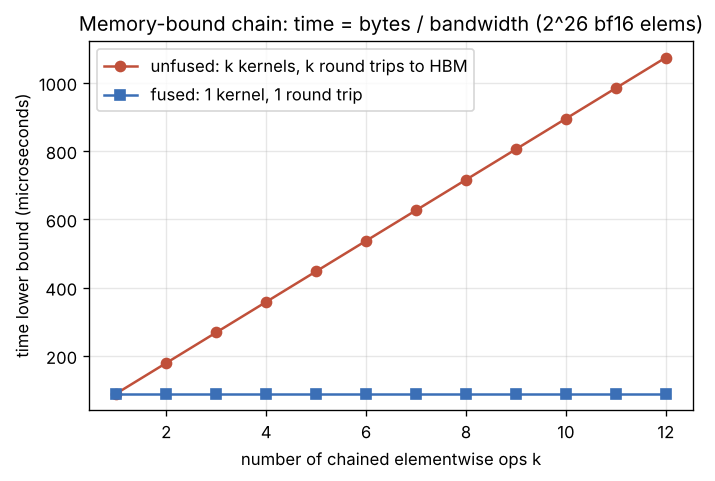

# Day 165 — Kernel fusion: why elementwise ops are memory-bound

> 📅 2026-11-13 (শুক্রবার) · Track B: Phase 13 (Kernels) — Concept 128 · Track A: CSE 4711 Week 3 (Informed search) · 📄 Paper Corner: FlashAttention

---

## ⚙️ গভীর পাঠ (Deep Dive) — Concept 128: Kernel fusion — কেন elementwise op memory-bound

### 💡 Intuition: তিনটা loop না, একটা loop

C++-এ তুমি নিশ্চয়ই লিখেছ:

```cpp
for (i) t1[i] = x[i] + b;        // loop 1
for (i) t2[i] = max(t1[i], 0);   // loop 2
for (i) y[i]  = t2[i] * s;       // loop 3
```

আর জানো, এগুলো এক loop-এ মিলিয়ে `y[i] = max(x[i]+b, 0) * s` লিখলে `t1`, `t2` অ্যারে বানাতে হয় না: এটাই **loop fusion**। অ্যারে বড় হলে সময় কমে অনেক, কারণ প্রতিটা loop পুরো অ্যারে RAM থেকে পড়ে আবার RAM-এ লেখে।

PyTorch-এ `y = torch.relu(x + b) * s` ঠিক ওই তিন-loop সংস্করণ। প্রতিটা op একটা আলাদা **kernel** (GPU-তে চলা একটা প্রোগ্রাম)। এক kernel শেষ হলে তার register আর shared memory মুছে যায়; পরের kernel-এর হাতে পৌঁছানোর একমাত্র উপায় HBM। তাই মাঝের ফলাফল `t1`, `t2` HBM-এ লেখা হয়, পরের kernel আবার পড়ে। "Computation is cheap, moving data is expensive" (Concept 115)-এর সবচেয়ে সরল উদাহরণ।

### 🔧 Mechanism

**১. Elementwise op-এর arithmetic intensity (Concept 117):** `z = x + y`-এ প্রতি element-এ ১টা FLOP, কিন্তু ডেটা আসে-যায় ৩টা element (২ পড়া, ১ লেখা)। bf16 হলে ২ byte/element:

$$
I_{\text{add}} = \frac{1\ \text{FLOP}}{3 \times 2\ \text{B}} \approx 0.17\ \text{FLOP/B}
$$

H100-এর ridge point (Concept 117): bf16 dense peak ≈ 1000 TFLOP/s আর HBM ≈ 3 TB/s ধরলে

$$
I_{\text{ridge}} \approx \frac{10^{15}}{3\times10^{12}} \approx 300\ \text{FLOP/B}
$$

আজকের op-এর intensity ridge-এর হাজার ভাগের এক ভাগেরও কম। অর্থাৎ roofline-এর একদম বাঁ দিকের ঢালু অংশে: সময় = bytes ÷ bandwidth, FLOPs-এর কোনো ভূমিকা নেই। `exp`, `gelu`, `tanh`-এর মতো ভারী elementwise op-এও প্রতি element-এ কয়েক দশ FLOP; তবু ridge-এর অনেক নিচে। তাই **সব elementwise op-ই memory-bound**।

**২. Fusion কী বদলায়:** $k$টা elementwise op শৃঙ্খলে (প্রতিটার এক input শৃঙ্খল থেকে, scalar/broadcast বাদ দিলে) $N$ element, $b$ byte/element:

$$
\text{bytes}_{\text{unfused}} = k\cdot 2Nb,\qquad \text{bytes}_{\text{fused}} = 2Nb
$$

পড়া একবার (শুরুর `x`), লেখা একবার (শেষের `y`); মাঝের মান থাকে **register-এ**। FLOP-সংখ্যা একই, শুধু HBM traffic $k$ গুণ কমে। Memory-bound বলে সময়ও প্রায় $k$ গুণ কমে।



**৩. আরও দুটো সুবিধা:**
- **Launch overhead:** প্রতিটা kernel launch-এর একটা স্থির খরচ আছে (≈ কয়েক µs CPU-পাশে)। ছোট tensor-এ এটাই মূল বাধা; সমাধান ওপরের মতো fusion আর Concept 134-এর CUDA graphs।
- **Activation memory:** unfused প্রোগ্রামে backward-এর জন্য `t1`, `t2` রেখে দিতে হয়; fused kernel সেগুলো বানায়ই না। Backward-এ দরকার হলে `x` থেকে আবার হিসাব (recompute, Day 137-এর ভাবনা), কারণ recompute সস্তা আর HBM পড়া দামি।

**৪. কোনটা fuse হয়, কোনটা হয় না:**

| জোড়া | fusion? | কেন |
|---|---|---|
| elementwise → elementwise | সহজ | প্রতিটা output element তার input element-এর ওপরই নির্ভর, কোনো সমন্বয় লাগে না |
| matmul → bias/GELU/residual (epilogue) | হ্যাঁ | matmul-এর ফলাফল তখনো register-এ; HBM-এ লেখার আগেই bias+GELU লাগিয়ে দাও |
| reduction (softmax, LayerNorm) সহ | কঠিন | পুরো সারির তথ্য লাগে; কৌশল Concept 129 (online softmax) |
| matmul → matmul মাঝে ভারী op | খুব কঠিন | tile-এর আকার ও SRAM-এর হিসাব মেলাতে হয়; FlashAttention (Concept 131) ঠিক এটাই |

**৫. Fusion-এর সীমা:** matmul নিজে compute-bound (বড় আকারে), তাই matmul-কে "fuse" করে তার নিজের সময় কমে না; জেতে শুধু তার আশপাশের memory-bound লেজ-মাথা। আর fuse করা কোড একটা বড় kernel হওয়ায় register চাপ বাড়ে, occupancy (Concept 127) কমতে পারে। এছাড়া একই intermediate একাধিক জায়গায় লাগলে fuse করলে হয় HBM-এ রাখতে হয়, নয় recompute করতে হয়।

### 🧮 খাতা-কলমের হিসাব (back-of-envelope)

$y = \max(x+b,\,0)\cdot s$, যেখানে $x$-এ $N=2^{26}\approx6.7\times10^{7}$ element, bf16 (২ B)। $b, s$ scalar।

- Tensor-এর আকার $=2^{26}\times2\ \text{B}=2^{27}\ \text{B}\approx134\ \text{MB}$।
- **Unfused (৩ kernel):** প্রতিটা ১ tensor পড়ে + ১ tensor লেখে $=2\times134=268$ MB; মোট $3\times268\approx805$ MB।
- **Fused (১ kernel):** $268$ MB।
- Bandwidth ≈ 3 TB/s ধরে: unfused $\approx 805\ \text{MB}/(3\ \text{TB/s})\approx 270\ \mu\text{s}$; fused $\approx 89\ \mu\text{s}$। Speedup $\approx 3\times=k$।
- Compute-সময়: মোট $3N\approx2\times10^8$ FLOP ÷ $10^{15}$ FLOP/s $\approx0.2\ \mu\text{s}$। অর্থাৎ compute হিসাবে ধরার মতোই নয়; সময়ের ১০০% data movement।

শিক্ষা: একই FLOP, একই ফলাফল; শুধু কয়বার HBM ছুঁয়েছ সেটা গুনলেই সময় বলে দেওয়া যায়। (মনে রেখো: এটা **lower bound**; বাস্তবে peak bandwidth-এর ≈ 80–90% মেলে।)

### 🔬 গবেষণার সীমানা (research frontier)

- আজকের প্রায় সব LLM serving/training stack-এ fused kernel হলো ভিত্তি: FlashAttention fusion-এর সবচেয়ে বিখ্যাত রূপ (আজকের Paper Corner), আর `torch.compile` (Concept 133) অনেক fusion স্বয়ংক্রিয় করে।
- DeepSeek-V3-এর technical report FP8 quantization-এর ধাপকে আলাদা কাজ না রেখে memory-transfer/matmul-এর সঙ্গে মেলানোর দিকে হার্ডওয়্যার-নির্মাতাদের নজর টেনেছে, কারণ আলাদা cast-kernel মানেই বাড়তি HBM round trip (Concept 156-এ বিস্তারিত)।
- খোলা প্রশ্ন: compiler কতটা fusion নিজে বের করতে পারে? কোন fusion-এ recompute বনাম store-এর ভারসাম্য কোথায়? Cost model দিয়ে fusion-এর search (autotuning) আসলে একটা সমস্যা-জগৎ, যেখানে ভালো heuristic-ই কাজ করে; আজকের Course Corner-এর A\*-এর সঙ্গে এর মিল লক্ষ করো।

### ❓ Interview প্রশ্ন

**Q (English):** *Your profiler shows a transformer block spending 40% of its time in dozens of tiny kernels (add, mul, GELU, dropout, layernorm pieces), each at only ~5% of peak FLOP/s. A colleague says "we should buy GPUs with higher TFLOP/s." What do you say, and what would you do instead?*

(পরীক্ষা হচ্ছে: memory-bound বনাম compute-bound শনাক্ত করা, আর fusion কেন সমাধান।)

---

## 🎓 কোর্স কর্নার — CSE 4711 Week 3: Heuristic শ্রেণিবিভাগ ও অজানা $h$-মানের range (admissible / consistent / expansion order)

### 📘 যা জানতেই হবে

- **Admissible:** সব node-এ $0\le h(n)\le h^*(n)$, যেখানে $h^*(n)$ = $n$ থেকে goal-এ প্রকৃত সস্তা পথের খরচ। (Goal-এ $h=0$।)
- **Consistent:** প্রতিটা edge $n\to n'$ (খরচ $c$)-এর জন্য $h(n)\le c+h(n')$; আর $h(\text{goal})=0$। এটা admissibility-র চেয়ে **শক্ত**: consistent ⇒ admissible, উল্টোটা নয়।
- **কোথায় কী লাগে:** A\* **tree search** optimal হতে admissible যথেষ্ট; **graph search** optimal হতে consistent যথেষ্ট (admissible-ই থাকলে node re-open করতে হতে পারে)।
- **দুটো শর্তই যথেষ্ট, আবশ্যিক নয়।** একটা নির্দিষ্ট গ্রাফে h admissible না হয়েও A\* optimal পথ দিতে পারে। পরীক্ষায় "কোন range-এ A\* optimal পথ ফেরত দেবে" আর "কোন range-এ admissible" আলাদা প্রশ্ন; দুটো গুলিও না।
- **Consistent হলে** পথ ধরে $f=g+h$ কখনো কমে না, তাই A\* node-গুলো $f$-এর ক্রমবর্ধমান ক্রমে expand করে।
- **কৌশল (অজানা $x$):** (১) $h^*$ বের করো → admissible range। (২) প্রতিটা edge-এর অসমতা লেখো, যেগুলোতে $x$ আছে সেগুলো থেকে range → consistent range। (৩) $f$-মান $x$-এর ফাংশন হিসেবে লিখে tie-সহ pop-ক্রম বের করো।

### ✍️ হাতে-কলমের সমাধান (hand-trace)

**গল্প:** তাসনিমের ওষুধ-ডেলিভারি ড্রোন গুদাম $S$ থেকে ক্রেতা $G$-তে যাবে। পথগুলো একমুখী, খরচ মিনিটে:

$S\to A$: 1, $S\to B$: 2, $A\to G$: 6, $B\to C$: 1, $C\to G$: 3।

Heuristic: $h(S)=5,\ h(B)=3,\ h(C)=2,\ h(G)=0$, আর $h(A)=x$ অজানা, $x$ পূর্ণসংখ্যা, $x\ge0$। A\* **tree search**; $f$ সমান হলে alphabetical ক্রমে আগে pop।

**(ক) $x$-এর কোন range-এ $h$ admissible? (CO1, ৩ marks)**

$h^*$: $G=0$; $C=3$; $B=1+3=4$; $A=6$; $S=\min(1+6,\ 2+4)=6$। দেওয়া মান ঠিক আছে: $5\le6$, $3\le4$, $2\le3$। তাই শুধু $A$ বাকি: $0\le x\le 6$।

**(খ) কোন range-এ consistent? (CO1, ৪ marks)**

| Edge | অসমতা $h(n)\le c+h(n')$ | ফল |
|---|---|---|
| $S\to A$ | $5\le 1+x$ | $x\ge4$ |
| $S\to B$ | $5\le 2+3=5$ | সত্য |
| $A\to G$ | $x\le 6+0$ | $x\le6$ |
| $B\to C$ | $3\le1+2=3$ | সত্য |
| $C\to G$ | $2\le3+0$ | সত্য |

অতএব consistent $\iff 4\le x\le6$। লক্ষ করো: consistent range $[4,6]$ admissible range $[0,6]$-এর ভেতরে; $x=3$ admissible কিন্তু consistent নয়।

**(গ) $x=3$ হলে A\* tree search-এর expansion-ক্রম ও ফেরত পথ (CO1, ৩ marks)**

$f=g+h$। প্রতি ধাপে fringe দেখাচ্ছি (node: $f$, পথ-সহ):

| ধাপ | Pop | Fringe pop-এর পর, তারপর নতুন যোগ |
|---|---|---|
| 1 | $S$ ($f=0+5=5$) | যোগ: $A$: $1+3=4$; $B$: $2+3=5$ |
| 2 | $A$ ($4$) | যোগ: $G_A$ (পথ $SAG$): $g=7,\ f=7$। Fringe: $B5,\ G_A7$ |
| 3 | $B$ ($5$) | যোগ: $C$: $g=3,\ f=3+2=5$। Fringe: $C5,\ G_A7$ |
| 4 | $C$ ($5$) | যোগ: $G_C$ (পথ $SBCG$): $g=6,\ f=6$। Fringe: $G_C6,\ G_A7$ |
| 5 | $G_C$ ($6$) | Goal pop ⇒ **থামো** |

Expansion-ক্রম: $S, A, B, C$, তারপর $G$ (goal pop)। ফেরত পথ $S\to B\to C\to G$, খরচ $6$, যা optimal। মনে রাখো: $G_A$ আগে fringe-এ ঢুকলেও $f=7>6$, তাই pop হয়নি। Goal **pop-এর সময়** থামা এখানে জরুরি।

**(ঘ) $x$ কত হলে $A$ কখনো expand হয় না? আর $x=5$ হলে ক্রম? (CO1, ৩ marks)**

$S$-এর পর fringe-এ $A$: $1+x$, $B$: $5$।
- $x\le4$: $1+x\le5$। $x<4$ হলে $A$ আগে; $x=4$ হলে tie, alphabetical-এ $A<B$, তাই $A$ আগে। ক্রম $S,A,B,C,G$।
- $x\ge5$: $B$ আগে, তারপর $C$ ($f=5$)। তখন fringe-এ $A$: $1+x$ আর $G_C$: $6$। $x=5$ হলে $A$-এর $f=6$ = $G_C$-এর $6$; tie-তে alphabetical $A<G$, তাই **$A$ আগে expand**: ক্রম $S,B,C,A,G$।
- $x\ge6$: $f(A)=1+x\ge7>6$, তাই $G_C$ আগে pop; **$A$ কখনো expand হয় না**: ক্রম $S,B,C,G$।

উত্তর: $A$ কখনো expand হয় না $\iff x\ge6$; $x=5$-এ ক্রম $S,B,C,A,G$। (অর্থাৎ $A$ expand হয় $\iff x\le5$।)

**(ঙ) দাবির মূল্যায়ন (CO3, ৩ marks):** তাসনিম বলল, "$x=8$ হলে $h$ admissible থাকে না, তাই A\* অবশ্যই ভুল (suboptimal) পথ দেবে।" ঠিক?

*উত্তর (সিদ্ধান্ত আগে): দাবি ভুল।* $x=8>h^*(A)=6$, তাই সত্যিই inadmissible। কিন্তু (ঘ) অনুযায়ী $x\ge6$-এ $A$ expand-ই হয় না; ফেরত পথ $SBCG$, খরচ $6$, optimal। কারণ overestimate হয়েছে এমন node-টা optimal পথে নেই; এটা শুধু একটা খারাপ পথকে *কম* আকর্ষণীয় করেছে। বিপদ তখন, যখন **optimal পথের** কোনো node overestimate হয়: যেমন $h(B)=8$ ($>h^*(B)=4$) আর $x=3$ হলে $f(B)=10>f(G_A)=7$, A\* $SAG$ (খরচ $7$) ফেরত দেয়; suboptimal।

**Mini rubric (মোট 16):** (ক) $h^*$-মানগুলো ১ + range $[0,6]$ ২ = ৩। (খ) $S\to A$ থেকে $x\ge4$ ২, $A\to G$ থেকে $x\le6$ ১, উপসংহার ১ = ৪। (গ) প্রতিটা ধাপে সঠিক fringe ২, ক্রম ও পথ ১ = ৩। (ঘ) $x\ge6$ ১, $x=5$-এ tie ব্যাখ্যা ১, ক্রম ১ = ৩। (ঙ) সিদ্ধান্ত "ভুল" ১ + যুক্তি (A expand হয় না) ১ + counterexample ($h(B)=8$) ১ = ৩।

### 🧩 Formulate & justify (CO2/CO3)

**গল্প:** রাফির রোবট $n\times n$ গ্রিডে ঘুরে $k$টা নির্দিষ্ট ঘরে পড়ে থাকা পার্সেল সংগ্রহ করবে (ঘরে ঢুকলেই পার্সেল তোলা হয়ে যায়); কিছু ঘর দেয়াল। সব পার্সেল সংগ্রহ হলেই শেষ, রোবট যেখানে খুশি থাকতে পারে। প্রতি চাল ১ খরচ।

1. (CO2, ৪ marks) Search problem formulate করো: state, action, goal, cost। Action-এ STAY/NoOp রাখবে কি?
2. (CO3, ৬ marks) Heuristic $h(n)=\max_{p\in U}\text{dist}(\text{pos},p)$ প্রস্তাব করো ($U$ = এখনো-অসংগৃহীত পার্সেল, dist = দেয়াল না থাকলে ধরা Manhattan দূরত্ব)। এটা admissible ও consistent কি? কোন algorithm সুপারিশ করবে, কেন?

*(Model answer নিচে, "কোর্স কর্নার — উত্তর"-এ।)*

### 🔗 সেতু (bridge)

A\*-এর $f=g+h$ মানে "এ পর্যন্ত খরচ + বাকির আশাবাদী অনুমান"। আধুনিক LLM-এর test-time search (beam search, best-of-N-এর ওপর value/reward model দিয়ে ছাঁটাই; Concept 164) একই ছাঁচ: $g$ = এ পর্যন্ত লেখা অংশের স্কোর, $h$ = একটা learned অনুমান। পার্থক্য: learned $h$ admissible হওয়ার কোনো গ্যারান্টি নেই, তাই optimality-ও নেই। আজকের Deep Dive-এর সঙ্গেও একটা মিল: Roofline-এর bound (bytes ÷ bandwidth) কখনো প্রকৃত সময়ের চেয়ে বেশি হয় না, মানে kernel-tuning-এর জন্য এটা একটা **admissible heuristic**; autotuner এই bound থেকে "আর কতটা বাকি" বুঝে search ছাঁটতে পারে।

---

## 🏋️ দ্য গন্টলেট (The Gauntlet)

### Problem: Weighted Grid A\* — expansion গোনা

You are given an $n\times m$ grid. Cell $(i,j)$ holds an integer $a_{ij}$: $a_{ij}=0$ means a wall; otherwise $a_{ij}\in[1,9]$ is the cost **to enter** that cell. Moves are 4-directional. The start $(s_r,s_c)$ and goal $(g_r,g_c)$ are non-wall cells (the start's own cost is never paid).

Run **A\* graph search** with $h(r,c)=|r-g_r|+|c-g_c|$ and the following exact rules:

- The priority queue orders entries $(f,\ r,\ c,\ g)$ lexicographically (smaller first), where $f=g+h$.
- Pop the smallest entry; if its cell is already closed, skip it. Otherwise close the cell (this counts as one **expansion**), and if it is the goal, stop.
- Otherwise, for each non-wall, non-closed neighbour with new cost $g'=g+a$ strictly smaller than the best known cost of that neighbour, record $g'$ and push $(g'+h,\ r',\ c',\ g')$.

Print two integers: the optimal path cost and the number of expansions (including the goal's). If the goal is unreachable, print `-1`.

**Input:** `n m sr sc gr gc` followed by $n$ rows of $m$ integers. **Constraints:** $1\le n,m\le1000$.

**Sample 1**

```
3 3 1 1 3 1
1 1 1
0 0 1
1 1 1
```

Output: `6 7`

**Sample 2**

```
3 3 1 1 3 3
1 1 1
1 1 1
1 1 1
```

Output: `4 9`

### Hints (ক্রমশ আরও স্পষ্ট)

1. **হিন্ট ১:** প্রতিটা ঘর enter করার খরচ কমপক্ষে ১। তাহলে Manhattan দূরত্ব কি কখনো প্রকৃত খরচের চেয়ে বেশি হতে পারে? একটা edge ধরে $h(u)\le w+h(v)$ যাচাই করো; এ থেকে বুঝবে একবার close করা ঘর কখনো আর খুলতে হবে না।
2. **হিন্ট ২:** এটা Dijkstra-ই, শুধু priority-তে $g$-র বদলে $g+h$। `priority_queue`-তে tuple $(f,r,c,g)$ রেখে `greater` ব্যবহার করো। একই ঘর একাধিকবার ঢুকতে পারে (lazy deletion), তাই pop-এর সময় `closed` দেখে বাদ দাও, আর expansion গোনো **শুধু close করার সময়**।
3. **হিন্ট ৩:** `dist[r][c]` রাখো এবং কেবল উন্নতি হলে push করো, তাহলে heap ছোট থাকে। উত্তর `long long`-এ রাখা নিরাপদ। Goal pop হওয়ার *সঙ্গে সঙ্গে* গুনে নিয়ে থামো; goal-কে ঢোকানোর সময় থামলে count আর cost দুটোই ভুল হতে পারে।

**Pattern:** A\* / heuristic-guided Dijkstra (consistent heuristic ⇒ no re-opening)  
**Target complexity:** $O(nm\log(nm))$ সময়, $O(nm)$ মেমরি।

---

## 📄 পেপার কর্নার

### FlashAttention: Fast and Memory-Efficient Exact Attention with IO-Awareness

**লেখক:** Tri Dao, Daniel Y. Fu, Stefano Ermon, Atri Rudra, Christopher Ré · **সাল:** 2022 · **Venue:** NeurIPS 2022 (arXiv 2205.14135)

**সমস্যা:** Standard attention $N\times N$ আকারের score matrix $S=QK^\top$ আর $P=\text{softmax}(S)$ HBM-এ বানিয়ে লেখে ও আবার পড়ে। $N$ বড় হলে সময় আর মেমরি দুটোই $O(N^2)$, এবং সময়ের বড় অংশ যায় FLOP-এ নয়, HBM আসা-যাওয়ায়: আজকের Deep Dive-এর ঠিক সেই memory-bound গল্প।

**মূল কৌশল:** (১) **Tiling:** $Q, K, V$-কে টুকরো করে SRAM-এ আনা, একটা tile-এর জন্য $QK^\top$ → softmax → $\times V$ সব SRAM-এর ভেতরেই শেষ করা, অর্থাৎ **একটা fused kernel**। (২) **Online softmax:** softmax-এর জন্য পুরো সারি লাগে, তাই প্রতি টুকরোর সঙ্গে চলমান max আর চলমান যোগফল রেখে আগের ফলাফল ঠিক করে নেওয়া (Concept 129)। (৩) **Backward-এ recompute:** $N\times N$ matrix সংরক্ষণ না করে প্রয়োজনে tile-এ আবার হিসাব। পেপার দেখায়, HBM access প্রায় $\Theta(N^2d^2/M)$ ($d$ = head dimension, $M$ = SRAM আকার), যা standard-এর $\Theta(Nd+N^2)$-এর চেয়ে সাধারণ ক্ষেত্রে অনেক কম। ফলাফল **exact** attention, কোনো approximation নয়।

**কীসের বিনিময়ে:** (ক) backward-এ বাড়তি FLOP (recompute), যদিও HBM কম ছোঁয়ায় সময় তবু কমে। (খ) জটিল, hardware-নির্ভর হাতে-লেখা kernel: নতুন GPU-তে নতুন করে টিউন করতে হয়। (গ) নতুন attention বৈচিত্র্য (অদ্ভুত mask, নতুন score-function) যোগ করা কঠিন, কারণ fusion-এ সব কিছু tile-এ ঢোকাতে হয়।

**Roadmap-এর সঙ্গে সম্পর্ক:** আজকের Concept 128 (fusion)-এর সবচেয়ে বড় ব্যবহার; Concept 129 (online softmax), 131 (পূর্ণ IO-aware derivation), 132 (FlashAttention-2/3) এই পেপারের ওপরেই দাঁড়িয়ে।

**মূল পেপার পড়তে পড়তে ভাবার ৩টা প্রশ্ন:**
1. Standard attention-এ ঠিক কোন কোন tensor HBM-এ লেখা ও পড়া হয়? Fused সংস্করণে কোনগুলো আর হয় না? (Byte গুনে দেখো।)
2. Online softmax-এ চলমান max বদলালে আগের যোগফলকে কোন গুণক দিয়ে ঠিক করা হয়, আর কেন সেটা সঠিক?
3. SRAM $M$ বাড়লে HBM access কমে বলে পেপার কী বলছে? Tile-এর আকার $M$ থেকে কীভাবে বেছে নেওয়া হয়, আর $d$ বড় হলে কী ঘটে?

## 🔭 রিসার্চ রাডার

বুধবার রিসার্চ রাডার।

## 🏗️ ব্লুপ্রিন্ট

আজ ব্লুপ্রিন্ট নেই।

## 🗺️ পরের পথ

আজকের শিক্ষা এক লাইনে: ভালো optimizer (আর ভালো A\* heuristic) কখনো আসল খরচের চেয়ে বেশি আশা করে না; আর ভালো kernel-লেখক ডেটা যতটা কম নাড়ানো যায় ততটাই নাড়ে।

**আগামীকাল: Concept 129 — Reductions & online softmax**। Course Corner: Week 3-এর শেষ sub-topic, inconsistent heuristic-এ graph-search A\* আর node re-open। সোম (১৬ নভেম্বর) থেকে Week 4 (CSP I)। মিড-সেমিস্টার (14–25 ডিসেম্বর) এখনো ৩১ দিন দূরে।

---

```
🔓 গন্টলেটের সমাধান
```

```cpp
#include <bits/stdc++.h>
using namespace std;
typedef long long ll;

int main() {
    int n, m, sr, sc, gr, gc;
    scanf("%d %d %d %d %d %d", &n, &m, &sr, &sc, &gr, &gc);
    vector<vector<int>> a(n + 1, vector<int>(m + 1));
    for (int i = 1; i <= n; i++)
        for (int j = 1; j <= m; j++) scanf("%d", &a[i][j]);

    auto h = [&](int r, int c) { return abs(r - gr) + abs(c - gc); };
    const ll INF = LLONG_MAX / 4;
    vector<vector<ll>> dist(n + 1, vector<ll>(m + 1, INF));
    vector<vector<char>> closed(n + 1, vector<char>(m + 1, 0));

    // (f, r, c, g): min-heap, lexicographic order
    typedef tuple<ll, int, int, ll> T;
    priority_queue<T, vector<T>, greater<T>> pq;
    dist[sr][sc] = 0;
    pq.emplace(h(sr, sc), sr, sc, 0);
    const int dr[4] = {-1, 1, 0, 0}, dc[4] = {0, 0, -1, 1};
    ll expanded = 0;
    while (!pq.empty()) {
        auto [f, r, c, g] = pq.top();
        pq.pop();
        if (closed[r][c]) continue;
        closed[r][c] = 1;
        expanded++;
        if (r == gr && c == gc) {
            printf("%lld %lld\n", g, expanded);
            return 0;
        }
        for (int d = 0; d < 4; d++) {
            int nr = r + dr[d], nc = c + dc[d];
            if (nr < 1 || nr > n || nc < 1 || nc > m) continue;
            if (a[nr][nc] == 0 || closed[nr][nc]) continue;
            ll ng = g + a[nr][nc];
            if (ng < dist[nr][nc]) {
                dist[nr][nc] = ng;
                pq.emplace(ng + h(nr, nc), nr, nc, ng);
            }
        }
    }
    puts("-1");
    return 0;
}
```

**কেন correct:** প্রতিটা edge-এর খরচ $w\ge1$ আর $h$ প্রতি ধাপে সর্বোচ্চ ১ বদলায়, তাই $h(u)\le w+h(v)$: $h$ consistent। ফলে node প্রথমবার pop হলেই তার $g$ optimal, কখনো re-open করতে হয় না, আর goal pop হলে খরচ optimal।

```
💡 গভীর পাঠের উত্তর
```

**উত্তর:** আমি বলব, এটা compute-র সমস্যা নয়, data movement-এর সমস্যা। Add/mul/GELU/dropout-এর arithmetic intensity ≈ 0.1–কয়েক FLOP/B, H100-এর ridge point ≈ 300 FLOP/B-এর হাজার ভাগের এক ভাগ। এগুলো roofline-এর memory-bound অংশে; তাই "৫% of peak FLOP/s" আশ্চর্যজনক নয়, আর বেশি TFLOP/s-ওয়ালা GPU কিনলে এই অংশ প্রায় এক ইঞ্চিও দ্রুত হবে না (বরং bandwidth বেশি GPU-ই কাজে দেবে)।

করণীয়: (১) profiler-এ দেখা কোন kernel-চেইনগুলো পরপর elementwise। (২) সেগুলো fuse করা: `torch.compile` (Concept 133) বা হাতে Triton (Concept 130), matmul-এর epilogue-তে bias/GELU/residual ঢুকিয়ে। (৩) লাভ হিসাব: $k$টা op-এর শৃঙ্খলে traffic প্রায় $k$ গুণ কমে, তাই সময়ও প্রায় তত। (৪) ছোট tensor হলে launch overhead ধরতে CUDA graphs (Concept 134)।

কখন কাজ করবে না: যে অংশ আগেই compute-bound (বড় matmul), সেখানে fusion কিছু দেয় না; আর বেশি fuse করলে register চাপে occupancy কমতে পারে। তাই fuse করার পরও মেপে দেখতে হয় (Concept 127-এর profiling mindset)।

```
🎓 কোর্স কর্নার — উত্তর
```

**১ (CO2, ৪ marks) Formulation:**
- **State:** (রোবটের অবস্থান $(r,c)$, এ পর্যন্ত সংগৃহীত পার্সেলের উপসেট $C\subseteq\{1..k\}$)। State-সংখ্যা $\le n^2\cdot2^k$। (১.৫)
- **Action:** উপরে/নিচে/বাঁয়ে/ডানে, দেয়ালে বা সীমার বাইরে নয়। ঘরে ঢুকলে সেখানকার পার্সেল $C$-তে যোগ হয়। (১)
- **Goal:** $C=\{1..k\}$ (রোবট যেকোনো ঘরে)। (০.৫)
- **Cost:** প্রতি চাল ১। (০.৫)
- **STAY/NoOp:** রাখব না (সিদ্ধান্ত, ০.৫)। কারণ: এটা state বদলায় না আর খরচ যোগ করে, তাই শুধু self-loop তৈরি করে; tree search-এ অসীম শাখা, graph search-এ কোনো লাভ নেই। (০.৫)

**২ (CO3, ৬ marks) Heuristic ও algorithm:**

*সিদ্ধান্ত (১): $h$ admissible ও consistent; সুপারিশ: A\* graph search।*

- **Admissible (১.৫):** $U$ খালি না হলে রোবটকে সবচেয়ে দূরের অসংগৃহীত পার্সেল $p^\star$-এ অন্তত যেতেই হবে। দেয়াল থাকলে প্রকৃত দূরত্ব ≥ Manhattan দূরত্ব (relaxed problem: দেয়াল সরিয়ে নেওয়া)। তাই $h(n)=\text{dist}(\text{pos},p^\star)\le h^*(n)$। $U=\emptyset$ হলে $h=0$, goal-এ ঠিক।
- **Consistent (২):** চাল $n\to n'$, খরচ ১। $U'\subseteq U$ (সংগ্রহে কেবল কমে)। যেকোনো $p\in U'$ এর জন্য ত্রিভুজ-অসমতায় $\text{dist}(\text{pos},p)\le1+\text{dist}(\text{pos}',p)\le1+h(n')$। যে $p\in U\setminus U'$ এই চালেই তোলা হলো (সে-ই $\text{pos}'$), তার জন্য $\text{dist}(\text{pos},p)=1\le1+h(n')$। সবার ওপর max নিলে $h(n)\le1+h(n')$।
- **কেন A\* graph search (১.৫):** state-space ছোট $n^2 2^k$, কিন্তু একই state একাধিক পথে পৌঁছানো যায় (ঘুরে এসে একই ঘর, একই উপসেট), তাই tree search অনেক পুনরাবৃত্তি করবে। Heuristic consistent বলে graph search optimal ও কোনো re-open দরকার নেই। UCS-ও optimal, কিন্তু goal-এর দিক জানে না, তাই বেশি expand করে; greedy optimal নয়।

**Mini rubric:** (১) state ১.৫ + action ১ + goal ও cost ১ + STAY সিদ্ধান্ত ও কারণ ১ = ৪। (২) সিদ্ধান্ত ১ + admissible ১.৫ + consistent ২ + algorithm-যুক্তি ১.৫ = ৬।
